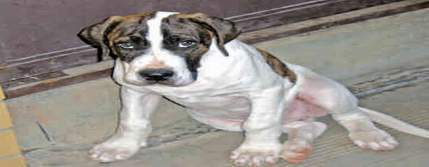

+++
title = "عن الكلاب.. نتحدث!"
date = 2006-12-11
aliases = ["/articles/masr-1283/"]

[taxonomies]
authors = []
sections = ["masr"]

[extra]
section_name = "ولاد البلد"
share_image = "/media/admins.20at.com/masr/kalbeb2.jpg"
summary = "إننا في ضيافة الكلب.. وهذا الملف يحاول أن يقدم وجهات نظر متعددة عن هذا الكائن النبيل والشهم.. هو ملف موجه للأعين الساهرة أمام البيوت واليقظة من أجل الأحبة.. من "
section_slug = "masr"
section_colour = "#666666"
thumb = "/media/admins.20at.com/masr/kalbeb2.jpg"
n_comments = 1
original_url = "http://www.20at.com:80/malafat/4895-2009-04-14-13-24-29.html"
archived = "20090425170135"
date_source = "byline/meta"
aliases_20at = ["//masr.20at.com/article.php?sid=1283", "/malafat/4895-2009-04-14-13-24-29.html"]

[extra.provenance]
original_url = "http://www.20at.com:80/malafat/4895-2009-04-14-13-24-29.html"
capture_url = "https://web.archive.org/web/20090425170135/http://www.20at.com:80/malafat/4895-2009-04-14-13-24-29.html"
capture_label = "٢٥ أبريل ٢٠٠٩، ١٧:٠١ UTC"
date_note = "من سطر التوقيع في المقال"
other_urls = ["//masr.20at.com/article.php?sid=1283"]
comments = "١"
missing_images = ""
+++

<figure></figure>

إننا في ضيافة الكلب.. وهذا الملف يحاول أن يقدم وجهات نظر متعددة عن هذا الكائن النبيل والشهم.. هو ملف موجه للأعين الساهرة أمام البيوت واليقظة من أجل الأحبة.. من علمنا الثورة ضد الاستبداد عندما بسط ذراعيه بالوصيد مع الفتية أصحاب الكهف..

من منا لم يسمع صوته ويأنس بنباحه ولم يخف من عوائه ولم يشج لنواحه ولم يحاول فهم سر هوهوته التي توقع بإيقاعها على كل شيء تصادفه وتمتزج مع أصوات ورسائل كونية وحيوانية لا ينقص من قيمتها أننا لا ندرك كنهها.

حاول البعض أن يفهم معاني هذه الرسائل ويفسرها على أن عين الكلب نافذة تخترق الحجب وترى ما نرى ولكنها ترى ما لا نرى حيث يمكنها أن تبصر الشياطين والكلب الأسود شيطان في الفلكلور الشعبي، وبعض الكلاب تلمح طيف ملك الموت والمرجع جدتي التي كانت كثيرا ما ربطت بين عواء بعض الكلاب وافتقاد الأحباب. وعندما يسترق سمعها وقع النباح المميز للنهاية تبدأ حملتها الشعواء في مطاردة الكلب رميا بالجزم ورجما بالحجارة تخفيفا من خطورة نذيره.

وتأمل العقل الشعبي الذي كان يتفاعل مع الحيوانات في تواصل بدأ مع سيدنا سليمان عليه السلام الذي سخرت له المملكة الحيوانية مرورا ببن المقفع والجاحظ ولم ينته عند ابن عروس شاعر الصعيد. وكلهم حاولوا تتبع درجات الحيوانية وما يسكنها من حكمة في بالتأكيد أنها نالت نصيبا من الحكمة وهل بعد أن تكون جزءا من العالم السبحاني المشهاداني الذي يقر للواحد بالأحدية وله في كل شيء آية تدل على أنه الواحد.

والكلب كائن اجتماعي بامتياز، بل وله وجهة نظر من الانحطاط الإنساني، وهي الرسالة التي حاول استشفافها الفلاسفة الكلبيون وهي فلسفة إغريقية قديمة، حيث حاولوا تفسير نباح الكلب

باعتبارها احتجاج ضد المجتمع الفاسد وحماقاته ولكنه احتجاج حزين . ويقال أنت كلبي بمعنى أنك متشائم وسخط وليس لديك أمل في الإصلاح (هل يستريح الضمير إذا قلنا كم تبقى منا من الكلبية؟؟). وكان من أشهر هؤلاء الفلاسفة ديوجين العظيم الذي تعلم التقشف من الكلاب كما كان يقول.

والكلاب أنواع.. وكلها من أجل.. الحراسة.. الرعي والأمن واقتفاء أثر اللصوص.. والشرفاء.. وأحيانا من أجل التعذيب وتوظيفها ضمن أدوات حقن الرعب في المعارضين. والكلب كحيوان لا يعرف فكرة التعذيب فقد تعلم في الغابة أن يصطاد إذا جاع.. يقتل من أجل الحاجة، أما قصة التعذيب لم يعرفها ولم يرب عليها وفي هذا العمل لابد أن يجوع أولا وعندما يهم بالافتراس ويقضي على الضحية يسحب وهو تعذيب إضافي لغريزته تزيد من سعاره (خير ممثل للبريء والجلاد) ولو فطن إلى أي مستوى زج به لازدرانا حيث دربته الطبيعة على القتل وليس القهر.

وبعض علماء الانثروبولوجيا الدروانيين اللادينيين يرون أننا أشرس من إسلافنا من القردة العليا وأننا فقناهم عدوانية، وهل في الغابة قانون طوارئ ومراكز استجواب تسجل خائنة الأعين وتحاول تلفيق ما تخفي الصدور وهل في الغابة سجلات من المشبوهين حيث يشيع العربي وهو مصنف أمنيا وممنوع من السفر والعمل والكلام ويرث بنوه وزارته..

إن الحديث عن الكلاب لاينقطع وقصص تفاني.. في الحب لا تنتهي..

<h3>اقرأ في هذا الملف</h3>

شوية.. كلاب!

تحب تكون.. كلب!

كان عندي كلب.. زمان!

قطمير.. الكلب الثائر!

احترس من.. العض!

اللص والكلاب.. يعني إيه كلمة شرف؟

هوهو.. أوأو!

