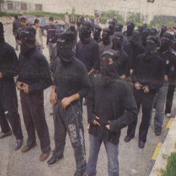
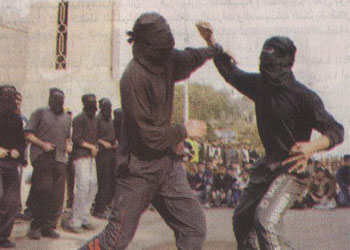
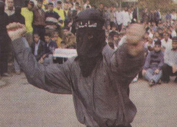
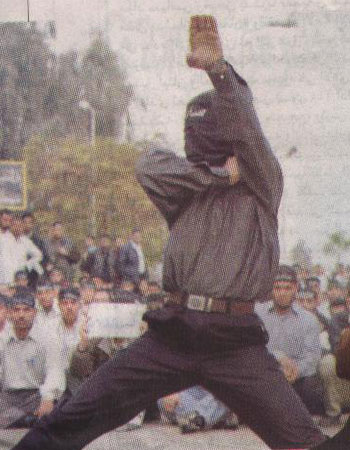
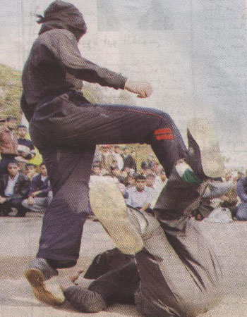

+++
title = "\"ميليشيات الإخوان\".. في جامعة الأزهر!"
date = 2006-12-11

[taxonomies]
authors = []
sections = ["masr"]

[extra]
section_name = "ولاد البلد"
share_image = "/media/admins.20at.com/masr/melsh.jpg"
summary = "ساحة جامعة الأزهر تحولت أمس إلي ما يشبه معسكراً لتدريب أعضاء في حركة المقاومة الإسلامية «حماس»، ارتدي نحو ٥٠ طالباً أزياء سوداء شبه عسكرية،"
section_slug = "masr"
section_colour = "#666666"
thumb = "/media/admins.20at.com/masr/melsh.jpg"
n_comments = 18
original_url = "http://masr.20at.com:80/article.php?sid=1286"
archived = "20070131042236"
date_source = "byline/meta"
aliases_20at = ["//masr.20at.com/article.php?sid=1286"]

[extra.provenance]
original_url = "http://masr.20at.com:80/article.php?sid=1286"
capture_url = "https://web.archive.org/web/20070131042236/http://masr.20at.com:80/article.php?sid=1286"
capture_label = "٣١ يناير ٢٠٠٧، ٠٤:٢٢ UTC"
date_note = "من سطر التوقيع في المقال"
other_urls = []
comments = "١٨"
missing_images = ""
+++

{{ <figure src="/media/admins.20at.com/masr/melsh.jpg" alt="" /> }}

ساحة جامعة الأزهر تحولت أمس إلي ما يشبه معسكراً لتدريب أعضاء في حركة المقاومة الإسلامية «حماس»، ارتدي نحو ٥٠ طالباً أزياء سوداء شبه عسكرية،

وغطوا وجوههم بأقنعة وعصبوا رؤوسهم بشارات مكتوب عليها كلمة «صامدون»، وأخذوا يستعرضون مهاراتهم ا

11/12/2006

أحمد البحيري – المصري اليوم

ساحة جامعة الأزهر تحولت أمس إلي ما يشبه معسكراً لتدريب أعضاء في حركة المقاومة الإسلامية «حماس»، ارتدي نحو ٥٠ طالباً أزياء سوداء شبه عسكرية،

وغطوا وجوههم بأقنعة وعصبوا رؤوسهم بشارات مكتوب عليها كلمة «صامدون»، وأخذوا يستعرضون مهاراتهم القتالية في الكاراتيه والكونغ فو أمام مكتب الدكتور أحمد الطيب رئيس الجامعة.

لم يكن المشهد معتاداً، فهذه هي المرة الأولي التي يقدم فيها أعضاء في اتحاد الطلاب الحر، ينتمون إلي جماعة الإخوان المسلمين، علي مثل هذا الاستعراض، وهو ما ينذر بحدوث مصادمات مستقبلية بين ميليشيات الإخوان في الجامعة والأمن، أو بينها وطلاب ينتمون إلي قوي سياسية أخري.

وبدأ نحو ثلاثة آلاف طالب اعتصاماً مفتوحاً في المدينة الجامعية التابعة لجامعة الأزهر صباح أمس، ثم انتقلوا إلي مقر الجامعة، حيث تظاهروا أمام مكتب رئيسها الدكتور أحمد الطيب، احتجاجاً علي فصل خمسة طلاب من «الاتحاد الحر» لمدة شهر، ورفع الطلاب شعارات جماعة الإخوان المسلمين،

وجلسوا علي الأرض يتابعون استعراضاً قتالياً لمهارات الكاراتيه والكونغ فو يؤديها نحو ٥٠ طالباً من زملائهم، وردد الطلاب هتافات تقول: «لما طالبنا بالحرية، فصلوا الطلبة من الكلية».

<figure></figure>

<figure></figure>

<figure></figure>

<figure></figure>

<figure></figure>

عدد التعليقات : <strong>58</strong>

