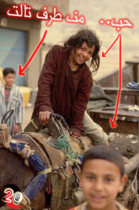

+++
title = "حب من طرف تالت.."
date = 2006-04-06

[taxonomies]
authors = []
sections = ["masr"]

[extra]
section_name = "ولاد البلد"
share_image = "/media/admins.20at.com/masr/7ob-33.jpg"
summary = "الحمد لله محمود وسعاد تزوجوا منذ عام، لكن مازالت مديحة هي الوسيط في كل خناقتهم وكانت موجودة أثناء زيارة محمود الأولى لبيت سعاد، وأثناء الخطوبة وكتب الكتاب.."
section_slug = "masr"
section_colour = "#666666"
thumb = "/media/admins.20at.com/masr/7ob-33.jpg"
n_comments = 0
original_url = "http://masr.20at.com:80/article.php?sid=134"
archived = "20070423225557"
date_source = "byline/meta"
aliases_20at = ["//masr.20at.com/article.php?sid=134"]

[extra.provenance]
original_url = "http://masr.20at.com:80/article.php?sid=134"
capture_url = "https://web.archive.org/web/20070423225557/http://masr.20at.com:80/article.php?sid=134"
capture_label = "٢٣ أبريل ٢٠٠٧، ٢٢:٥٥ UTC"
date_note = "من سطر التوقيع في المقال"
other_urls = []
comments = ""
missing_images = ""
+++

{{ <figure src="/media/admins.20at.com/masr/7ob-34.jpg" alt="" /> }}

الحمد لله محمود وسعاد تزوجوا منذ عام، لكن مازالت مديحة هي الوسيط في كل خناقتهم وكانت موجودة أثناء زيارة محمود الأولى لبيت سعاد، وأثناء الخطوبة وكتب الكتاب..

06/04/2006

- هي بتحبك؟

- لأ

- يعني حب من طرف أول

- لأ.. من طرف تالت

- موش فاهم

- هي بتحب واحد وهو بيحبها، وأنا بروح أقعد معاهم عشان بيتكسفوا من بعض

الحوار السابق من فيلم ظرف طارق، طبعا الإفية تسمعه لأول مرة في حياتك، لكن الغريب إني لما سألت الشباب فوجئت إنهم عندهم حكايات كتيرة عن موضوع الطرف التالت ده.. اللهم أجعلنا دائما طرف أول..

<h3>صديق العلاقة</h3>

في الشغل، كان محمود قد اتخذ قرار بعد مشاورة أبوه وأمه وخالته وعم بخيت البقال، إنه يتقدم لسعاد زميلته في نفس القسم، وكانت مديحة مديرتهم هي الوسيط، لإنها زميلته وزميلتها، ولإنها قريبة منهم هما الاتنين..

الحمد لله محمود وسعاد تزوجوا منذ عام، لكن مازالت مديحة هي الوسيط في كل خناقتهم وكانت موجودة أثناء زيارة محمود الأولى لبيت سعاد، وأثناء الخطوبة وكتب الكتاب..

مديحة فخورة جدا بإنها السبب في اتمام الزواج، وإن أي مشكلة صغيرة أو كبيرة بينهم هي بتكون الحكم فيها..

لكن الحقيقة التي يقولها محمود في سره أنها ليست فقط الحكم، بل هي أحيانا تكون السبب في الخناقة، والسبب أن سعاد لا تستطيع أن تمسك لسانها عن حكي كل أسرار البيت للطرف الثالث في العلاقة.. مديحة!

أما سعاد، فهي طبعا مبسوطة جدا بوجود مديحة في حياتها، لإنها تقوم بدور الحماة بالنسبة لمحمود بعد وفاة والدتها، وبالتالي فوجودها ضروري.. وهو الجواز يبقى جواز من غير حماة!

<h3>الإشبين</h3>

في فيلم أمريكي شهير اسمه kissing a fool أو "تقبيل مغفل" هتلقي فكرة الطرف الثالث هي البطل في الفيلم، واحد عرف صاحبه بواحدة زميلته، وكان الوسيط بينهم، وهما حبوا بعض، وعشان صاحبه يتأكد إن حبيبته مش بتخونه، يطلب من الأول إنه يختبرها، ويختبرها، وتحبه هي، ويتزوجوا آخر الفيلم..

رغم إن الفيلم كوميدي وغير واقعي، إلا أنه لفت نظري لنقطة مهمة جدا، وهي إن الطرف الثالث يكون دائما هو الشخص المناسب لإنه يصبح الطرف الثاني فور انتهاء صلاحية العلاقة..

ماجي تحكي لناعن سماح الخاينة اللي باعت العيش والملح وهانت عليها العشرة، والسبب إنها حاليا زوجة مدحت، وأكيد إنت خمنت إن ماجي كانت بتحب مدحت وسماح كانت الطرف الثالث...

سماح لها رأي مختلف تماما، فماجي هي التي تركت مدحت فورا ودون أي أسباب بعد أن تقدم لها ابن خالها القادم من أمريكا، وماجي نفسها هي التي طلبت من سماح أن تقف جانب مدحت لإنه تعبان، ولإن مدحت كان تعبان فعلا، فقد كانت سماح هي الدواء.. وبالرفاء والبنين..

<h3>بيبو فرقع جيجي</h3>

واحد صاحبي متجوز من عشر سنين، وكان لمغامراته في الجامعة صدى أهم من فوز مصر بكأس العالم، ولإنه خبير قلت أسأله عن رأيه، فقال:

شوف، أهم حاجة إن الولد ميسمعش رأي الطرف التالت في البنت، خاصة ولو كان الطرف التالت ده بنت..

البنت عموما بتكون شايفه في صاحبتها عيوب ممكن تكون بسيطة من وجهة نظرها، لكن لو الولد عرفها ممكن يفركش الموضوع كله للسبب ده...

صاحبي عنده حكايات كثيرة عن قصص فشلت بسبب إن صاحبة البنت كانت دايما بتقول رأيها بصراحة في صاحبتها قدام الولد.. وغالبا الولد مش بيكون حابب إنه يسمع عيوب في حبيبته، وغالبا برضه البنت موش بتحب تقول كلام كويس عن صاحبتها.. حتى لو من باب المجاملة..

<h3>صوت وصورة!</h3>

ثانية واحدة قبل ما أخلص الموضوع، افتكرت إني أحكيلكم شوية عن الأغاني اللي بتتكلم عن الحالة دي..

<figure></figure>

لا حظت إن في أغاني كتيرة بتتكلم عن الموضوع ده، أهمها "عمال يحكيلي عنها" لهشام عباس، و"بتحبيه لهاني شاكر، و"حبيبي وصاحبتي" لشيرين وجدي، و"ده اللي انتي طايره بيه" لمحمد محي، و"بتحبها ولا" لأنغام، و"حبها جوة القلبين" لفريق واما..

وطبعا هتسألوني ليه منزلتوش الأغاني مع الموضوع، الإجابة إني دورت كتير على أي أغنية من دول ملقتش، زائد إن الـBndwidth بتاعة الموقع بعافية، وزوار ولاد البلد طول اليوم عمالين يعملوا داونلود لما الموقع هيقع..

المهم، واضح إن الموضوع كبير، وإن الظاهرة خطيرة، وإن الحكايات كثيرة جدا..

طيب، بما إن الحكايات كثيرة جدا فلا داعي لكتابة المزيد منها، لإنك بالتأكيد تعرف أنت أيضا حكايات أكثر.. إحكيلنا.. سواء كنت طرف أول أو ثاني.. أو حتى ثالث.. ويا بخت من وفق راسين.. في الحلاااااااااااااااال!

عدد التعليقات : <strong>170</strong>

