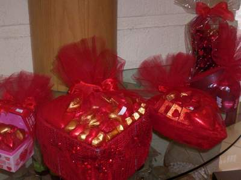

+++
title = "بتحبها إيه.. في عيد الحب"
date = 2007-02-13

[taxonomies]
authors = []
sections = ["masr"]

[extra]
section_name = "ولاد البلد"
share_image = "/media/admins.20at.com/masr/choc1.jpg"
summary = "وبالنسبة لأشكال الشكولاته هذا العام، فالمنتشر لفات الشكولاتة بالتول الأحمر وأيضا السوليفان الأحمر وفي منتصف الشكولاتة دبدوب"
section_slug = "masr"
section_colour = "#666666"
thumb = "/media/admins.20at.com/masr/choc1.jpg"
n_comments = 0
original_url = "http://masr.20at.com:80/article.php?sid=1588"
archived = "20070403085948"
date_source = "byline/meta"
aliases_20at = ["//masr.20at.com/article.php?sid=1588"]

[extra.provenance]
original_url = "http://masr.20at.com:80/article.php?sid=1588"
capture_url = "https://web.archive.org/web/20070403085948/http://masr.20at.com:80/article.php?sid=1588"
capture_label = "٣ أبريل ٢٠٠٧، ٠٨:٥٩ UTC"
date_note = "من سطر التوقيع في المقال"
other_urls = []
comments = ""
missing_images = "٢٥"
+++

{{ <figure src="/media/admins.20at.com/masr/gif010.jpg" alt="" /> }}

{{ <figure src="/media/admins.20at.com/masr/gif014.jpg" alt="" /> }}

{{ <figure src="/media/admins.20at.com/masr/gif06.jpg" alt="" /> }}

{{ <figure src="/media/admins.20at.com/masr/gif07.jpg" alt="" /> }}

وبالنسبة لأشكال الشكولاته هذا العام، فالمنتشر لفات الشكولاتة بالتول الأحمر وأيضا السوليفان الأحمر وفي منتصف الشكولاتة دبدوب

13/02/2007

يسر عبد الدايم- ولاد البلد:

محتار.. مش عارف تشتري أيه.. حساس إن الوقت فات.. بكرة عيد الحب.. ومش عامل حسابك.. مفيش فلوس كفاية.. وحتى لو في فلوس اشتري من فين.. واشتري أيه.. وأعمل لفه فين.. أجمل اللفات.. وأرخص اللفات... في يوم عيد الحب

<h3>هدايا متعارف عليها</h3>

أشهر هدايا عيد الحب والمتعارف عليها لدي الجميع هي الورود والشيكولاته و"الدباديب"، ويرتفع سعر الوردة يوم عيد الحب من نصف جنية إلي خمسة جنية للوردة، وأشهر لفات الورود لفات الخيش، السوليفان، وأقل سعر في اللفات هي لفات الكورشية.

وبالنسبة لأشكال الشكولاته هذا العام، فالمنتشر لفات الشكولاتة بالتول الأحمر وأيضا السوليفان الأحمر وفي منتصف الشكولاتة دبدوب.

<figure></figure>

وتهتم الفتيات بشكل خاص بوجود الورود في هذه المناسبة، ويؤثر بشكل ملحوظ علي حالتها النفسية علي عكس الأولاد فالموضوع لا يمثل لهم شيء فاحرص علي تقديم الورود في هذا اليوم.

وعن بعض الهدايا الأخرى التي يمكنك تقديمها هي زجاجة برفان، ساعة، علبة مكياج، شنطة، وهذه من أكثر الهدايا التي تعجب بيه الفتيات.

أما بالنسبة للأولاد، وهم الأكثر عمليه، فيمكن تقديم زجاجة برفان، ساعة، كوتشي، أي شيء خاص بالملابس.

