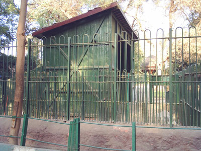
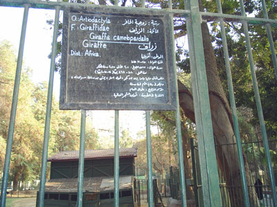
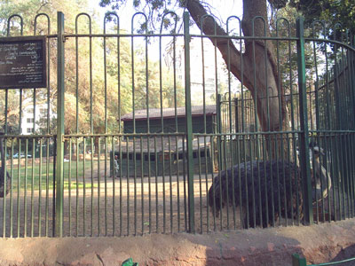
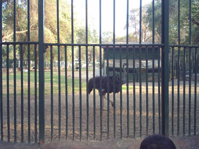
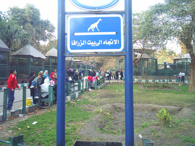
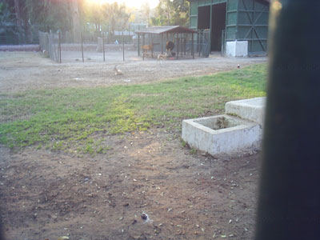

+++
title = "الزرافة.. ماتت"
date = 2007-02-19

[taxonomies]
authors = []
sections = ["masr"]

[extra]
section_name = "ولاد البلد"
share_image = "/media/admins.20at.com/masr/zar1.jpg"
summary = "وعادات الأقاويل لتختلف من جديد وكل واحد بيفتي.. هناك من قال إنهم هيشتروا زراف جديد من بره.. وأخر يقول أن هناك صفقة لتبادل أسدين بزراف"
section_slug = "masr"
section_colour = "#666666"
thumb = "/media/admins.20at.com/masr/zar1.jpg"
n_comments = 0
original_url = "http://masr.20at.com:80/article.php?sid=1611"
archived = "20070318014109"
date_source = "byline/meta"
aliases_20at = ["//masr.20at.com/article.php?sid=1611"]

[extra.provenance]
original_url = "http://masr.20at.com:80/article.php?sid=1611"
capture_url = "https://web.archive.org/web/20070318014109/http://masr.20at.com:80/article.php?sid=1611"
capture_label = "١٨ مارس ٢٠٠٧، ٠١:٤١ UTC"
date_note = "من سطر التوقيع في المقال"
other_urls = []
comments = ""
missing_images = ""
+++

{{ <figure src="/media/admins.20at.com/masr/zraf.jpg" alt="" /> }}

وعادات الأقاويل لتختلف من جديد وكل واحد بيفتي.. هناك من قال إنهم هيشتروا زراف جديد من بره.. وأخر يقول أن هناك صفقة لتبادل أسدين بزراف

19/02/2007

محمد عبد العاطي – ولاد البلد:

"زراف أفريقي من الثدييات رتبة زوجية الحافر"

كان ذلك وصف آخر زرافة تمتلكها حديقة الحيوانات بالجيزة.. فقد استيقظت حديقة الحيوان لتجد الزرافة قد ماتت.

أثناء جولة في حديقة الحيوان سألت أحد العاملين عن بيت الزرافة، ففوجئت بإجابة مقتضبة "مفيش زرافة.. خلاص"، تعجبت من رد الفعل وحدثت نفسي لعل بينه وبين بيت الزراف بعض الذكريات السيئة أو المشاكل.. إلا أن إجابات الجميع –وعلي الرغم من اختلاف رد الفعل – كانت واحده "مفيش زرافة في الجنينة". حتى وجدت أحد الشباب استفاض في الحديث ليخبرني بأن الزرافة قد ماتت من قرابة الثلاثة شهور.

تلقيت الخبر في آسى.. كانت آخر زرافة موجودة في حديقة الحيوان، حاولت البحث عن حارسها لأعزيه فلم أجده.. وجدتني أمام قفص الأسود قلت ما أكثركم.. وكيف استقبلت الحيوانات الخبر.. ربما أخذوا واجب العزاء في بيتها ونعاها الثعلب ببعض الأشعار يشيد فيها بخصالها السمحة وسيرتها العطرة وكيف كانت تعطي البهجة مجانا من منا لم يتصور معها.. لم يؤكلها.. حاول أن يشب برأسه لأعلى يطولها حتى يكاد ينقلب على الأرض.. هكذا أنشد الثعلب.

قطعت تلك الخواطر لافتة إرشادية إلى بيت الزرافة تقول: (الاتجاه إلى بيت الزرافا) فتعجبت من بقاء اللافتة لعلها مجرد ذكرى الفقيدة.. حاجة من ريحتها أو ظرفها.. وتوقعت أن أصل لأجد حارس الفقيدة يجلس في حزن جوار بيتها ويأتي كل طفل يحمل زهرة فيضعها أمام بيت الزرافة مع نظرة حزن بريئة..

ولكن المشهد كان غير ما تخيلت تماماً فيبدوا أن الحياة لم تنته عن موت الزرافة نظرت إلى اللافتة التي تحمل بيانات الزرافة علي بيتها الذي تحول إلى بيت النعام.. وهكذا الأيام دول بين من يرفع الرأس ويحني الجبين يشاركه عدد من الغزلان الصغيرة وحارس يضع الطعام في نهاية عصا للطفل حتى يطعم النعامة..

سألته عن الزرافة.. ويبدوا أنه مل السؤال ليجيب بصبر نافذ "ماتت.. بس هنجيب زراف جديد" ورغم عدم رغبته في الكلام عن الزرافة علمت منه أنهم وجدوها ذات صباح ميته فقاموا بنقلها.. ولا يعلم إلى أين، أما عن حراس الزراف فقد تم توزيعهم علي أعمال الحديقة فمنهم من عمل بالنظافة أو جنايني.

شكرته وانصرفت ولم أقابل من يعلم كيف انتقلت الزرافة إلى مثواها الأخير فهناك من يقول إنها في بطن الأسد والبعض يقول إنها دفنت.. ولكن أين قبرها؟ وما هو حجمه؟ وهل كتب علي شاهد قبرها قصة كفاح زرافة في حديقة الحيوان؟..

أحد أفراد الأمن قد أكد إنها حرقت في المحرقة.. الزرافة كان موطنها الأصلي من أفريقيا وليست من الهند فلماذا تحرق.. أم كانت تتبع الديانة الهندوسية فحرصوا علي أن يحترموا عقيدتها الخاصة في جسدها بعد الموت..

وعادات الأقاويل لتختلف من جديد وكل واحد بيفتي.. هناك من قال إنهم هيشتروا زراف جديد من بره.. وأخر يقول أن هناك صفقة لتبادل أسدين بزرافة لأن عندهم أسود كثير وعايزين يقللوا فلوس اللحمة طعام الأسود فيستبدلوا أسدين بزرافة.. وأحد النبهاء يعتقد أنهم وضعوا الحيوانات التي سوف يتم استبدلها بالزراف في بيت الزرافة آي النعام والغزالتين..

ولكن النهاية واحدة فقدت حديقة الحيوان زرافتها الأخيرة وانتقلت إلى مكان مجهول وفي انتظار قدوم زراف جديد.. هذا إن جاء.

<figure></figure>

<figure></figure>

<figure></figure>

<figure></figure>

<figure></figure>

<figure></figure>

عدد التعليقات : <strong>31</strong>

• <a href="/articles/masr-1748/">عبد العليم داوود: الرئيس كان بيكبر دماغه!</a>

• <a href="/articles/masr-1747/">احتلال وسط البلد</a>

• <a href="/articles/masr-1746/">المعالجة الرسمية لقتل الأسري</a>

• <a href="/articles/masr-1745/">مجلس تفريغ الشحنات !</a>

