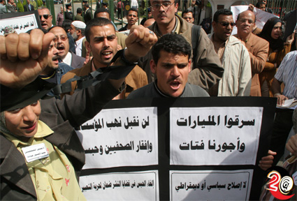
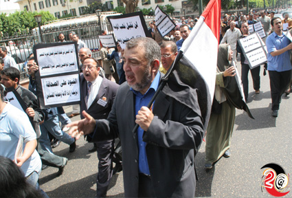
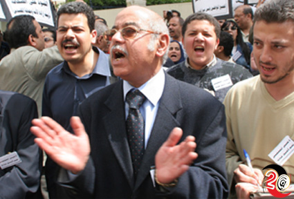
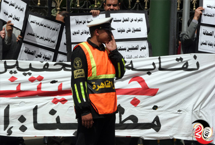
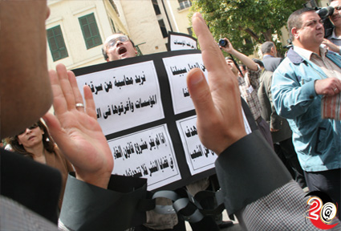
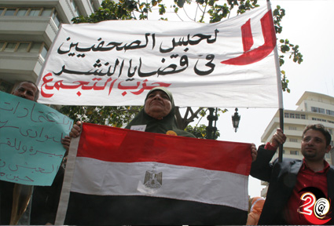

+++
title = "عايزين صحافة حرة"
date = 2006-04-21

[taxonomies]
authors = []
sections = ["masr"]

[extra]
section_name = "ولاد البلد"
share_image = "/media/admins.20at.com/masr/mothara1.jpg"
summary = "\"ما هو بصراحة الموضوع زاد عن حده\".. عويس.. عامل البوفية"
section_slug = "masr"
section_colour = "#666666"
thumb = "/media/admins.20at.com/masr/mothara1.jpg"
n_comments = 0
original_url = "http://masr.20at.com:80/article.php?sid=165&PHPSESSID=b21753af24e3fec8c8003677058e91e3"
archived = "20070422150223"
date_source = "first-capture"
aliases_20at = ["//masr.20at.com/article.php?sid=165"]

[extra.provenance]
original_url = "http://masr.20at.com:80/article.php?sid=165&PHPSESSID=b21753af24e3fec8c8003677058e91e3"
capture_url = "https://web.archive.org/web/20070422150223/http://masr.20at.com:80/article.php?sid=165&PHPSESSID=b21753af24e3fec8c8003677058e91e3"
capture_label = "٢٢ أبريل ٢٠٠٧، ١٥:٠٢ UTC"
date_note = "تاريخ أول لقطة في الأرشيف (لا يوجد تاريخ في المقال)"
other_urls = []
comments = ""
missing_images = ""
+++

{{ <figure src="/media/admins.20at.com/masr/mothara612.jpg" alt="" /> }}

"ما هو بصراحة الموضوع زاد عن حده".. عويس.. عامل البوفية

الموضوع هو حبس الصحفيين، وزاد عن حده لأن الأمن يتعامل مع "وعد" الرئيس للصحفيين بمنع النشر في قضايا النشر باعتباره كلام في الهوا.. وبالتالي كان لابد للصحفيين من أن يقفوا وقفة..

وهو ما

13/04/2006

"ما هو بصراحة الموضوع زاد عن حده".. عويس.. عامل البوفية

الموضوع هو حبس الصحفيين، وزاد عن حده لأن الأمن يتعامل مع "وعد" الرئيس للصحفيين بمنع النشر في قضايا النشر باعتباره كلام في الهوا.. وبالتالي كان لابد للصحفيين من أن يقفوا وقفة..

وهو ما حدث بالفعل أمام مجلسي الشعب والشورى، تظاهرة للصحفيين يعبرون فيها عن غضبهم ضد تصرفات الدولة معهم..

ولاد البلد كانوا هناك معهم، وقابلوهم وسمعوا ما قالوه.. عادل حمودة رئيس تحرير صحيفة الفجر

يقول "طبعا السبب الأساسي لوقفة اليوم هو التعبير عن الصحفيين استجابة لنقابة الصحفيين في الاحتجاج على اخراج القانون الجديد الخاص بحبس الصحفيين او قضايا النشر بشكل عام."

في حين قال جلال عارف نقيب الصحفيين: "نحن نلجأ أساسا للحوار... أساسا هو الحوار مع كل الاطراف ولدينا بعد ذلك خطوات قررتها الجمعية العمومية ونحن نقضي في تطبيقها. نحن لدينا الان حديث عن ان الحكومة قد انجزت المشروع ونحن ننتظر المشروع لكي نقول رأينا فيه ونتمنى أن يكون المشروع مستمدا اساسه من المشروع الذي قدمته النقابة وناقشته مع كل الاطراف."

وكتبت على لافتات رفعها المتظاهرون شعارات "أيها الصحفيون فكروا ألف مرة قبل أن تكتبوا فالسجن مصيركم" و"إلغاء الحبس في قضايا النشر ضمان لحرية التعبير" و"لا لحبس الصحفيين في قضايا النشر" و"سرقوا المليارات وأجورنا فتات".

وفي مؤتمر عام للصحفيين عقد في فبراير شباط عام 2004 قال عارف إن مبارك أبلغه بأنه سيعمل على إلغاء عقوبة الحبس في قضايا النشر.

ومنذ ذلك الوقت لم تقدم الحكومة إلى مجلس الشعب مشروع قانون لإلغاء العقوبة المنصوص عليها في قانون تنظيم الصحافة وقانون العقوبات.

وأضيفت العقوبة في قانون مباشرة الحقوق السياسية الذي صدر في العام الماضي لتطبق على من يثبت أنه سب وقذف المرشحين للانتخابات.

ووافقت لجنة الشؤون التشريعية والدستورية في مجلس الشورى اليوم على رفع الحصانة البرلمانية عن إبراهيم نافع رئيس مجلس إدارة مؤسسة الأهرام الصحفية ورئيس تحرير الأهرام سابقا للتحقيق معه في اتهامات بإهدار ملايين الجنيهات من أموال المؤسسة.

وقال نافع إنه كان يتقاضي أجورا سنوية 3.5 مليون جنيه (ستمئة ألف دولار). غير ان الصحفيين الشبان يتقاضى الواحد منهم بضعة ألوف من الجنيهات في العام.

وقالت الحكومة إنها أعدت مشروع قانون لإلغاء عقوبة الحبس في قضايا النشر يتضمن تغليظ عقوبة الغرامة في قضايا القذف والسب بطريق النشر.

وفي ختام المظاهرة التي استمرت أكثر من ساعة نظم عشرات من المتظاهرين مسيرة مرت بشوارع وسط القاهرة نحو مبنى نقابة الصحفيين رددوا خلالها هتافات تقول "اللي حيحبس صحفيين بكرة يشرف في الزنازين" و"عايزين صحافة حرة العيشة بقت مرة".

شاهد معنا.. ماذا فعل الصحفيين يومها..

<figure></figure>

<figure></figure>

<figure></figure>

<figure></figure>

<figure></figure>

<figure></figure>

<h3>تصوير : عبد الناصر نوري</h3>
