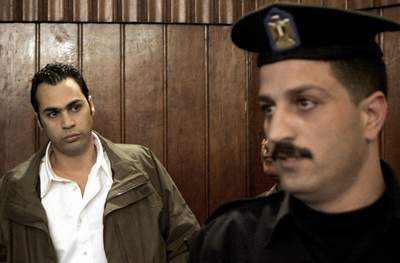

+++
title = "إسلام نبيه.. ماشي براحته!"
date = 2007-03-04

[taxonomies]
authors = []
sections = ["masr"]

[extra]
section_name = "ولاد البلد"
share_image = "/media/admins.20at.com/masr/islam-_nabeh21.jpg"
summary = "أمثاله لازم يتم تدميرهم، لكي يكونوا عبرة للجميع، وأي تهاون من أي نوع.. سيدمر المجتمع بالكامل.. وهيعمل عاهة مستديمة في العلاقة بين الشرطة والشعب"
section_slug = "masr"
section_colour = "#666666"
thumb = "/media/admins.20at.com/masr/islam-_nabeh21.jpg"
n_comments = 0
original_url = "http://masr.20at.com:80/article.php?sid=1683"
archived = "20070316114923"
date_source = "byline/meta"
aliases_20at = ["//masr.20at.com/article.php?sid=1683"]

[extra.provenance]
original_url = "http://masr.20at.com:80/article.php?sid=1683"
capture_url = "https://web.archive.org/web/20070316114923/http://masr.20at.com:80/article.php?sid=1683"
capture_label = "١٦ مارس ٢٠٠٧، ١١:٤٩ UTC"
date_note = "من سطر التوقيع في المقال"
other_urls = []
comments = ""
missing_images = "٢"
+++

أمثاله لازم يتم تدميرهم، لكي يكونوا عبرة للجميع، وأي تهاون من أي نوع.. سيدمر المجتمع بالكامل.. وهيعمل عاهة مستديمة في العلاقة بين الشرطة والشعب

04/03/2007

<h3>(1)</h3>

تقول مريام فارس في ألبومها الأخير :

ماشي براحتك..

يا أخي مصلحتك

شوف إزاي أنا هقلق راحتك..

أنا هقلق راحتك!

<h3>(2)</h3>

تسجيل سابق على "ميموري كارد" موبايل حديث :

- بكرة الموقف كله يعرف إنك (***)

- خلاص يا باشا.. والنبي خلاص يا باشا.. الله يكرمك يا باشا.. خلاص المرة دي يا باشا..

- أنت إيه..؟

- أنا (***) يا باشا!

<h3>(3)</h3>

من محاضر النيابة :

- وقد فتح المحضر في ساعته وتاريخه، وبتوجيه السؤال للمتهم إسلام نبيه عن الفيديو الذي تم ضبطه قال :

- مش أنا والله يا باشا.. أنا معرفش عماد الكبير ده إصلا.. معرفش ده يبقى مين يا باشا..

<h3>(4)</h3>

تقرير الخبير الذي وكلته النيابة العامة بمطابقة صوت المتهم إسلام نبيه بالصوت الظاهر في الفيديو..

"وقد حاول المتهم أكثر من مرة خلال التسجيل تغيير طبقات صوته، وحاول كذلك التظاهر بأنه "أخنف".. لولا أننا خلال التسجيل طلبنا منه نطق كلمات مختلفة.. فظهر أن صوته متطابق مع الصوت الظاهر في الفيديو"..

<h3>(5)</h3>

الدكتور أحمد عبد الله مدرس الطب النفسي في حديث سابق مع "ولاد البلد"..

"أمثاله لازم يتم تدميرهم، لكي يكونوا عبرة للجميع، وأي تهاون من أي نوع.. سيدمر المجتمع بالكامل.. وهيعمل عاهة مستديمة في العلاقة بين الشرطة والشعب"..

<h3>(6)</h3>

ثم تستكمل مريام فارس في الأغنية ذاتها..

عايز تحبس روحي في قلبك..

لا لا لا..

يا حبيبي ده بعدك!

<h3>(7)</h3>

صورتان حديثتان لإسلام نبيه وقد خرج لتوه من قاعة المحكمة.. يظهر فيها تملؤه العزة.. والوقار بنظرة شمسية حديثة.. إلا أن شاويش أقل منه في الرتبة كان يسحبه من يده ناحية.. البوكس..

البوكس ذاته الذي اعتاد إسلام نبيه ركوبه بجوار سائقه ليخرج في جولة تفتيشية على "عباد الله" يصطاد منهم فريسة جديدة يتسلى بها في "ثلاجة" القسم...

البوكس ذاته.. يركبه إسلام نبيه.. للمرة الأولى.. من الخلف!

<h3>(8)</h3>

وصورة أخرى.. يظهر فيها إسلام نبيه ينظر لشاويش آخر يقف أمامه..

<figure></figure>

شاويش أعتاد إسلام نبيه على أن يلبي له طلباته وأوامره..

شاويش.. تعلم إسلام نبيه في كلية الشرطة أن دوره فقط هو سحب المتهمين من "قفاهم"..

ربما تكون هذه هي المرة الأولى التي يرى فيها إسلام نبيه درسا عمليا على نظرية الشاويش والقفا..

الشيء الغريب.. أن الشاويش معروف.. إلا أن القفا هذه المرة.. سيكون هو قفا إسلام نفسه!

<h3>(9)</h3>

فكروا..

عماد الكبير يجلس في زنزانته.. ويرى صور إسلام نبيه الأخيرة..

ربما رغم إرادته سيدندن..

"ماشي براحتك..

يا أخي مصلحتك..

شوف إزاي أنا هقلق راحتك..

أنا هقلق راحتك"..

<h3>(10)</h3>

لخلفية معلوماتية : <a href="/articles/masr-1150/"> الله يكرمك يا باشا.. معلش المرة دي..</a>

• الدرع يقترب.. بقوة

• <a href="/articles/masr-1743/">يا شباب العلم.. إيييييييييييييه!</a>

• <a href="/articles/masr-n9675/">الإخوان والسكتة الدماغية.. السياسية</a>

• <a href="/articles/masr-1741/">أنت عانس.. ولا عازب</a>

