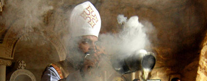

+++
title = "• والى : لا لمبارك فى الحكم لا لإبنه المختل عقلياً الفاسد ل..."
date = 2006-04-22
aliases = ["/articles/masr-228/"]

[taxonomies]
authors = []
sections = ["masr"]

[extra]
section_name = "ولاد البلد"
share_image = "/media/masr.20at.com/images/articles/we7da-wataniya.jpg"
summary = "ولاد البلد: عشان مصر"
section_slug = "masr"
section_colour = "#666666"
thumb = "/media/masr.20at.com/images/articles/we7da-wataniya.jpg"
n_comments = 0
original_url = "http://masr.20at.com:80/article.php?sid=174&PHPSESSID=508a6a582ad57e4ac563a842270676bd"
archived = "20070422144307"
date_source = "byline (year corrected)"
aliases_20at = ["//masr.20at.com/article.php?sid=174", "//masr.20at.com/article.php?sid=228"]

[extra.provenance]
original_url = "http://masr.20at.com:80/article.php?sid=174&PHPSESSID=508a6a582ad57e4ac563a842270676bd"
capture_url = "https://web.archive.org/web/20070422144307/http://masr.20at.com:80/article.php?sid=174&PHPSESSID=508a6a582ad57e4ac563a842270676bd"
capture_label = "٢٢ أبريل ٢٠٠٧، ١٤:٤٣ UTC"
date_note = "من سطر التوقيع، مع تصحيح خطأ واضح في السنة"
other_urls = ["//masr.20at.com/article.php?sid=228"]
comments = ""
missing_images = ""
+++

<figure></figure>

<h3> ولاد البلد: عشان مصر </h3>

اجتماعات متواصلة منذ أزمة أحداث الإسكندرية، نحاول أن نبحث لأنفسنا عن دور في حلها، وأخيرا كان الدكتور أحمد عبد الله الطبيب النفسي الشهير والذي استضفناه في أحد اجتماعاتنا هو صاحب التوليفة التي نطرحها عليكم الآن..

16/04/2006

"الأزمة الأخيرة ليها حلول كثيرة.. آخرها بالتأكيد هو إفطار الوحدة الوطنية"..

رغم أن عويس عامل البوفية لم يحصل على شهادته الجامعية، ولا هو متابع للشأن السياسي، ولا ينتمي طبعا لأي من الجماعات الإرهابية.. لكنه أشار لحل الأزمة دون أن يدري...

عويس يقول أن حلول الأزمة كثيرة، لكن الشرط الوحيد هي ألا تكون تقليدية.. وهو ما نراه نحن أيضا في ولاد البلد..

اجتماعات متواصلة منذ أزمة أحداث الإسكندرية، نحاول أن نبحث لأنفسنا عن دور في حلها، وأخيرا كان الدكتور أحمد عبد الله الطبيب النفسي الشهير والذي استضفناه في أحد اجتماعاتنا هو صاحب التوليفة التي نطرحها عليكم الآن..

<h3>رب.. العالمين</h3>

ولماذا لا نصلي معهم..

الصلاة.. لدينا ولديهم.. لدينا جميعا لها معنى واحد.. نحن بين يدي الله.. ولا يصح أن تقف بين يدي ربك وأنت خائف.. فلنطمئنهم!

ندعوكم لأن نذهب جميعا إلى الإسكندرية من الثلاثاء إلى الأحد، للكنائس التي شهدت الاعتداءات.. نحضر صلواتهم.. نهنئهم بعيدهم.. نهاديهم.. ونبتسم في وجوههم.. وما أجمل البسمة في وجه المجروح.. وهم بلا شك مجروحين.. حتى ولو كان الحادث فردي.. وحتى ولو كان مختل عقليا..

فلنصلي معهم.. نشعرهم أن مصر يمكن أن تحتملنا جميعا.. وهذه حقيقة.. فالبلد التي احتملت أزمات أخطر وكوارث أبشع.. يمكنها أن تتغلب على حادث فعله مختل عقليا.. كما وصفته الحكومة..

نصلي معهم.. لنشعر أن المشكلة تعنينا وأن الحل بأيدينا.. وأن إفطار الوحدة الوطنية لم يفرز إلا عناوين صحفية براقة.. وصور جميلة للإخوة المفطرين في الإفطار العظيم..

دعوة عامة من "ولاد البلد".. لكل الناشطين في مصر.. ليفعلوا ما تحتاجه الأزمة منهم..

<h3>إن الذكرى .. تنفع "المؤمنين"..</h3>

الأزمة خطيرة..

- لأنك لا تتصور نفسك خارجا من المسجد، بعد أن صليت لربك وأديت فرضك.. يقترب منك شخص ما، وبدلا من أن يقول لك .."تقبل الله".. يطعنك بسكين..

- أن في المسيحيين أيضا مختلين عقليا، وإذا كان محمود المختل المسلم تأتيه النوبة كل إبريل (أعياد المسيحيين) فهناك من المختلين من تأتيه النوبة كل جمعة (عيد المسلمين)..

- أننا نحتاج لأن يبقى هذا "الوطن" آمنا مطمئنا.. وأن الطريقة المثالية لضياع الأمن.. أن يكره أبناء هذا الوطن وطنهم.. وهو ما تتسبب فيه طعنات غادرة من شخص مختل..

تابعونا بأفكاركم.. وباقتراحتكم..

على : weladelbald@yahoo.com

أو من خلال صفحة<a href="https://web.archive.org/web/20070422144307/http://www.20at.com/contactus.php"> اتصل بنا</a>

عدد التعليقات : <strong>193</strong>

