+++
title = "وبيقولوا.. مختل عقليا!"
date = 2006-04-18

[taxonomies]
authors = []
sections = ["masr"]

[extra]
section_name = "ولاد البلد"
share_image = "/media/admins.20at.com/masr/mo7tal/1.jpg"
summary = "قصة حقيقية.. حدثت منذ قليل، في شوارع المحروسة.. وبالتحديد في الإسكندرية.. وخلال المظاهرات التي قام بها المسيحيون ردا على الاعتداءات.."
section_slug = "masr"
section_colour = "#666666"
thumb = "/media/admins.20at.com/masr/mo7tal/1.jpg"
n_comments = 0
original_url = "http://masr.20at.com:80/article.php?sid=192&PHPSESSID=b21753af24e3fec8c8003677058e91e3"
archived = "20070422065759"
date_source = "byline/meta"
aliases_20at = ["//masr.20at.com/article.php?sid=192"]

[extra.provenance]
original_url = "http://masr.20at.com:80/article.php?sid=192&PHPSESSID=b21753af24e3fec8c8003677058e91e3"
capture_url = "https://web.archive.org/web/20070422065759/http://masr.20at.com:80/article.php?sid=192&PHPSESSID=b21753af24e3fec8c8003677058e91e3"
capture_label = "٢٢ أبريل ٢٠٠٧، ٠٦:٥٧ UTC"
date_note = "من سطر التوقيع في المقال"
other_urls = []
comments = ""
missing_images = ""
+++

قصة حقيقية.. حدثت منذ قليل، في شوارع المحروسة.. وبالتحديد في الإسكندرية.. وخلال المظاهرات التي قام بها المسيحيون ردا على الاعتداءات..

18/04/2006

قصة حقيقية.. حدثت منذ قليل، في شوارع المحروسة.. وبالتحديد في الإسكندرية.. وخلال المظاهرات التي قام بها المسيحيون ردا على الاعتداءات..

<figure>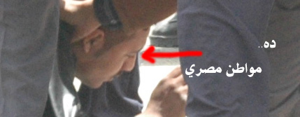</figure>

<figure>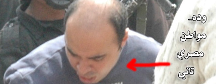</figure>

<figure>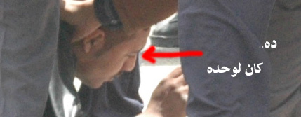</figure>

<figure>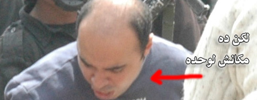</figure>

<figure>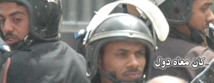</figure>

<figure>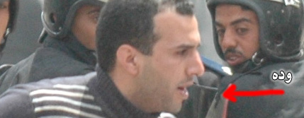</figure>

<figure>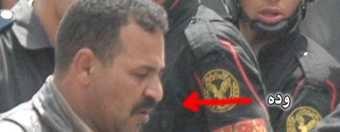</figure>

<figure>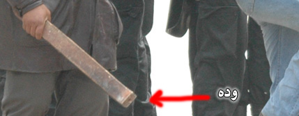</figure>

<figure>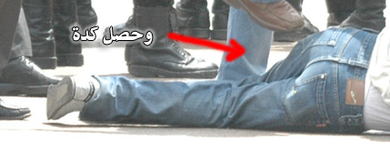</figure>

<figure>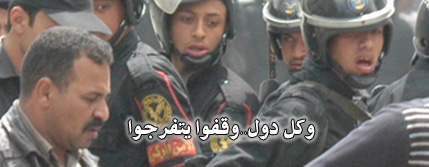</figure>

<figure>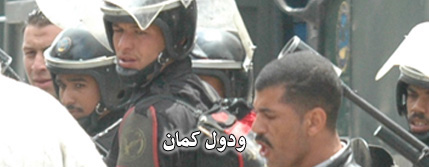</figure>

<figure>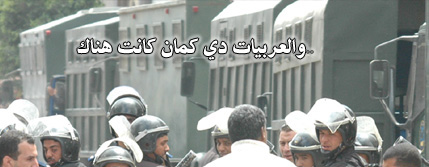</figure>

<figure>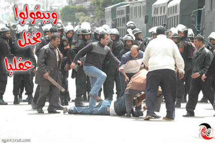</figure>

المواطن رقم واحد رجله مكسورة حاليا، والمواطن رقم إثنين.. يعمل ظابط في أمن الدولة، وهي الوظيفة ذاتها لكل المواطنين الظاهرين في الصور، عدا ذوي البدلات السوداء، فهم جنود الأمن المركزي..

الصورة التي ارسلها لنا عبد الناصر النوري، ووجدنا داخلها تفاصيل كثيرة، تصلح لتكون أكثر من صورة.. وهو ماحدث بأعلى..

<h3>سيناريو : البراء أشرف</h3>

<h3>عدسة : عبد الناصر النوري</h3>

عدد التعليقات : <strong>162</strong>

