+++
title = "افتح يا ماسينجر!"
date = 2006-05-08

[taxonomies]
authors = []
sections = ["masr"]

[extra]
section_name = "ولاد البلد"
share_image = "/media/admins.20at.com/masr/23.jpg"
summary = "أصبح اختيار صورة لك في الديسبلاي يمثل خطوة هامة لشكلك أمام أصداقك الماسينجاريين!"
section_slug = "masr"
section_colour = "#666666"
thumb = "/media/admins.20at.com/masr/23.jpg"
n_comments = 0
original_url = "http://masr.20at.com:80/article.php?sid=288&PHPSESSID=b21753af24e3fec8c8003677058e91e3"
archived = "20070423024445"
date_source = "byline/meta"
aliases_20at = ["//masr.20at.com/article.php?sid=288"]

[extra.provenance]
original_url = "http://masr.20at.com:80/article.php?sid=288&PHPSESSID=b21753af24e3fec8c8003677058e91e3"
capture_url = "https://web.archive.org/web/20070423024445/http://masr.20at.com:80/article.php?sid=288&PHPSESSID=b21753af24e3fec8c8003677058e91e3"
capture_label = "٢٣ أبريل ٢٠٠٧، ٠٢:٤٤ UTC"
date_note = "من سطر التوقيع في المقال"
other_urls = []
comments = ""
missing_images = "١٣"
+++

{{ <figure src="/media/admins.20at.com/masr/msn-pic.jpg" alt="" /> }}

أصبح اختيار صورة لك في الديسبلاي يمثل خطوة هامة لشكلك أمام أصداقك الماسينجاريين!

08/05/2006

محمود حامد – ولاد البلد :

طبعا تعرف الماسينجر، البرنامج الوهمي الجباااااار، الذي يستخدمه كل من دخل على الإنترنت، أو حتى سمع عنه من بعيد..

وبغض النظر عن إن أصدقائنا معدومي اللغة الانجليزية في مصر يسمونه "مازينجر"

<figure></figure>

، وكل واحد منهم يعتبر نفسه "ماهر" الذي يناديه مع كل دخول على النت.. افتح يا مازينجر (ماسينجر) .. أنا ماهر!

في الماسينجر، وخصوصا مع نسخته الجديدة والأخيرة، بدأت الصورة تأخذ مكانها بقوة فيه، وأصبح اختيار صورة لك في الـDisplay يمثل خطوة هامة لشكلك أمام أصدقاؤك الماسينجاريين!

ولأن صناع الماسينجر يعلمون جيدا أهمية الصورة، فقد وضعوا لك ضمن البرنامج مجموعة من الصور تختار منها.. بطة.. كلب صغير.. حصانين.. كرة قدم.. شطرنج.... وطبعا كلها صور لا تعبر عن أي شيء.. ولذلك فهي لا تحظى بشعبية كبيرة خصوصا صورة الكلب التي تجعل أصدقائك "يستلموك" تريقة من ساعة دخولك أون لاين.. ولحد ما تعملهم بلوووووك!

على الماسينجر، أخذت أقلب في صور أصدقائي، ووجدتها كلها تصلح لعمل موضوع على "ولاد البلد" عن الصور الغريبة والطريفة التي يختارونها

زميلنا يحب دائما أن تكون صورته تعبير عن آخر أخباره

، وبما أن آخر أخباره هو خبر خطوبته على زميلتنا دعاء الشامي

<figure></figure>

، فتجد دائما الدبلة الفضة هي صورته على الماسينجر.. بينما تفضل دعاء وضع صورة فتاة صغيرة مكانها!

أما مصعب، فهوسه بالكمبيوتر والبرمجة تجعله دائما يضع صورة له وهو جالس على اللاب توب

<figure></figure>

، ويظهر مصعب في الصورة موجها ظهره للكاميرا، وهو ما يجعله محل سخرية لبعض أصدقائه..

على عبد المنعم يختار صوره بعناية شديدة، وكانت صورته الأخيرة من نصيب طلعت زكريا، رغم أنه يقول أنها جاءت معه بالصدفة، لكنه وجدها مناسبة جدا للماسينجر!

أما صديقنا وائل الغزاوي، فيضع صورة صورها بنفسه لمجند أمن مركزي يقف مبتسما وخوذته معوجة على رأسه أثناء محاصرته للمتظاهرين أمام نادي القضاة!

أما مريم المعتصم زميلتنا في عشرينات، فوجدناها تضع صورة عجلة (دراجة يعني)، لا تعبر عن أي شيء، لكنها مبسوطة بالمنظر على حد تعبيرها..

صديقنا باسم الشربيني، يعتبر صورته الشخصية جزء مهم جدا في التواصل بينه وبين أصدقائه على الماسينجر، لذلك فهو يضع آخر صوره التي التقطها لنفسه على الماسينجر.. وشك زي القمر يا باسم!

أما عبد الله، فيعبر عن ولعه بأشعار صلاح جاهين، ويضع دائما صورته، ودائما ما يسأله أصدقائه عن الشخص الجالس في الصورة.. فيخبرهم.. لكن بعد أن يضحك قبلها على جهلهم بالشاعر المشهور!

أما مي كامل، فتجد صورتها رومانسية، رغم أن شخصيتها ليست كذلك (أوعى تزعلي يا مي) وهي صورة لولد وبنت.. واضح إن في أخبار حلوة قريبة.. ربنا يسهل!

زميلتنا الحامل، تضع صورة ولد زي القمر على ماسينجرها.. وطبعا يعتقد البعض أن الصورة لها استخدام آخر، وهو أن يولد الولد بكل هذا الجمال.. ربنا يجعله أجمل إن شاء الله..

زينب تضع حالياً صورة خطيبها خاصة عندما تكون الأمور بينهما على خير أما في حالة الخصام فهي تضع صورة لفتي كاوبوي يحمل مسدسات كنوع من التهديد لخطيبها.. استر يا رب!

شعار النادي الأهلي هو دائما الصورة المميزة لمحمد مصطفى الذي يعتبر نفسه سفير النادي الأهلى على النت.. ليك حق يا عم.. لكنه أحيانا يتخلى عن الشعار، ويضع مكانه صور لنجوم النادي أمثال أبو تريكة والحضري وبركات.

<figure>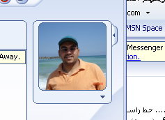</figure>

<figure>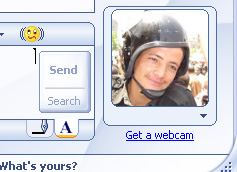</figure>

<figure>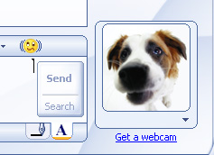</figure>

<figure>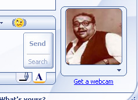</figure>

<figure></figure>

<figure>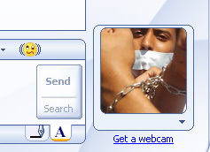</figure>

<figure>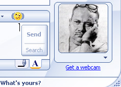</figure>

<figure>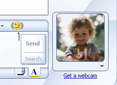</figure>

<figure>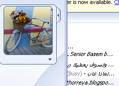</figure>

<figure>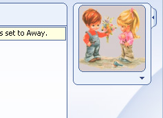</figure>

<figure>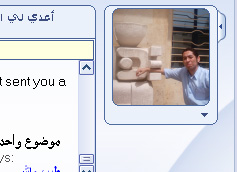</figure>

<figure>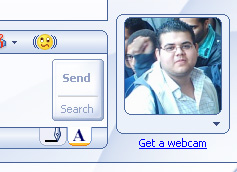</figure>

<figure>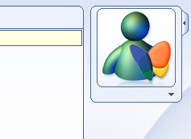</figure>

<figure>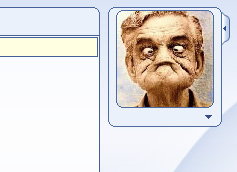</figure>

<figure>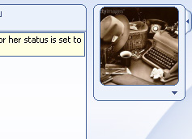</figure>

<figure>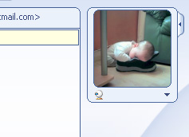</figure>

<figure>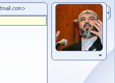</figure>

<figure>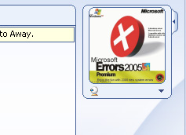</figure>

<figure>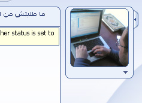</figure>

<figure>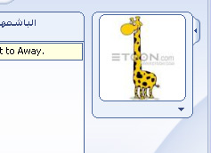</figure>

<figure>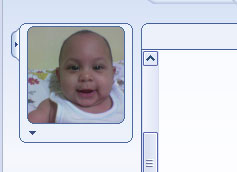</figure>

وأنت بقى.. صورتك ع الماسينجر إيه.. ولا مقضيها بطة وحصانين.. وكلب صغير!

علشان تحط صورتك أو صورة عجبتك في التعليقات تحت استخدم الكود التالي "copy &amp; paste" :

طبعا شيل الـURL ده و حط الـURL بتاع صورتك، و ما تنساش ترفعها على أي موقع رفع ملفات الأول

عدد التعليقات : <strong>173</strong>

