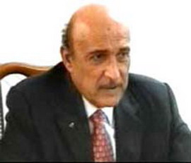

+++
title = "عمر سليمان.. شاهد الزواج"
date = 2007-05-05
authors = ["سوسن أبو حسين"]

[taxonomies]
authors = ["sosn-abu-hussein"]
sections = ["masr"]

[extra]
section_name = "ولاد البلد"
share_image = "/media/admins.20at.com/masr/shahed2.jpg"
summary = "أقيم مساء أمس حفل زفاف جمال مبارك نجل الرئيس المصري محمد حسني مبارك، على خديجة الجمال. وبدأ حفل الزفاف بعد ظهر أمس بحفل عائلي مصغر اقتصر على عدد من الأقارب."
section_slug = "masr"
section_colour = "#666666"
thumb = "/media/admins.20at.com/masr/shahed2.jpg"
n_comments = 0
original_url = "http://www.20at.com:80/masr/2khbar/5735.html"
archived = "20090805113105"
date_source = "byline/meta"
aliases_20at = ["/masr/2khbar/5735.html"]

[extra.provenance]
original_url = "http://www.20at.com:80/masr/2khbar/5735.html"
capture_url = "https://web.archive.org/web/20090805113105/http://www.20at.com:80/masr/2khbar/5735.html"
capture_label = "٥ أغسطس ٢٠٠٩، ١١:٣١ UTC"
date_note = "من سطر التوقيع في المقال"
other_urls = []
comments = ""
missing_images = ""
+++

<figure></figure>

أقيم مساء أمس حفل زفاف جمال مبارك نجل الرئيس المصري محمد حسني مبارك، على خديجة الجمال. وبدأ حفل الزفاف بعد ظهر أمس بحفل عائلي مصغر اقتصر على عدد من الأقارب.

وفي المساء انتقل الجمع العائلي إلى فندق «فور سيزون»، إذ أقيمت مراسم احتفال الزفاف الرسمية، وانضم إليهم في الفندق عدد من الشخصيات العامة المصرية والوزراء المقربين، من بينهم عمرو موسى أمين عام جامعة الدول العربية وحرمه ووزير الخارجية أحمد أبو الغيط وحرمه ووزير المخابرات العامة عمر سليمان، الذي كان أحد الشاهدين على عقد القران، وحرمه، والسفير عبد الرؤوف الريدي سفير مصر السابق في واشنطن وجمال السادات نجل الرئيس الراحل انور السادات، وعدد محدود من الأصدقاء المقربين للعروسين.

وأحيا الحفل عدد من الفنانين المصريين، في مقدمتهم المطربان عمرو دياب وهاني شاكر.

يذكر أن الرئيس مبارك كان يفضل أن يبقى حفل الزفاف عائليا لولا إصرار العروس وأسرتها على إقامة حفل يضم المقربين بعيدا عن التقاليد الرسمية.

* نقلا عن جريدة الشرق الأوسط

