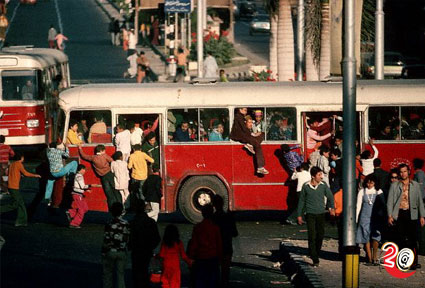
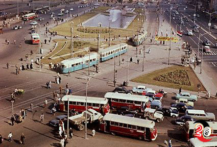
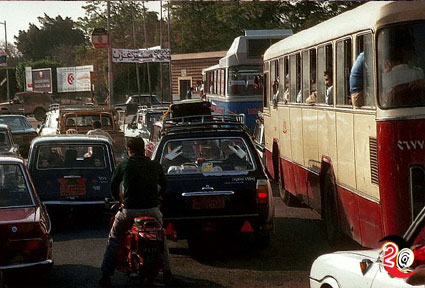
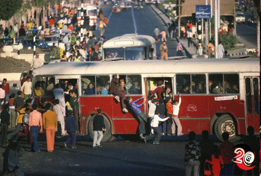
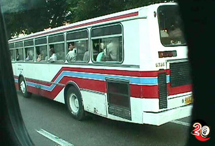
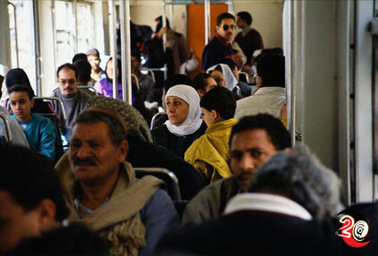
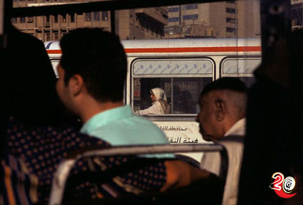
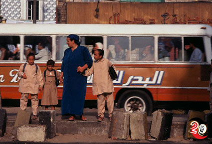
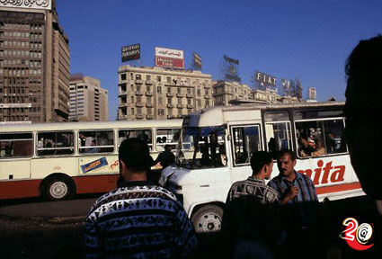
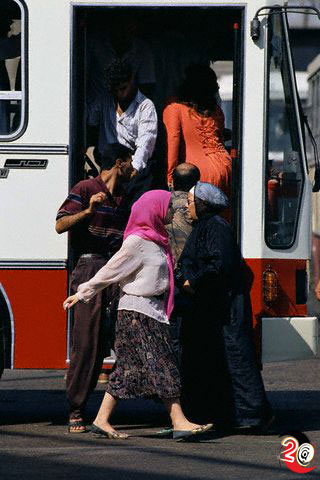

+++
title = "على جدران (الأتوبيس)!"
date = 2006-05-20

[taxonomies]
authors = []
sections = ["masr"]

[extra]
section_name = "ولاد البلد"
share_image = "/media/admins.20at.com/masr/outobees/1.jpg"
summary = "لعلها رمز، على أن هذا الأتوبيس بكل ما يحتويه من كراسي وشبابيك وإعلانات وناس ملتصقة ببعضها.. هو صناعة مصرية خالصة.. تصنعها الظروف والأحوال.. المصرية فقط!"
section_slug = "masr"
section_colour = "#666666"
thumb = "/media/admins.20at.com/masr/outobees/1.jpg"
n_comments = 0
original_url = "http://masr.20at.com:80/article.php?sid=349"
archived = "20070425154545"
date_source = "byline/meta"
aliases_20at = ["//masr.20at.com/article.php?sid=349"]

[extra.provenance]
original_url = "http://masr.20at.com:80/article.php?sid=349"
capture_url = "https://web.archive.org/web/20070425154545/http://masr.20at.com:80/article.php?sid=349"
capture_label = "٢٥ أبريل ٢٠٠٧، ١٥:٤٥ UTC"
date_note = "من سطر التوقيع في المقال"
other_urls = []
comments = ""
missing_images = ""
+++

{{ <figure src="/media/admins.20at.com/masr/outobees122.jpg" alt="" /> }}

لعلها رمز، على أن هذا الأتوبيس بكل ما يحتويه من كراسي وشبابيك وإعلانات وناس ملتصقة ببعضها.. هو صناعة مصرية خالصة.. تصنعها الظروف والأحوال.. المصرية فقط!

20/05/2006

محمود حامد - ولاد البلد :

دنيا الأتوبيس عالم تاني فرغم اتفاقنا بأنه يعد وسيلة نقل (وحيدة) للناس الغلابة محدودي الدخل إلا أن الشركات والمصانع لم تترك لهم فسحة من الوقت ليستمتعوا بقرف الزحمة والحر والوقوف محشورين، وأرادت أن تفسد عليهم لذة المتعة في ركوب الأتوبيس- وأقصد هنا الاتويبس بتاعنا العادي مش الـ CTA- وتطاردهم بإعلانات من نوع خاص يتناسب مع طبيعة ودخل أرباب الأتوبيسات ومقدرتهم المالية واحتياجاتهم.

وأنت تجد نفسك محاصراً بالإعلانات فور صعودك القانوني من الباب الخلفي للأتوبيس وقبل دفع ثمن التذكرة وأثناء سماعك لصيحات المحصل أو الكمسري الشهيرة والتي لا تتعدى "أبعت ، العربية فاضية قدام يا أستاذ، ح تدفع يا كابتن ولا تنزل ، نوسع لبعض كدة يا أساتذة"، ربما تجد أحد الإعلانات التي مكتوب في وسطها بالبنط العريض " سماعات لضعاف الآذن" وطبعاً مع ذكر بعض مميزاتها من حيث السعر والجودة وكيف أنها ستجعلك تسمع دبة النملة.

فإذا أعدت النظر مرة أخرى من الجائز جدا أن ترى بلا خجل إعلان "وداعا للعقم والضعف الجنسي" وبالأسفل عنوان ورقم تليفون لأحد تجار الأعشاب أو المراكز الطبية الرخيصة وكأن معظم المصريين مصابون بالضعف الجنسي؟!!، كذلك كثيراًًَ ما ستجد إعلاناً عن إحدى الأجهزة أو الأعشاب العبقرية لمشكلة التبول اللاإرادي "ولا أعرف سبب كثرة ذلك الإعلان بالتحديد".

<h3>الإيريال العجيب</h3>

"شاهد أكثر من 80 قناة عربية وأجنبية بواسطة الإيريال الذهبي بدون دش ولا ريسيفر"، وكالعادة يفاجئك ذلك الإعلان بالسعر المعجزة الذي أحياناً لا يتعدى 60 جنيهاً، ويسيل لعابك لمشاهدة قنوات أوربية وعالمية، كما تجد إعلانات للطلبة "النص نص" والتي تتراوح ما بين المدارس الثانوية الخاصة، وهي تشتهر بتلك العبارة الشهيرة "نقبل الحاصلين على 50% فأكثر" ولو كان ينفع أقل من كدة لم يكن لديهم مانع، كما توجد دعايا للمعاهد العليا والكليات الخاصة للطلبة الذين لم يسعفهم الوقت للمذاكرة.

<h3>ابحث معانا</h3>

وبجانب تلك الإعلانات قد تجد صورة غير واضحة المعالم لشخص تائه وربما يكون متخلف عقلياً وتبحث أسرته عنه، والغريب أنك تجد الصورة والكلام والاسم غير واضحين تماماُ، وربما يكون العائق المادي لتلك الأسرة هي السبب في عدم مقدرتهم على طبع صورة أكثر وضوحا ولا تسألني أين الشرطة وأجهزتها الجبارة وعساكرها ولماذا لم يساعدوا تلك الأسرة على الأقل بطبع تلك الملصقات على حساب الدولة، وربما يكون السبب هو اهتمام رجال الشرطة بعمليات أهم منها سحل المتظاهرين في أي مكان والضرب على "القاضي" والمليان.

<h3>وداعا للسمنة والنحافة</h3>

ونترك الشرطة في حالها لنعود مرة أخرى لإعلاناتنا الأتوبيسية التي حولته من مجرد وسيلة مواصلات إلى مول متحرك لتجد إعلانا عن العدسات اللاصقة ومستشفيات العيون، كما تنتشر إعلانات للحصول على الوزن المثالي وتبشرك بتلك المقولة المكررة "وداعا للسمنة وأهلاً بالرشاقة" ولا تستعجب إذا وجدت في نفس الإعلان بشرى لأصحاب الأجسام النحيفة بإمكانية زيادة وزنهم في خلال أسبوعان.

<h3>الوظيفة المعجزة</h3>

أما إذا كنت تبحث عن وظيفة فبالتأكيد ستجد إعلان يطلب شباب متحمس وطموح لوظيفة مندوبين مبيعات، ولست أدري كيف سيعرف صاحب العمل إذا كان الشاب طموحا أم لا وما هي علامات الحماس بالظبط، ولا تستعجب يا صديقي إذا وجدت أن المقابل المادي كبير جدا ولاحظ ذلك الجزء جيداَ "أجر ثابت وعمولة"، والشائع أن تجد تلك العبارات "شباب من الجنسين"، "مرتب مغري" تتصدر دائماَ إعلانات الوظائف في الأتوبيسات.

وبالنسبة للطلبة أيضا من الممكن أن تجد إعلانات عن شقق إيجار مفروش وذلك غالبا ما يوجد في الأتوبيسات على خطوط الجامعات، كما لم ينسى البعض التحذير من خطوة التدخين بالعبارة التقليدية "إذا كان من حقك أن تدخن.. فمن حقي أن استنشق هواءً نقياً"، ولا تتعجب إذا نظرت خلف الأتوبيس فوجدت الدخان الأسود الكئيب يخرج من الشكمان بصورة مرعبة، وأتذكر هنا قول أحد زملاء الأتوبيس "يعني هي السيجارة اللي ح تلوث الجو".

وكذلك هناك فرصة لك لتكون من أصحاب الأراضي في منطقة صحراوية شاسعة وسعر المتر زهيد جداً ولكن بالطبع هناك "رسم معاينة" وهو عادة ما يكون 20 أو 30 جنيهاً، وبالطبع ستدفعها أولاً وربما تجد تلك الأراضي ما هي إلا مجرد جبال ومنطقة صخور لا تصلح لأي شئ.

<h3>ولاعة وجلدة البطاقة</h3>

وقبل أن تفرغ من إعلانات الأتوبيسات وتأخذ قسطا فقط من قراءة كل تلك الإعلانات، يفاجئك شخص يقفز على باب الأتوبيس بخفة معتادة، اكتسبها من كثرة دخوله وخروجه من الأتوبيسات برغم الحمولة التي يحملها على يديه إنه بالتأكيد أحد الباعة المتجولون "الذين يبيعون كل شئ وأي شيء.

ذلك البائع يرمي أمامك بمهارة أشياء صغيرة بداية من باكو مناديل أو نعناع أو بسكويت وأحيانا طقم أمشاط وبعض الأغراض الحريمي، وهو يطلق عبارات سريعة وبصوت عالي تكاد لا تميز أي منها إلا جملة واحدة فقط "كل ده بـ25 قرش" .

أو يكون خفيف الدم ويبدأ في النداء بشكل كوميدي وبنداءات أكثر كوميدية، "معايا الفلاية اللي تطلع 100 قملاية وتفرق بين الدكر والنتاية، ومعايا من الإبرة للصاروخ، ومن الذرة للمجرة، وصلي على رسول الله"..

كما قد تجد رجلاً أو سيدة تبيع بعض الكتب التي يكون معظمها دينياً وبعضها يخص العلاقات الزوجية، والعجيب ذلك الرجل الذي أجده كثيراً ما يبيع أعداد قديمة من الصحف الصفراء التي يتهافت على شرائها الناس وذلك لأنها 25 قرش فقط "يابلاش".

<h3>صنع في مصر</h3>

ملاحظة أخيرة، وأنت تنزل من البوابة الأمامية للأتوبيس، وبجوار السائق الذي تقف بجواره في انتظار المحطة لأن "ممنوع النزول إلا في المحطات الرسمية"، وستجدها مكتوبة أعلى الباب..

وأنت تقف، انظر لأعلى، وتحت الـ"دوكو" المرشوش حديثا، ستجد لوحة نحاسية صغيرة، كانت ظاهرة قبل أن يتم طمسها بالـ"دوكو".. مكتوب عليها.. "صنع في مصر"..

لعلها رمز، على أن هذا الأتوبيس بكل ما يحتويه من كراسي وشبابيك وإعلانات وناس ملتصقة ببعضها.. هو صناعة مصرية خالصة.. تصنعها الظروف والأحوال.. المصرية فقط!

<figure></figure>

<figure></figure>

<figure></figure>

<figure></figure>

<figure></figure>

<figure></figure>

<figure></figure>

<figure></figure>

<figure></figure>

<figure></figure>

عدد التعليقات : <strong>154</strong>

