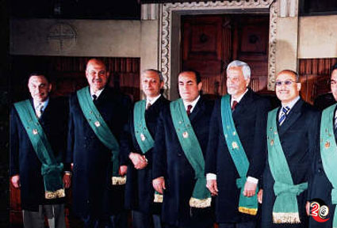
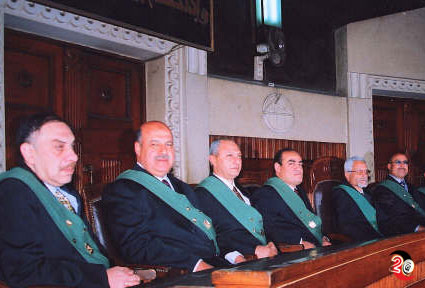
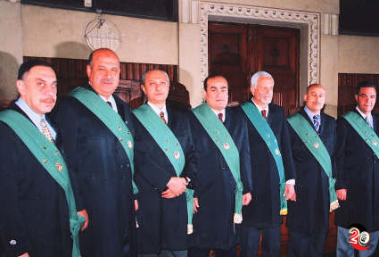
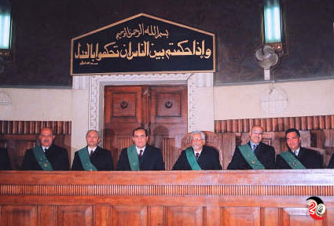
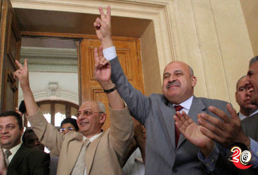
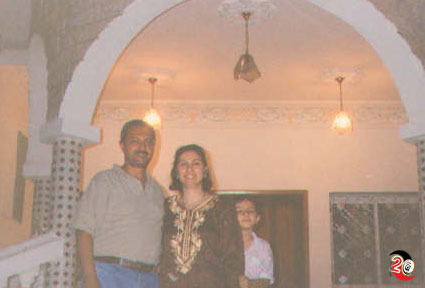
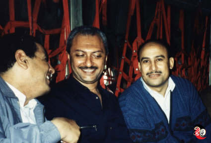
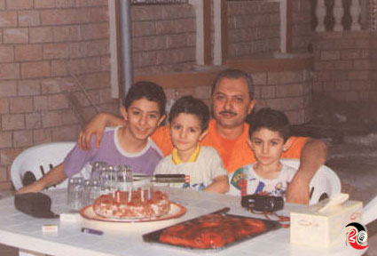
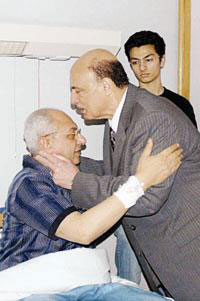

+++
title = "تعرف.. هشام البسطويسي!"
date = 2006-05-23

[taxonomies]
authors = []
sections = ["masr"]

[extra]
section_name = "ولاد البلد"
share_image = "/media/admins.20at.com/masr/bastawesy/1.jpg"
summary = "في اعتصام غدا.. سيغيب عن القضاة واحد من زملائهم.. بل هو جزء كبير من الأزمة الحالية.. مستشار اسمه.. هشام البسطويسي!"
section_slug = "masr"
section_colour = "#666666"
thumb = "/media/admins.20at.com/masr/bastawesy/1.jpg"
n_comments = 45
original_url = "http://masr.20at.com:80/article.php?sid=360&PHPSESSID=b21753af24e3fec8c8003677058e91e3"
archived = "20061215041735"
date_source = "byline/meta"
aliases_20at = ["//masr.20at.com/article.php?sid=360"]

[extra.provenance]
original_url = "http://masr.20at.com:80/article.php?sid=360&PHPSESSID=b21753af24e3fec8c8003677058e91e3"
capture_url = "https://web.archive.org/web/20061215041735/http://masr.20at.com:80/article.php?sid=360&PHPSESSID=b21753af24e3fec8c8003677058e91e3"
capture_label = "١٥ ديسمبر ٢٠٠٦، ٠٤:١٧ UTC"
date_note = "من سطر التوقيع في المقال"
other_urls = []
comments = "٤٥"
missing_images = ""
+++

{{ <figure src="/media/admins.20at.com/masr/bastawesy1.jpg" alt="" /> }}

في اعتصام غدا.. سيغيب عن القضاة واحد من زملائهم.. بل هو جزء كبير من الأزمة الحالية.. مستشار اسمه.. هشام البسطويسي!

23/05/2006

غدا.. يخرج قضاة مصر إلى الشارع ليعتصموا يوما كاملا في ذكرى أحداث أسوأ استفتاء دستوري مصري على الإطلاق في 25 مايو 2005 وأحداث الأربعاء الأسود الذي خرج فيه المصريون ليقولا كلمتهم في تعديل المادة 76 ولم يسمع كلمتهم أحد..

في اعتصام غدا.. سيغيب عن القضاة واحد من زملائهم.. بل هو جزء كبير من الأزمة الحالية.. مستشار اسمه.. هشام البسطويسي!

عن هشام البسطويسي نكتب، عن واحد من "ولاد البلد" الذي يستحق أن نعرفه جميعا.. ونحرمه..

في 23 مايو عام 1951 ولد هشام محمد عثمان البسطويسي، على عكس الأطفال لم يكن يحلم بأن يصبح ضابطاً ؛ وإنما أن يعمل بالقانون مثل أبيه المحامي، وهو ما تحقق عام 76 بتخرجه من حقوق القاهرة..

وأثناء تدربه بمكتب أستاذه المحامي صلاح السهلي تعرف على حب عمره ورفيقة دربه ألفت صلاح السهلي، فتزوجها وسافرا إلى الإسكندرية حيث بدأ حياته العملية كوكيل نيابة بالجمرك..

ثمان سنوات قضياها تنقل فيها من نيابة الجمرك لنيابة الأحداث ثم قاضي بالمحكمة الجزئية، وخلالها رزقا بثلاثة أبناء محمد، وأحمد، ومصطفى، في عام 1988 رجعت الأسرة إلى القاهرة ليعمل البسطويسي في نيابة النقض ويقضي بها عشرة سنوات حتى عام 1998 عندما اختارته الجمعية العمومية لمحكمة النقض – عدا واحد – مستشاراً لمحكمة النقض، وفي عام 2000 تم ترقيته بفضل تقاريره القضائية الممتازة إلى نائب رئيس محكمة النقض.

<h3>أسير كلمة الحق</h3>

ثلاثون عاماً من العمل القضائي لم يوجه فيها للبسطويسي أي إنذار أو لفت نظر حتى تم إحالته للتحقيق الجنائي بقرار من وزير العدل مطعون عليه، وإجراءات قانونية انتهت بتوجيه اللوم إليه في 18 مايو الماضي، في الوقت الذي تشهد فيه تقاريره القضائية فضلاً عن شهادات زملائه ورؤسائه بانضباطه في العمل وانحيازه الدائم لكلمة الحق.

في عام 1992 أعير البسطويسي للعمل في الإمارات، وهناك قاد أول إضراب للقضاة المصريين احتجاجاً على وقف قاضيين مصريين عن العمل، وشاركه في الإضراب الذي استمر 25 يوماً صديق عمره المستشار محمود مكي، و المستشارين ناجي دربالة، وسيد عمر، وأحمد سليمان، وكانوا وقتها وكلاء نيابة خضر العود، لكنهم رغم كل الضغوط رفضوا فض الإضراب إلا بعد إعادة القاضيين المصريين إلى العمل، والالتزام بكل شروط القضاة المصريين، وبعد أشهر قلائل من الأزمة يحقق وكيل النيابة هشام البسطويسي في واقعة سكر بين في الطريق العام " وعندما يتدخل الأمير للعفو عن المتهم يرفض البسطويسي ويكتب على أمر العفو العالي كلمة الحق (لا شفاعة في حد) ويحول المتهم إلى المحكمة، لم يثنيه عن قراره الخوف من السلطان أو الرغبة في المال والجاه، فكلمة الحق أحق بأن تتبع.

ومضت سنوات الإعارة الأربع ليعود بعدها إلى القاهرة دون التجديد لعامين كما هو معمول به في الوسط القضائي، والطريف أنه لم يعر البسطويسي بعدها لأي مكان أخر في الوقت الذي يعار فيه أصحاب الحظوة مرتين وثلاثة.

<h3>قاضي المنصة</h3>

ثلاثون عاماً من العمل القضائي لم يشرف فيها البسطويسي على انتخاباتهم " النزيهة قدر الإمكان " كما يقولون، المزورة كما نحن متأكدون إلا مرة واحدة في الثمانينات، في دائرة مينا البصل، كان وكيلاً للنيابة وقتها، مشرفاً في اللجنة العامة بصحبة القاضي محمد بيومي درويش، وإزاء التدخلات الأمنية والتلاعب في الصناديق قرر القاضيان – بسطويسي ودرويش – إلغاء الانتخابات في الدائرة، ورغم كل الضغوط التي مارسها وزير العدل ومجلس القضاء الأعلى وتلويحهم لهما بالتفتيش القضائي إلا أنهما لم يرضخا للضغوط ولجئا إلى نادي القضاة بالإسكندرية، ومن يومها لم يتم انتداب المستشار هشام البسطويسي للإشراف على أي انتخابات .

كما لم ينتدب لوزارة أو شركة لأداء عمل غير قضائي، فللانتدابات ومزاياها أصحابها، وحتى عندما جاء دوره للانتداب لمحكمة القيم ؛ اعتذر عنه رافضاً بذلك زيادة في المرتب الشهري قدرها 1200 جنيه، لكن القاضي الحر أقر في اعتذاره المكتوب أنه " لا يشرفني العمل في محكمة استثنائية طالب القضاة مراراً بإلغائها "

ثلاثون عاماً أخلص قلبه لكلمة الحق يقولها على المنصة وأجره على الله لا يبتغي إلا وجهه، و لا يخشى فيها لومة لائم، ففي عام 2003 تقضي محكمة النقض برئاسة المستشار حسام الغرياني وعضوية المستشار هشام البسطويسي ببطلان نتائج انتخابات دائرة الزيتون – دائرة د.زكريا عزمي – بموجب الطعنين 959، 949 لسنة 2000، ويؤشر المستشار فتحي خليفة رئيس النقض على النسخة الأصلية للقرار بتعييب إجراءات التحقيق والقرار الصادر فيهما طالباً إعادة عرض الطعنين، فترد المحكمة بذات التشكيل في فبراير 2004 تعقيب رئيس محكمة النقض على الحكم في الطعن الانتخابي لأنه لا صفة له فيما يطلبه، " فلا صفة لرئيس المحكمة في التعقيب عليها أو إملاء طريق معين للتحقيق، أو توجيه الدائرة أو أحد أعضائها في شأنها".

<h3>فتش عن الرجل تحت الوسام</h3>

كأي مواطن مصري بسيط ينتظر البسطويسي أخر الشهر بفارغ الصبر، فبعد ثلاثين عاماً من العمل لا يملك سيارة خاصة أو شاليه في مارينا وإنما يقضي المصيف في شقة والده بالإسكندرية، ولا يملك إلا شقته في 10 ش توفيق وهبي بمدينة نصر، أما ثروته فهي أبنائه الثلاثة محمد – 24 سنة – خريج هندسة، أحمد – 21 سنة – الطالب بالصف الثالث حقوق فرنسي، ومصطفى – 18 سنة – يدرس في عامه الأول بنفس الكلية.

<h3>عندما توقف قلب مصر</h3>

شهراً كاملاً قضاه البسطويسي معتصماً في نادي القضاة، حرمته الإحالة للتحقيق من مشاهدة مباريات كرة القدم التي يعشقها كأهلاوي صميم، كما منعه تحضير الدفاع وقراءة التحقيقات والمذكرات من قراءة كتب الفلسفة ومحمد حسنين هيكل كاتبه المفضل .

شهراً كاملاً من حصار الأمن، والاعتداء على القضاة بالضرب، وسحل المعتصمين أمام النادي، واعتقال المتظاهرين المتضامنين مع القضاة.

شهراً كاملاً من الضغط العصبي، والتوتر، والقلق سقط في أخره القلب المثقل بهم البلد رغم أن صاحبه لا يعاني من السكر أو الضغط أو حتى زيادة نسبة الكولسترول.

توقف القلب 4 دقائق كاملة وأوقظه سبع صدمات كهربائية وعملية قسطرة استغرقت ساعة ونصف أجراها د. أحمد عبد الرحمن بمستشفى كيلوباترا.

لم تفلح حملات التشهير المدفوعة حكومياً بالصحف السوداء في تشويه صورة المستشار هشام البسطويسي، ففور نشر خبر الأزمة الصحية التي يتعرض لها زارته (مواطنة مصرية من المعادي) كما تقول بطاقتها التعريفية على باقة الورد، ومن يومها لم تنقطع أمنيات الشفاء العاجل المصاحبة لباقات الزهور، والاتصالات الهاتفية المتسائلة عن صحته من مصريين خارج البلاد.

اليوم – الثلاثاء 23 مايو – نحتفل مع المستشار هشام البسطويسي بعيد ميلاده الخامس والخمسين، كما نحتفل معه غداً الأربعاء بمرور أسبوع على عودته للحياة - بعد أن كان قلبه قد توقف 4 دقائق الأربعاء الماضي -، ولا نملك إلا أن نقول له كما قالها الملايين الهاتفين باسمه (يا بسطويسي قوم قوم، ما يهمكش أي لوم).

<figure></figure>

<figure></figure>

<figure></figure>

<figure></figure>

<figure></figure>

<figure></figure>

<figure></figure>

<figure></figure>

<figure></figure>

عدد التعليقات : <strong>146</strong>

