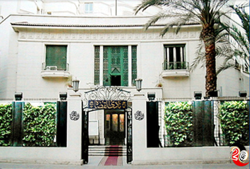

+++
title = "نادي القضاة .. قلعة الحرية"
date = 2006-05-25

[taxonomies]
authors = []
sections = ["masr"]

[extra]
section_name = "ولاد البلد"
share_image = "/media/masr.20at.com/images/galleries/nady/5.jpg"
summary = "وإن كان نادي القضاة أصبح قبلة لحجاج الحرية، فالسطور القادمة تحكي قصة إنشائه، المبنى والمعنى، البشر والحجر."
section_slug = "masr"
section_colour = "#666666"
thumb = "/media/masr.20at.com/images/galleries/nady/5.jpg"
n_comments = 0
original_url = "http://masr.20at.com:80/article.php?sid=373&PHPSESSID=b21753af24e3fec8c8003677058e91e3"
archived = "20070424004136"
date_source = "byline/meta"
aliases_20at = ["//masr.20at.com/article.php?sid=373"]

[extra.provenance]
original_url = "http://masr.20at.com:80/article.php?sid=373&PHPSESSID=b21753af24e3fec8c8003677058e91e3"
capture_url = "https://web.archive.org/web/20070424004136/http://masr.20at.com:80/article.php?sid=373&PHPSESSID=b21753af24e3fec8c8003677058e91e3"
capture_label = "٢٤ أبريل ٢٠٠٧، ٠٠:٤١ UTC"
date_note = "من سطر التوقيع في المقال"
other_urls = []
comments = ""
missing_images = "٥"
+++

وإن كان نادي القضاة أصبح قبلة لحجاج الحرية، فالسطور القادمة تحكي قصة إنشائه، المبنى والمعنى، البشر والحجر.

25/05/2006

اليوم تتعلق أنظار العالم كله بنادي القضاة المصريين، فالشعوب الأوربية قررت التضامن مع الشعب المصري في وقفته اليوم التي دعا إليها نادي القضاة في ذكرى الاستفتاء على تعديل المادة 76 من الدستور.

اليوم نقف جميعاً وقفة حق أمام نادي القضاة احتجاجاً على الظلم والفساد الذي ندفع ثمنه جميعاً، القضاة يدفعون ثمنه بعدم استقلالهم وتدخل الحكومة ممثلة في وزير العدل في أعمالهم، وندفعه جميعاً كمواطنين في ظل الطوارئ التي تتيح للشرطة إجراءات استثنائية من اعتقال وتفتيش وتصنت على التليفونات دون إذن من النيابة، سنقف جميعاً لنقول لا للظلم، والفساد والاستبداد.

وإن كان نادي القضاة أصبح قبلة لحجاج الحرية، فالسطور القادمة تحكي قصة إنشائه، المبنى والمعنى، البشر والحجر.

<h3>فكرة إنشائه</h3>

أنشئ نادي القضاة ككيان معنوي بموجب معاهدة منترو الموقعة عام 1937، ونصت على إلغاء المحاكم المختلطة، وإنشاء المحاكم الأهلية، كما نصت على أن القضاة يجب أن تكون لهم نقابات تمثلهم، وفي ذلك الوقت اصطلح على تسمية النقابة بالنادي تنزيهاً له عن باقي النقابات.

اجتمع 59 قاضياً في سراي محكمة الاستئناف برئاسة صاحب السعادة محمود فهمي يوسف باشا رئيس محكمة الاستئناف، وكان قرارهم في 10 فبراير 1939 بإنشاء نادي القضاة، ثم عرض على الحاضرين من القضاة الاقتراحات الواردة الخاصة بمشروع قانون النادي، فتقرر أن يتلى المشروع مادة مادة وتعرض الملاحظات الخاصة بها وتم ذلك بأن تلا حضرة محمد جلال صادق نصوص المشروع وبعد المناقشة في كل نص منها والملاحظات عليها أجمع الحاضرون على النص الأتي يكون قانوناً لنادي القضاة، والقارئ لهذا الحدث يظهر له أن القائمين على إنشاء النادي اعتزوا بفكرة القضاء المصري المستقل.

وبذلك يكون نادي القضاة سابقاً في تنظيمه وإنشائه على صدور أي قانون لتنظيم العمل الأهلي، وكان الهدف الأساسي من إنشاء النادي كما تنص المادة الثانية من لائحة النظام الأساسي هو توثيق روابط الإخاء والتضامن بين جميع رجال القضاة والنيابة العامة، وتسهيل سبل الاجتماع والتعارف بينهم، ورعاية مصالحهم، ودعم استقلال القضاء ورجاله.

<h3>أول مجلس إدارة</h3>

بعد إقرار قانون النادي غادر القاعة بعض الأعضاء وقرر الحاضرون وعددهم 53 عضواً البدء في انتخاب أعضاء مجلس الإدارة، وحصل كل من محمود فهمي يوسف باشا وعبد الرحمن الطوير بك عن المستشارين ومحمد حافظ بك عن النيابة العامة على أصوات جميع الحاضرين – وعددهم على 53 عضواً – وهو إجماع يستحيل تكراره وبهذا كان أول تشكيل لمجلس إدارة النادي برئاسة محمود فهمي يوسف باشا والذي ترأس النادي من عام 1939 – 1941 أما أول جمعية عمومية عقدها النادي بعد جمعيته التأسيسة فكانت يوم الخميس 28 ديسمبر1939 وترأسها مصطفى محمد باشا رئيس محكمة النقض والإبرام وتم فيها تعديل بعض مواد النظام الأساسي للنادي.

ظل القضاة يجتمعون في سراي محكمة الاستئناف حتى قرر القضاة إنشاء مقر للنادي ن وفي 10 فبراير 1947 وافقت الجمعية العمومية للقضاة على الإنفاق الذي أبرمه مجلس الإدارة مع شركة ( هتينا ) لعمل أساسات المبنى بتكلفة 35 ألفاً و 491 جنيهاً، كما فوضته في السير في إتمام المبنى.

<h3>تاريخ المبنى</h3>

وفي 24 فبراير 1949 وافقت الجمعية العمومية للقضاة على الاتفاق مع المقاول محمد حسن العبد باشا على بناء النادي مقابل 21 ألفاً و 700 جنيهاً، ولقلة موارد النادي تنازل المقاول الوطني عن مبلغ 1250 جنيهاً من قيمة عطائه مساهمة منه في بناء النادي، كما ساهمت الحكومة بعشرة ألاف جنيه بالإضافة إلى تبرعها بقطعة الأرض التي أقيم عليها النادي ومساحتها 2089 متراً مربعاً في عهد رئاسة مصطفى النحاس باشا لمجلس الوزراء.

<h3>علاقة الحكام بالنادي</h3>

مبارك الحاكم الوحيد الذي لم يزر نادي القضاة رغم استمراره في الحكم 25 عاماً، ورغم كل وعوده للقضاة، وتصريحاته المؤكدة على استقلال القضاء والإصلاحات القضائية إلا أنه لم يزر النادي إطلاقاً وحتى عندما اعتصم القضاة في النادي لم يفعلها رغم أن النادي وقتها كان مزاراً وقبلة لكل المصريين المطالبين بالإصلاح .

والمؤكد أن المرة الوحيدة التي زار فيها مبارك النادي كان بصحبة الرئيس الراحل محمد أنور السادات في الاحتفال الذي أقامه النادي بمناسبة الاحتفال بانتصار أكتوبر في 10 / 10 / 1977، وساعتها وعد السادات بإلغاء الطوارئ وجميع المحاكم الاستثنائية.

أما عبد الناصر ورغم كل قراراته المسيئة بحل مجلس إدارة النادي وعزل القضاء عام 1969 إلا أنه كان يكن تقديراً خاصاً للقضاة عبر عنه بزيارتهم في ناديهم.

ويرجع للملك فاروق فضل إنشاء النادي الحالي وافتتاحه حيث تبرعت الحكومة في عهده للنادي بالأرض فضلاً عن عشرة ألاف جنيه من تكليفات إنشائه، وحرص الملك على زيارة النادي الذي افتتحه في 5 مايو 1950 وهو عيد جلوسه على عرش مصر.

<h3>محاولات فرض الوصاية</h3>

خاض النادي منذ إنشائه عام 1939 معارك كثيرة لتأكيد استقلال القضاء والقضاة كانت أولاها عام 1963 عندما صدر قرار جمهوري بقانوني 74 و 76 لسنة 63 بحل مجلس إدارة النادي وتشكيله من أعضاء بحكم مناصبهم على أن تكون رئاسة النادي لرئيس محكمة النقض، ووكالته للنائب العام، وقاطع القضاة النادي حتى تبدل رأي الوزارة بتغيير وزيرها ( فتحي الشرقاوي وقتها ولم يكن رجل قضاء )، وأفتى مجلس الدولة وقتها بأن القرار الصادر بحل النادي تم إلغائه ضمناً، فأعاد القضاة انتخاب مجلس إدارة ناديهم بتشكيله السابق، ولم تنقض فترة حكم عبد الناصر إلا وكانت المعركة الثانية عام 1969، والتي عرفت بمذبحة القضاة حينما أصدر النادي بياناً بتاريخ 28 مارس 1969 يرفض زج القضاة في التنظيم الواحد ويعتبر أن غياب الحريات وعدم استقلال القضاء سبب نكسة يونيو، كما أكد البيان أن عودة الأرض المحتلة لن يكون سوى بعودة الحريات وسيادة القانون واستقلال القضاء، وكالعادة لم يحتمل النظام الانتقاد الموجه له، حتى وإن كان صادراً من سلطة مستقلة كالقضاة لا يمكن وصفهم بأنهم أعداء الثورة..

فما كان من النظام إلا إصدار قرار جمهوري بالقانون رقم 84 لسنة 1969 بحل مجلس إدارة النادي، وتشكيل مجلس إدارة من قضاة بحكم مناصبهم يتكنون من رئيس محكمة الاستئناف القاهرة رئيساً، والنائب العام، وأقدم نائب رئيس الاستئناف، ورئيس محكمة القاهرة الابتدائية وأقدم رئيس نيابة في القاهرة كما كان من ضمن قرارات المذبحة عزل240 مستشاراً وقاضياً، وقد طعن في قرارات المذبحة المستشار يحيي الرفاعي أمام محكمة النقض بالطعنين 76 لسنة 43 ق، و 43 لسنة 45 ق، فحكمت المحكمة في 29 ديسمبر 1977 بإلغاء القرار رقم 84 لسنة 1969 واعتباره عديم الأثر.

وتستمر محاولات السيطرة على النادي حتى اللحظة الراهنة حيث حاول أحد مجالس إدارة النادي في عامي 99 / 2000 تسجيل النادي كجمعية أهلية بحيث يخضع لوزارة الشئون الاجتماعية، إلا أنه صدر الحكم بعدم دستورية قانون الجمعيات الأهلية رقم 153 لسنة 99، كما حاول المجلس الأعلى للقضاء إخضاع النادي لإشرافه في الفترة 2003 / 2004، لكن نادي القضاة قرر في جمعيته العمومية بصفة نهائية في 12 مارس 2004 أن النادي شأن قضائي خاص لا يمكن إخضاعه لغير جمعيته العمومية.

ولا تقتصر محاولات السيطرة على النادي على مجلس الإدارة، ولكن تستخدم وزارة العدل الدعم المالي للضغط على النادي، كما ظهر ذلك واضحاً في الأزمة الأخيرة بين النادي ووزارة العدل عندما تذرعت الوزارة بعدم كفاية الأموال في صندوق أبنية المحاكم لتأخير دفع مستحقات النادي .

<h3>الدفاع عن الحرية</h3>

ويستخدم النادي العديد من الوسائل للدفاع عن استقلال القضاء والمطالبة بالإصلاح الديموقراطي ومنها إعداد مشروعات قوانين، وعقد الندوات والمؤتمرات، وإصدار البيانات الإعلامية لإعلان وجهة نظره وموقفه، بالإضافة إلى تشكيل لجان متخصصة تكلفها الجمعية العمومية أو مجلس الإدارة بمتابعة التوصيات التي تطالب بها الجمعية العمومية مثل لجنة تقصي الحقائق، بالإضافة إلى تنظيم الوقفات الاحتجاجية والاعتصام .

أما أبرز إنجازات النادي للدفاع عن استقلال القضاء فكان المساهمة في عودة المجلس الأعلى للقضاء وإضفاء الحصانة القضائية على منصب النائب العام، واقتراح التعديلات على قانوني مباشرة الحقوق السياسية والتي تم إقراراها، فضلاً عن اقتراح تعديل قانون السلطة القضائية بما يحقق استقلال القضاء ويقلص صلاحيات وزير العدل التي يتدخل بها في أعمال القضاء من خلال وضع قواعد محددة للندب والإعارة، وإلغاء الندب لأعمال غير قضائية، تبعية التفتيش القضائي والميزانية لمجلس قضاء أعلى منتخب وليس معين.

شاهد صور نادي القضاة :

<figure></figure>

و شاهد جاليري رؤساء نادي القضاة :

عدد التعليقات : <strong>162</strong>

