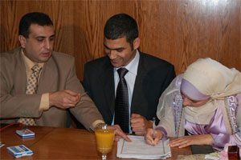
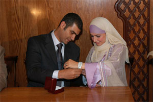
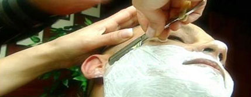
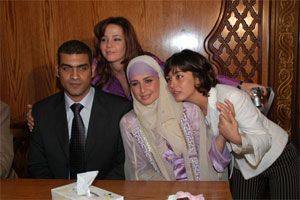

+++
title = "حلا شيحا.. يمين طلاق!!"
date = 2006-07-18

[taxonomies]
authors = []
sections = ["masr"]

[extra]
section_name = "ولاد البلد"
share_image = "/media/admins.20at.com/masr/7ala.jpg"
summary = "فهي بنت مصرية عقدت قرانها وظهرت أمام العالم كله تعلن حبها لشاب ارتبطت به، وللحجاب الذي ترتديه حق يجب أن تحافظ عليه أو تخلعه إلى الأبد.. إلى الأبد."
section_slug = "masr"
section_colour = "#666666"
thumb = "/media/admins.20at.com/masr/7ala.jpg"
n_comments = 8
original_url = "http://masr.20at.com:80/article.php?sid=671"
archived = "20070131042527"
date_source = "byline/meta"
aliases_20at = ["//masr.20at.com/article.php?sid=671"]

[extra.provenance]
original_url = "http://masr.20at.com:80/article.php?sid=671"
capture_url = "https://web.archive.org/web/20070131042527/http://masr.20at.com:80/article.php?sid=671"
capture_label = "٣١ يناير ٢٠٠٧، ٠٤:٢٥ UTC"
date_note = "من سطر التوقيع في المقال"
other_urls = []
comments = "٨"
missing_images = ""
+++

{{ <figure src="/media/admins.20at.com/masr/7ala.jpg" alt="" /> }}

فهي بنت مصرية عقدت قرانها وظهرت أمام العالم كله تعلن حبها لشاب ارتبطت به، وللحجاب الذي ترتديه حق يجب أن تحافظ عليه أو تخلعه إلى الأبد.. إلى الأبد.

18/07/2006

محمد عبد الرحمن – ولاد البلد:

ربما كانت خبر انفصال حلا شيحا عن زوجها المطرب هاني عادل قبل إتمام الزفاف مفاجأة للكثيرين لكنه لم يكن بأي حال من الأحوال صدمة لوالديها أحمد وناديا شيحا .

ويمكن القول باختصار أن حلا شيحا حالة خاصة في الوسط الفني المصري، خصوصاً السينمائي بالطبع حيث تم تصنيفها في فترة من الفترات كاحدي نجمات السينما في مرحلتها الحالية لكنها فقدت التصنيف سريعاً، وبدون أدني مجهود، لكن يمكن القول كذلك أن حلا ليست حالة فنية غريبة فقط لكنها أيضاً تعبر عن أزمة تعيشها نسبة غير قليلة من فتيات الطبقة العليا اللاتي ينقسمن بين حياة تربين عليها بكل ما فيها وبين الرغبة في الحفاظ على خصوصية شخصية يوفرها الحجاب والتدين بصفة عامة .

لهذا كله لم يكن غريباً أن توجه والدة الممثلة الشابة الكلام لابنتها بصوت واضح ومرتفع يوم عقد القران في فبراير الماضي لتقول لها "خلاص يا حلا ..مش هترجعي في كلامك " لكن حلا عادت بالفعل في كلامها بعد خمسة شهور بدعوى أن زوجها المنتظر اهتم بالشهرة أكثر منها حسبما ذكرت صحيفة الفجر والكلام لو كان صحيحاً فأنه يعني أن حلا لازالت تضحك على نفسها قبل أن تضحك على الآخرين وتفسير هذه العبارة يحتاج للعودة إلى الوراء على طريقة السينما.

<h3>فلاش باك</h3>

حلا شيحا هي كبرى بنات الفنان التشكيلي الدكتور أحمد شيحة، والدتها لبنانية، والأسرة بأكملها تتبع النموذج الغربي في الحياة، حتى أنهم يقيمون في منطقة الريف الأوربي، قبل 4 أعوام تقريباً، كانت حلا وهنا ومايا ورشا الشغل الشاغل للصحافة الفنية التي اهتمت بوجود 4 شقيقات دفعة واحدة لديهن مواهب فنية ورغبة في التمثيل، لكن سرعان ما تبقت حلا وهنا فقط وكانت لحلا الأولوية كونها حصلت على نجومية السينما بينما تعثرت هنا بسبب الزواج والإنجاب .

ثم كانت المفاجأة الأولى لحلا شيحا عندما أعلنت ارتداء الحجاب للمرة الأولى بعد ظهورها في فيلمي "اللمبي" و"سحر العيون" وتوالت الشائعات حول صدمة الأسرة من ذلك التصرف، ومحاولة الأب تحديداًَ غسل مخ أبنته والعودة بها للطريق الذي حددته العائلة من قبل، بينما كانت حلا قد أصابها الملل من حياة الشهرة وكان الحجاب على ما يبدو هو الحل، وهنا وقبل أن نكمل، لابد من الإشارة إلى ملاحظة عامة ترتبط بحلا شيحا تحديداً، فهي من البداية لا تملك الرغبة العارمة نحو الشهرة، بل هي أشهر ممثلة لا ترد على الاتصالات ولا توجد لديها خطة عمل محددة، بشكل يجعلنا نقول أنها دخلت هذا المجال رغماً عنها كما يبدو من كل ما يحدث .

المهم..عادت حلا مرة أخرى للتمثيل وكالعادة اهتمت الصحافة بشدة بعودتها، وطبيعي ان تقول أنها تحترم الحجاب لكنها لم تجد غضاضة في الجمع بين التدين والفن، وكانت عودتها قوية مع عادل إمام في " عريس من جهة أمنية" لكن كل من شاهد الفيلم خرج وهو يتذكر الكثير فيما عاد حلا، لتعود للاختباء مرة أخرى وتعتذر عن أكثر من فيلم، ثم تقبل العودة لفيلم محمد فؤاد الذي اعتذرت عنه، وهكذا، ليكون لها في موسم عيد الفطر الماضي فيلمين دفعة واحدة هما " غاوي حب" و" أريد خلعاً" وتظهر في العرض الخاص للفيلم الأخير وقد غطت شعرها، لكن دون حجاب، وبعدها بأسابيع يقال أن حلا تحجبت للمرة الثانية، حلا ستتزوج، حلا أجلت الزواج، حلا قرأت الفاتحة، حلا عقدت قرانها بالفعل.

<h3>فارس الأحلام</h3>

ارتباط حلا بهاني عادل تحديداً لم يكن مفاجأة، فقد نشرت الصحف أكثر من مرة أن حلا من المعجبات لفريق وسط البلد الغنائي وأنها تحضر كل حفلات الفريق، وإذا شاهدنا أعضاء الفريق على شاشة روتانا ضمن أغنيات فيلم "عودة الندلة" سنجد ان هاني هو الوحيد الصالح ليكون زوج الفنانة الجميلة.

هنا نتوقف عند القرار المركب لحلا، الذي ربما لم تجد هي له تفسيراً والذي يجعلنا نقول كما ذكرنا في البداية أن حجة الطلاق واهية وتعبرعن أن حلا لا تفهم ما تفعل حتى الآن، حلا قررت الآتي، ارتداء حجاب عصري يختلف عن حجابها الأول.

الاستمرار في التمثيل وبالفعل أنهت بطولة فيلم تم تعديل تفاصيله خصيصاً لها وظهرت في صورالاحتفال مع عامر منيب وعلا غانم، هي بالحجاب وعلا بالميني جيب وعامر بينهما، وقبل ذلك كان الارتباط بمطرب من فرقة غنائية لم تحصل على الشهرة إلا مؤخراً ومعظم حفلاتها بملهى ليلي بوسط البلد، ونحن هنا لا ندين الفرقة لكن لأعضائها بالتأكيد أسلوب حياة ربما أرادات حلا أن تجمع بينه وبين الحجاب والتمثيل والزواج في نفس الوقت.

وبعدما ظهرت مع خطيبها مراراً وتكراراً على شاشات التليفزيون، بعد عقد القران، وبدأت العروض تتوالى على المطرب الشاب، تأتي الآن لتقول أن الشهرة أخذته منها، بينما اللعبة هي الشهرة والأضواء من البداية.

بالتأكيد ليست حلا هي الأولى التي تفعل ذلك في حياتها الشخصية، لكن ما يمكن ان ننتقده هنا وننتقد الصحافة بخصوصه، أن الجمهور، أي نحن، له حق الحفاظ على وقته وأفكاره والصورة التي يشكلها عن الآخرين، فليس من المعقول أن تلهث الصحافة وراء ممثلة صاعدة لتقدمها كنجمة، ثم تلهث مرة أخرى وراء أخبارها بعد الحجاب الأول، ثم العودة، ثم الحجاب الثاني، ثم الزواج، ثم الكلام عن شقة الزوجية ذلك العش السعيد، ثم الطلاق وكل هذا يحدث دون وقفة للتفسير والتحليل وكأن المهم هو الاستهلاك وليس التفكير.

أما حلا فنحن نتمنى لها أن تتجاوب مع محاولات الصلح القائمة الآن بين الطرفين، فهي بنت مصرية عقدت قرانها وظهرت أمام العالم كله تعلن حبها لشاب ارتبطت به، وللحجاب الذي ترتديه حق يجب أن تحافظ عليه أو تخلعه إلى الأبد.. إلى الأبد.

<h3>شاهد صور عقد قران حلا</h3>

<figure></figure>

<figure></figure>

<figure></figure>

<figure></figure>

عدد التعليقات : <strong>269</strong>

