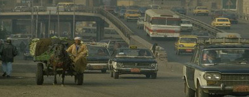

+++
title = "القاهرة تتحرك.. لنصرة لبنان"
date = 2006-07-21

[taxonomies]
authors = []
sections = ["masr"]

[extra]
section_name = "ولاد البلد"
share_image = "/media/admins.20at.com/masr/cairo1.jpg"
summary = "الأمن المصري يلغي مؤتمر لنقابة المحامين كان مزمع عقده في ميدان الشهيد عبد المنعم رياض بوسط القاهرة.. مسيرة أحزاب الظل تحركت من بير السلم لتتجه \"يادوب\" إلي مدخل "
section_slug = "masr"
section_colour = "#666666"
thumb = "/media/admins.20at.com/masr/cairo1.jpg"
n_comments = 25
original_url = "http://masr.20at.com:80/article.php?sid=675"
archived = "20060721141756"
date_source = "first-capture"
aliases_20at = ["//masr.20at.com/article.php?sid=675"]

[extra.provenance]
original_url = "http://masr.20at.com:80/article.php?sid=675"
capture_url = "https://web.archive.org/web/20060721141756/http://masr.20at.com:80/article.php?sid=675"
capture_label = "٢١ يوليو ٢٠٠٦، ١٤:١٧ UTC"
date_note = "تاريخ أول لقطة في الأرشيف (لا يوجد تاريخ في المقال)"
other_urls = []
comments = "٢٥"
missing_images = "٩"
+++

الأمن المصري يلغي مؤتمر لنقابة المحامين كان مزمع عقده في ميدان الشهيد عبد المنعم رياض بوسط القاهرة.. مسيرة أحزاب الظل تحركت من بير السلم لتتجه "يادوب" إلي مدخل العمارة.. الإخوان كعادتهم الأكثر..

كانت هذه هي أبرز مظاهر يوم ساخن في القارة كان مخصص

أحمد مصطفي – ياسر أبو العلا - ولاد البلد:

الأمن المصري يلغي مؤتمر لنقابة المحامين كان مزمع عقده في ميدان الشهيد عبد المنعم رياض بوسط القاهرة.. مسيرة أحزاب الظل تحركت من بير السلم لتتجه "يادوب" إلي مدخل العمارة.. الإخوان كعادتهم الأكثر..

كانت هذه هي أبرز مظاهر يوم ساخن في القارة كان مخصصا في أغلبه للتضامن مع لبنان ضد العدوان الإسرائيلي الغاشم في <a href="https://web.archive.org/web/20060721141756/http://www.harb.20at.com"> الحرب التي تدور بينهما </a>هناك.

<h3>الوزير معدي</h3>

في ميدان عبد المنعم رياض كانت جحافل الأمن المركزي منتشرة، كعادتها، بالزي الأسود وبمجرد وصولي لم أجد أي متظاهر فتوجهت بسؤال إلي احد الضباط برتبة نقيب فسألته أين المظاهرة!! فاخبرني أن هذه الآلاف رجال الأمن بسبب أن الوزير معدي.

تركته وعبرت الميدان إلي ناصية شارع محمود بسيوني ووقفت بجانب رجال فرق الكاراتيه وسألتهم عن المظاهرة ونظرا إلي أن الله أنعم علي بجسم يوحي بأني ضابط شرطة، والعياذ بالله، وارتدائي نظارة شمسية لونها داكن فوجدت أحد هؤلاء الشباب يقترب مني ويخبرني بلفظ "يا باشا" المظاهرة "جاية من ناحية الكوبري وإحنا مستعدين" فتركتهم كما تركت الضابط من قبل.

<h3>القائد.. فتاة!!</h3>

توجهت إلي أبراج "معروف" بشارع رمسيس ففوجئت بحوالي 40 متظاهر منهم رؤساء أحزاب "السلام الديمقراطي" و"الوفاق" و"الأحرار"، ومعهم جبهة شرفاء الغد يقودهم المهندس موسي مصطفي موسي. وأكد الجميع علي ضرورة وقف إطلاق النار ومبادلة الأسري اليهود بعدد من الأسري العرب في إسرائيل.

هتافات المظاهرة كانت تقودها فتاة في معظم الوقت، أما رؤساء ما أطلق عليها الأحزاب راحوا يبحثون عن مكان لا توجد فيه شمس ليسهبوا في أحاديثهم مع الفضائيات.

بادرت بالاتصال التليفوني مع سامح عاشور نقيب المحامين فأكد لي أن الأمن منع المؤتمر الذي كان من المقرر عقده بميدان عبد المنعم رياض، وأعلن عن عقد مؤتمر حاشد الاثنين القادم.

وقال في تصريح خاص لـ"ولاد البلد": "أن لجنة تلقي طلبات الجهاد لنصرة لبنان قد وصلها حتى الآن 50 طلب معظمهم من شباب، رفض الإفصاح عن أسماءهم أو الخطوات القادمة.

<h3>الاخوان.. قادمون</h3>

في الساعة السادسة توافد علي شارع عبد الخالق ثروت جموع متظاهرة عرفت من هتافاتهم أنهم أعضاء جماعة الإخوان المسلمين والذين راحوا يرددوا هتافات مثل "الله.. الله.. الله.. تسلم أيدك يا نصر الله" و"يا نصر الله يا حبيب.. فجر دمر تل أبيب" و"أول مطلب للجماهير.. قفل سفارة وطرد سفير"

وهذه المظاهرة هي أول مظاهرة حاشدة ينظمها الإخوان في هذا الشأن، وأكد الإخوانمن أمام نقابة الصحفيين رفضهم القاطع لدعاوى الاستسلام التي تتردد في بعض وسائل الإعلام العربية معلنين دعم الشعب المصري غير المحدود للمجاهدين في لبنان وفلسطين.

وردد المتظاهرون الهتافات المؤيدة لخيار المقاومة "أبدا أبدا مش هنلين.. إحنا معاكى يا فلسطين"، و"ابني في الجدار وعلى.. بكرة نشيله ومش هنخلي"،و"اليهود.. اليهود.. قتلوا إخوانا على الحدود"، و"أدي الحل أهو جاى من الضفة.. الصهيوني لازم يتصفى"، و"يا حماس شدي الحيل.. خلى ليلهم يبقى طويل"،

وأعلن المتظاهرون عن ضجرهم من الخنوع العربي المستمر بهتافات مثل "يا حكامنا كفاية إهانة.. حطوا بلادنا في الزنزانة"، وأنتي فينك يا شعوب.. حرقوا إخوانا في الجنوب"، و"ليه ساكتين.. ليه ساكتين.. قتلوا إخوانا في فلسطين".

وجاء ذلك وسط حراسة أمنية مشددة انتقدها جمال تاج الدين عضو مجلس نقابة المحامين الذي أشار إلى أن كافة دول العالم تتمكن شعوبها من إعلان دعمها للشعبين اللبناني والفلسطيني في حين يضيق على الشعب المصري في الإعلان عن هذا الدعم، لافتا إلى أهمية دعم المقاومة في البلدين وعد تركهم أمام الصهاينة بمفردهم دون ظهير.

في حين أشار الدكتور جمال نصار، أحد القيادات الشابة للإخوان، إلى أن الأمل يتركز الآن في الشعوب لتقديم الدعم للمقاومين بعد أن فقدت الأمة الأمل في تحرك حكامها، مطالبا بوقفة جادة للشعوب مع حكامها للتحرك لإنقاذ الشعبين من العدوان الصهيوني الغاشم.

وشاركت القوي الوطنية في الوقفة التضامنية لنصرة الشعبين اللبناني والفلسطيني التي تم خلالها حرق العلم الإسرائيلي، ومن ناحية أخري أعلن جورج إسحاق المنسق العام للحركة المصرية من اجل التغيير كفاية عن تنظيم 26 مظاهرة في جميع محافظات مصر يوم الجمعة القادم في وقت واحد تضامننا مع الشعب اللبناني وبالطبع لم تنسي المظاهرات أن تطالب بإطلاق سراح جميع المعتقلين في السجون المصرية.. والإسرائيلية.

<h3>شاهد صور المظاهرة</h3>

<figure></figure>

عدد التعليقات : <strong>28</strong>

