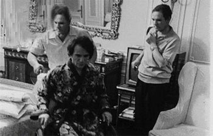
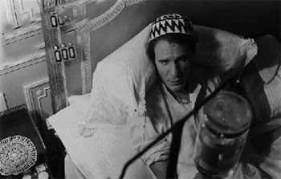
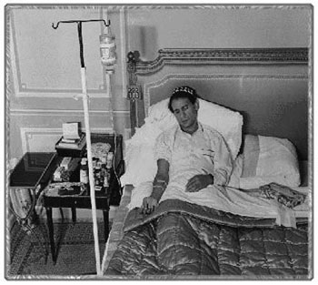
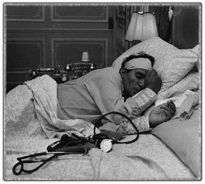

+++
title = "\"حليم\" فيلم لـ\"شريف عرفة\"!!"
date = 2006-07-26

[taxonomies]
authors = []
sections = ["masr"]

[extra]
section_name = "ولاد البلد"
share_image = "/media/admins.20at.com/masr/7alem.jpg"
summary = "وإن وجد الراحل عبد الحليم حافظ من يقدم له سيرة الذاتية في عمل سينمائي، فقد لا يجد أحمد زكى من يستطيع أن يقدم حياته، ولكنه سيظل في ذاكرتنا فنان عظيم قدم الكثير م"
section_slug = "masr"
section_colour = "#666666"
thumb = "/media/admins.20at.com/masr/7alem.jpg"
n_comments = 0
original_url = "http://masr.20at.com:80/article.php?sid=712"
archived = "20070424004556"
date_source = "byline/meta"
aliases_20at = ["//masr.20at.com/article.php?sid=712"]

[extra.provenance]
original_url = "http://masr.20at.com:80/article.php?sid=712"
capture_url = "https://web.archive.org/web/20070424004556/http://masr.20at.com:80/article.php?sid=712"
capture_label = "٢٤ أبريل ٢٠٠٧، ٠٠:٤٥ UTC"
date_note = "من سطر التوقيع في المقال"
other_urls = []
comments = ""
missing_images = ""
+++

{{ <figure src="/media/admins.20at.com/masr/7alem.jpg" alt="" /> }}

وإن وجد الراحل عبد الحليم حافظ من يقدم له سيرة الذاتية في عمل سينمائي، فقد لا يجد أحمد زكى من يستطيع أن يقدم حياته، ولكنه سيظل في ذاكرتنا فنان عظيم قدم الكثير من أجل الفن ومن أجل أن يمتعنا

26/07/2006

كريم الشناوي – ولاد البلد:

عندما شاهدت فيلم "ناصر 56" في السينما كان عمري وقتها 10 سنوات، لم أكن اعلم من يكون "احمد زكي"، ولم تكن معلوماتي عن "جمال عبد الناصر" تتجاوز ما يكتب في مناهجنا الدراسية الرائعة، وأنه أول- وليس ثاني ـ رؤساء مصر.!!

وبعد دخولي الفيلم ولفترة طويلة ظلت صورة "جمال عبد الناصر" لدي هي صورته في الفيلم، فكنت عندما أستمع إلى أي شيء عن جمال عبد الناصر تتهيأ في ذهني صورة "احمد زكي".. نفس الأمر حدث مع"السادات" بعد ذلك..

حتى أن هذا الارتباط الذهني بين الشخصيات التي يقدمها الراحل "احمد زكي" والواقع أمتد ليصبح ضابط أمن الدولة بالنسبة لي هو أحمد زكى في "زوجة رجل مهم"، والرجل المظلوم المطارد من الشرطة هو أحمد زكى في فيلم الهروب، إلى غير ذلك من الشخصيات التي امتدت من البواب إلى الوزير.

إلا أن هذا التوحد بين أحمد زكى و حليم لم يكن بنفس الدرجة هذه المرة.. و هذا الكلام ليس نقدًا سلبيا للفيلم بقدر ما هو حالة سيطرت على أثناء مشاهدته، فهذا هو أخر أفلام أحمد زكى، وهى الحقيقة التي طالما ذكرت نفسي بها في كل مشهد أراه فيه.

ولعل التشابه الكبير بين حياة النجمين هو ما جعلني أتمادى في هذه الحالة التي جعلتني استمتع و أتأثر بهذا الفيلم و بأخر مشاهد العظيم أحمد زكى في السينما.

<h3>مجموعة من.. الفلاشات!!</h3>

الفيلم لا يحكى حياة عبد الحليم مسلسلة، بل يحكى لقطات من هذه الحياة بشكل "فلاشات" يتذكرها حليم ومن حوله أثناء الفيلم. فالفيلم يبدأ بسقوط حليم بعد إحدى الحفلات ودخوله المستشفى، و هنا تبدأ أحداث الفيلم في السير من خلال ثلاثة خطوط متوازية.. الأول هو عبد الحليم نفسه وهو في المستشفى وما يتذكره وهو على سريره من مواقف جمعته مع زواره ومنهم صلاح جاهين "بهاء جاهين"...

أما الخط الثاني فهو حديث إذاعي مع حليم وكان يذاع في نفس ليلة وجود حليم في المستشفى ومن خلاله كان هناك استعراضا بانوراميا لحياة حليم وخصوصا الفنية، أما الخط الثالث فهو خط منى زكى و هي الفتاه التي يعطف عليها عبد الحليم ويساعدها في نفقات تعليمها، وهى من جانبها تحبه وتعتقد أنه يحبها.

و تذهب إلى منزل حليم بعد عدم تمكنها من دخول المستشفى التي يرقد بها حليم، وذلك لتطلب من مدير أعماله أن يساعدها في الدخول للمستشفى للاطمئنان عليه، ولكنه يخبرها بأن الزيارة ممنوعة ويتركها في المنزل ليبدأ الخط الثالث للفيلم داخل منزل حليم نفسه.

و قد سارت الخطوط الثلاثة بشكل متوازي إلى أن اجتمعت مع سفر حليم الأخير إلى لندن. وقد رأى البعض أن الفيلم بهذا الأسلوب جاء مفككا ومباشرا وأن اختيار هذا الأسلوب أضر بالعمل نفسه، و أن وفاة أحمد زكى أربكت ترتيبات الفيلم وجعلته يظهر بهذا الشكل، ولكنني أعتقد أن الفيلم لو خرج بنفس الشكل قبل وفاة أحمد زكى، لما خرجت هذه الانتقادات على اعتبار أن هذا هو الأسلوب المستخدم للفيلم!!.

<h3>احمد زكى..</h3>

في أخر أفلامه جاء أداء أحمد زكى طبيعيا جدا، فإحساسه العالي غمر كل جزء من أجزاء العمل، والتفاصيل الدقيقة والبسيطة التي أعتدنا أن نراها من أحمد زكى لم يتخل عنها، رغم مرضه، هذه المرة أيضا، بالعكس فقد أهتم بأبسط التفاصيل.. التدرج والتنقل بين الحالات المختلفة من فرح وحزن وخوف وغضب جاء بتمكن وتلقائية شديدين، حتى أن نظراته و تعبيراته في مشهد الحفل الأخير والمشهد الأخير له في الفيلم من المشاهد التي يصعب نسيانها، و كأنه يلقى علينا نظرة الوداع الأخير.

أما هيثم زكى فقد وضع في موقف صعب، فهو من جانب يقف للمرة الأولى أمام الكاميرا، و من جانب أخر يمثل مشاهد يقارن الجميع بين أداءه و أداء والده إن كان مثلها، مهما قيل من أن هذه هي خطة العمل العادية.

ولعل المقارنة بينه و بين والده تبدو ظالمة جدا ، وهو وإن لم يترك بصمة قوية في أداءه، إلا أنه في الوقت نفسه لم يكن سيئا، بل أن أداءه كان جيدا و لكن لا يرقى إلى الامتياز وهى نقطة نسبيه، فقد يراه البعض متميزا جدا.. وقد لا يُعجب البعض الأخر به على الإطلاق ، مثلما حدث مع محمد إمام في عمارة يعقوبيان.. المهم أن الأيام القادمة قد تحمل لنا أعمال أكثر نضوجا من حيث الأداء بالنسبة لهيثم زكى الذي، وبالتأكيد أكتسب قدرا كبيرا من الخبرة خلال هذا العمل.

كما أدت كل من منى زكى وسلاف فواخرجى "الفتاة الأرستقراطية التي أحبها عبد الحليم" دوريهما بشكل جيد، إلا إنهما أيضا لم تلفتا الانتباه بشكل كبير ربما لكثرة العناصر المبهرة في الفيلم، فتاها وسط هذه العناصر. كذلك جاء أداء جمال سليمان "مذيع الإذاعة" ثابتا واثقا وأعتقد أنه سيدخل سوق السينما المصرية بقوه بعد هذا الدور رغم حجمه الصغير، فهو ممثل متمكن وذو إمكانيات عالية.

إلا أن مفاجأة الفيلم من ناحية التمثيل كان عزت أبو عوف، و الذي قام بدور الموسيقار محمد عبد الوهاب، و لعل هذه هي المرة الأولى التي أرى فيها عزت أبو عوف يؤدى دورا بهذا الإتقان، بغض النظر عما قد يتهم به البعض هذه الشخصية في الفيلم بالكاريكاتورية، وقد ظهر هذا التطور و الإتقان في الأداء من خلال اهتمامه بكل تفاصيل الشخصية.

وذلك بعد فتره من الأعمال التي لم يخرج أداءه بها عن بعض الصوت العالي والأداء المتكرر وربما يكون هذا الدور نقلة جديدة بالنسبة لعزت أبو عوف، قد تتأكد أو تزول مع دوره القادم في فيلم "واحد من الناس" مع كريم عبد العزيز.

<h3>الرجل.. الأول</h3>

شريف عرفه هو رجل الفيلم الأول، فتأثيره ظهر بقوة و وضوح في كل جزئية منه، فقد استطاع أن يخلق شخصية مميزة للفيلم سواء من خلال الصورة أو المونتاج أو الموسيقى، ويظهر ذلك من أول لقطات الفيلم، حيث عاد بنا سريعا إلى أجواء ما بين الخمسينات والسبعينات،و قد كان كل شيء في الصورة يعكس هذه المرحلة.

أما من ناحية التصوير فقد أستعمل شريف عرفة وأيمن أبو المكارم "مدير التصوير" الزوايا المتعددة والكاميرا المضطربة من خلال عدم ثبات الكادر سواء بتحريك جسم الكاميرا أو الزووم، و يظهر هذا الأسلوب بوضوح وكثرة في الفيلم ليصبح سمة مميزة للتصوير فيه. وخصوصا في بداية الفيلم أثناء الحفل، وذلك لإثارة الجمهور وجذب انتباهه والمساهمة في إسراع الإيقاع.

وهذا الأسلوب لجأ إليه الكثير من المخرجين العالميين في الفترة الأخيرة منهم "ستيفن سبيلبيرج" في فيلمه الأخير "ميونخ" مما يدل علي أن هذا الأسلوب يمثل اتجاها جديدا في السينما يحاول كسر القواعد الخاصة بالصورة السينمائية في محاولة التجديد وخلق صورة مختلفة.

أما إضاءة الفيلم فكانت جيدة كثر فيها استخدام طبقات الإضاءة المنخفضة والمتوسطة مع مساحات كبيرة من الظلال، إلا أن هناك بعض المشاهد كان من الممكن أن تضاء بشكل أفضل وخصوصا المشاهد التي تضمنت أماكن تصوير كبيرة كمشهد حفل حديقة الأندلس .

كما ساهم المونتاج بشكل كبير في تحقيق رؤية المخرج للفيلم، وكان عنصرا مميزا في الفيلم خصوصا إذا وضعنا في الاعتبار أن تدخل عمليات تصحيح الألوان والفلاتر على الصورة لتبدو متفاوتة في القدم بين أوقات و ظروف مختلفة ضمن عملية المونتاج، و يوضح ذلك أيضا سبب التكلفة الإنتاجية العالية للفيلم، وقد جاء المونتاج في بعض مشاهد الفيلم كمشاهد الليلة الأخيرة لحليم في لندن على مستوى عالمي فعلا.

<h3>مشاهد.. تركيب!!</h3>

علي الرغم من ذلك إلا أن هناك بعض المشاهد التي تم تركيب صورة هيثم زكى بها على أغاني عبد الحليم في الأفلام ليظهر مع شادية وغيرها، والواقع أن هذه المشاهد لم تعجب الكثيرين ولم تحدث التأثير المطلوب على المشاهدين، كذلك كان هناك فارقا بسيطا بين لقطات الأبيض والأسود التي تم تصويرها حديثا، و لقطات الأبيض و الأسود الأرشيفية والتي تم الاستعانة بها في الفيلم وهذا الفارق كان من الممكن تجنبه خصوصا مع كل المجهود المبذول فى الفيلم.

كما أن من أهم الملحوظات على الفيلم طول فترة عرض بعض الأغاني الوطنية في منتصف الفيلم تقريبا ما أصاب إيقاع الفيلم ببطء ورتابة كان من الممكن أن تقضى على انتباه المشاهدين، إلا انه سرعان ما زاد إيقاع الفيلم مره أخرى بعد هذا الجزء، وكان من الممكن الاستعاضة عن هذا الجزء الطويل بأجزاء أقصر من الأغاني، دون أن يؤثر ذلك على الغرض من استخدامها .

كما كان استخدام الموسيقى كثيفا في هذا الفيلم، و هو أمر يبدو مقبولا جدا في هذا الفيلم، عكس بعض الأفلام الأخرى، خصوصا عندما يتعلق الفيلم بعبد الحليم حافظ. والحقيقة أن الموسيقار عمار الشريعي لم يطل علينا بهذا الإشراق والتجدد منذ فترة طويلة. وقد صرح الشريعي في أكثر من لقاء أن هذه الموسيقى جزء من روحه وأنها هديته لصديقه أحمد زكى.

و قد ظهر ذلك بالفيلم، وجاء عزف أوركسترا لندن ليضيف إليها الكثير، فجاءت جملها قوية ومؤثرة، و ازدادت قوة عند وضعها على شريط الصوت للفيلم لتصاحب مشاهده المختلفة.. كما استخدم الشريعي في موسيقاه بعض الجمل الموسيقية لأغاني عبد الحليم مع إعادة توزيعها، فكانت حلقة ربط جميلة بين موسيقى الشريعي وأغاني حليم التي استخدمت في الفيلم.

وإذا كان حليم هو فيلم الوداع ونهاية المشوار للكبير الراحل أحمد زكى، فهو خطوة كبيرة في مشوار البعض الأخر ومنهم هيثم زكى و سلاف فواخرجى وجمال سليمان، وهو تأكيد لقدرة وتمكن شريف عرفة وقدرته على تقديم أعمال ضخمه. وإن وجد الراحل عبد الحليم حافظ من يقدم له سيرة الذاتية في عمل سينمائي، فقد لا يجد أحمد زكى من يستطيع أن يقدم حياته، ولكنه سيظل في ذاكرتنا فنان عظيم قدم الكثير من أجل الفن ومن أجل أن يمتعنا.

<h3>شاهد صور نادرة لعبد الحليم علي فراش المرض وقارنها بأداء أحمد ذكي عندما ترى الفيلم</h3>

<figure></figure>

<figure></figure>

<figure></figure>

<figure></figure>

عدد التعليقات : <strong>176</strong>

