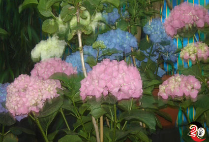

+++
title = "صباح الخير .. ع الورد"
date = 2006-03-26

[taxonomies]
authors = []
sections = ["masr"]

[extra]
section_name = "ولاد البلد"
share_image = "/media/masr.20at.com/images/galleries/ward-gallery/6.jpg"
summary = "إذا كنت مواطنا بمصر المحروسة، و تربيت على مبدأ أنك لا تملك من مصيرك إلا فردة شراب، وأنه لا مفر من أن تبنى قصورا في الهوا و تنحت مش في الصخر بس ولكن في الطين وال"
section_slug = "masr"
section_colour = "#666666"
thumb = "/media/masr.20at.com/images/galleries/ward-gallery/6.jpg"
n_comments = 0
original_url = "http://masr.20at.com:80/article.php?sid=77&PHPSESSID=b21753af24e3fec8c8003677058e91e3"
archived = "20070426031708"
date_source = "byline/meta"
aliases_20at = ["//masr.20at.com/article.php?sid=77"]

[extra.provenance]
original_url = "http://masr.20at.com:80/article.php?sid=77&PHPSESSID=b21753af24e3fec8c8003677058e91e3"
capture_url = "https://web.archive.org/web/20070426031708/http://masr.20at.com:80/article.php?sid=77&PHPSESSID=b21753af24e3fec8c8003677058e91e3"
capture_label = "٢٦ أبريل ٢٠٠٧، ٠٣:١٧ UTC"
date_note = "من سطر التوقيع في المقال"
other_urls = []
comments = ""
missing_images = "١٥"
+++

إذا كنت مواطنا بمصر المحروسة، و تربيت على مبدأ أنك لا تملك من مصيرك إلا فردة شراب، وأنه لا مفر من أن تبنى قصورا في الهوا و تنحت مش في الصخر بس ولكن في الطين والتراب.

وإن كنت تعبان من كلام عزيز صدقي" أبو الاقتصاد المصري الحديث زى ما بيقولوا"

26/03/2006

منى سليم ـ ولاد البلد

إذا كنت مواطنا بمصر المحروسة، و تربيت على مبدأ أنك لا تملك من مصيرك إلا فردة شراب، وأنه لا مفر من أن تبنى قصورا في الهوا و تنحت مش في الصخر بس ولكن في الطين والتراب.

وإن كنت تعبان من كلام عزيز صدقي" أبو الاقتصاد المصري الحديث زى ما بيقولوا" عن الاقتصاد المخطط، وفقدت الأمل في صناعة الحديد والصلب والنووي والتكنولوجيا والطائرات.

ولا تجد حلا لك أنت وأهلك وبلدك وقطعت كل ما في منزلكم من شهادات وكراسات مليئة بالطموحات .. اختصر الطريق مثلهم واسمع كلام الحكومة وازرع قدام بيتك..( وردة).

ذلك المشروع الذي عالج به كثير من الشباب أحلامهم، واستطاعوا من أرباحه أن يفتحوا بيوتا و يتزوجوا، وهو أيضا المشروع الذي بدأت الحكومة بشكل مثير وغريب الاهتمام الزائد به خلا ل الأعوام الثلاث الماضية.

ففي افتتاح المعرض السنوي للزهور في حديقة الأورمان قال وزير الزراعة واستصلاح الأراضي أمين أباظة أن صناعة الزهور ونباتات الزينة أصبحت الأولى في قائمة صادرات الحاصلات الزراعية المصرية، وأنها سجلت ارتفاع من‏890‏ طنا ‏ بقيمة‏157‏ مليون دولار عام 2004 إلى 0‏30‏ مليون دولار هذا العام .. وإن صدقت الأرقام فهذا يعنى أن صناعة الزهور تقترب بصورة وردية من الدخل السنوي لقناة السويس.

لاحظت الحكومة الصحوة الوردية، وسيراً على نهج التعلم من اللي أكبر منا بدأت وزارة التجارة الخارجية منذ ثلاث سنوات الماضية برنامج مساعدة مع الصين يعيد إلى حد ما تجربتها وقد أصبحت من أشهر ثلاث دول في المجال ولديها ما يزيد عن 20 ألف محل بيع للزهور في أرجاء البلاد و يعمل بها أكثر من مليوني شخص.

وعد الوزير بكثير من الوعود التي تجعلك تضغط على نفسك وتقول هل تنجح الحكومة ولو مرة في إنقاذ أي جبهة ، ولكن لا تلبث وتتخوف من أن يكون التدخل الحكومي أشبه بمن يفتى بلا كتاب أو سنة.

فقد قال الوزير أن الحكومة تنوى توفير مزيد من الفرص للشباب في هذا المجال الغير تقليدي وستمنحهم قروضا على مد خمس سنوات وأنها ستسعى لاجتذاب المزيد من الاستثمارات الأجنبية في هذا المجال، وتحدث أيضاً على ضرورة أن تلعب مراكز البحوث التابعة للوزارة دورا أساسيا في الفترة القادمة لإنعاش هذه الصناعة.

انتهى حفل الافتتاح واستطاعت رائحة الزهور أن تطغى على أي تصريح مهما كان وردى، الموردين لم يعلقوا كثيراً على الوعود الحكومية ولم يتخوفوا منها أيضاً واكتفوا بتوضيح أهم المشكلات التي تواجههم.

ركز المهندس سامي الفار صاحب أحد الشركات الموردة للزهور على أن السوق العالمي يحتاج مواصفات خاصة في النقل والشحن وهو ما لا تستطيع الجهود الذاتية مهما بلغت قيمتها توفيره فالأمر يحتاج لتدخل حكومي وتبقى شهادة ضمان الجودة التي نستخرجها من وزارة الزراعة قبل كل شحن أمر في غاية الصعوبة والروتينية التي تؤثر على سوق الورود.

ومن ناحية أكاديمية تحسر الباحثين كما هو معتاد على الفجوة الواسعة بين دراساتهم والنتائج على أرض الواقع، فيقول د.صلاح عيد العزيز من معهد البساتين أن الزهور قادرة على تسجيل رقم إيرادات مواز لكل الصادرات الزراعية الأخرى مجتمعة، ولكن هذا لن يحدث طالما نعد دراسات لا تعرف للهواء والماء طريقا، يمكن فنحن بعيدين عن الصورة وكأننا والمنتجين كل منا يعمل في مهنة مختلفة.

قال أيضاً أن تاريخ هذه الصناعة كان مميزا دائما ولكن نتيجة الإهمال متعدد الجوانب تراجعت وعادت إلى رونقها منذ أقل من عشر سنوات نتيجة جهود المشاريع الفردية والتي كانت أغلبها نتيجة تجمعات شبابية، وأصبح للشركات المصرية اسماً في بورصة الزهور بهولندا.

ربنا يستر، ولا نخذل الزهور وتنرك لها الفرصة حتى تنقذنا .. شاهد معنا لقطات من مهرجان الورد.

<figure></figure>

عدد التعليقات : <strong>80</strong>

