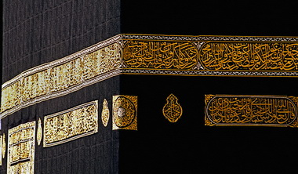

+++
title = "كسوة الكعبة.. لسه في الخرنفش!"
date = 2008-12-07
authors = ["علياء أبوشهبة"]
aliases = ["/articles/masr-n18767/", "/articles/masr-places-of-egypt-10697/"]

[taxonomies]
authors = ["alia-aboshhba"]
sections = ["masr"]

[extra]
section_name = "ولاد البلد"
share_image = "/media/masr.20at.com/currentarticleassets/kaaba-1.jpg"
summary = "تشرفت مصر لعقود طويلة بصناعة كسوة الكعبة المشرفة في \"دار الكسوة\" بحي \"الخرنفش\"، حيث كانت تصنع من الحرير المنقوش عليه آيات من القرآن الكريم، وظل \"المحمل\" يجوب شو"
section_slug = "masr"
section_colour = "#666666"
thumb = "/media/masr.20at.com/currentarticleassets/kaaba-1.jpg"
n_comments = 8
original_url = "http://20at.com/masr/places-of-egypt/10697-2009-06-09-20-39-07.html"
archived = "20100105143030"
date_source = "byline/meta"
aliases_20at = ["//masr.20at.com/newarticle.php?sid=18767", "/masr/7eta-mn-baladi/10697-2009-06-09-20-39-07.html", "/masr/places-of-egypt/10697-2009-06-09-20-39-07.html"]

[extra.provenance]
original_url = "http://20at.com/masr/places-of-egypt/10697-2009-06-09-20-39-07.html"
capture_url = "https://web.archive.org/web/20100105143030/http://20at.com/masr/places-of-egypt/10697-2009-06-09-20-39-07.html"
capture_label = "٥ يناير ٢٠١٠، ١٤:٣٠ UTC"
date_note = "من سطر التوقيع في المقال"
other_urls = ["//masr.20at.com/newarticle.php?sid=18767", "/masr/places-of-egypt/10697-2009-06-09-20-39-07.html"]
comments = "٨"
missing_images = "٢"
+++

<figure></figure>

تشرفت مصر لعقود طويلة بصناعة كسوة الكعبة المشرفة في "دار الكسوة" بحي "الخرنفش"، حيث كانت تصنع من الحرير المنقوش عليه آيات من القرآن الكريم، وظل "المحمل" يجوب شوارع المحروسة حاملا الكسوة منذ عهد الملكة شجرة الدر مرورا بعهد المماليك وحتى بداية عهد جمال عبد الناصر، ولا زالت دار الكسوة تحتفظ بأخر كسوة صنعت للكعبة المشرفة وحتى اليوم.

عن تاريخ صناعة الكسوة في مصر وارتباطها منذ عام 1233 ميلاديا يحدثنا د.محمد نصر، أستاذ التاريخ الإسلامي بكلية الآداب جامعة عين شمس، قائلا: "ارتبطت مصر بصناعة كسوة الكعبة مع بداية عهد الدولة الفاطمية حيث اهتم الحكام الفاطميين بإرسال الكسوة كل عام من مصر، وكانت بيضاء اللون، وفي عهد الظاهر بيبرس أيضا كانت الكسوة ترسل من مصر، فقد كان المماليك يرون أن إرسالها شرفاً كبيراً لا يجب أن ينازعهم فيه أحد حتى ولو وصل الأمر إلى القتال".

<h3 class="center">الملك المجاهد</h3>

ويكمل مؤكدا على أن الأمر كاد أن يصل للقتال بالفعل في عام 751 هجرية وذلك في الرواية التاريخية المعروفة لملك اليمن "المجاهد" الذي أراد أن ينزع كسوة الكعبة المصرية ليكسوها كسوة من اليمن، فلما علم بذلك أمير مكة أخبر الملك الصالح إسماعيل.

ويضيف بأن محاولات نيل هذا الشرف استمرت بعدها فقد تنازع عليها من قبل الفرس وأهل العراق ولكن سلاطين المماليك تمسكوا بهذا الشرف، و هو ما دفع الملك الصالح إسماعيل تخصيص وقفا خاصا لكسوة الكعبة الخارجية مرة كل عام، وكان هذا الوقف عبارة عن قريتين من قرى القليوبية هما بسوس وأبو الغيث، وظل هذا النظام قائما حتى عهد السلطان العثماني سليمان القانوني، حيث أضاف له سبع قري أخرى وذلك للوفاء بالتزامات الكسوة، وظلت كسوة الكعبة ترسل بانتظام من مصر بصورة سنوية ويحملها أمير الحج قائد قافلة الحج المصري.

وبانتهاء عصر السلطان سليمان القانوني لم تتوقف عملية إرسال الكسوة حيث حرص كل سلطان تولى عرش الدولة العثمانية على إهداء كسوة جديدة للكعبة المشرفة، فظلت ترسل بانتظام من مصر بصورة سنوية.

<h3 class="center">سر هودج شجرة الدر</h3>

الأمر الطريف كما يؤكد د. محمد نصر أن المحمل أو موكب الكسوة ربطته بعض السير الشعبية الغير موثقه بعهد سلطانة مصر "شجرة الدر" أخر حكام الدولة الأيوبية، إذ قيل إنها سافرت لأداء مناسك الحج في هودج على ظهر جمل مع قافلة الحجاج، وزينته بخمائل الحرير والتطريز البديع ورصعته بالأحجار الكريمة، وحملت معها الهدايا والستائر للكعبة والحجرة الشريفة، ولكن هذه السير ليس لها أي سند تاريخي.

كما يشير إلى أن إرسال كسوة الكعبة تأثر بما حدث في مصر من أحداث سياسية فمع قدوم الحملة الفرنسية حرص نابليون بونابرت وقادة حملته على التقرب من المصريين من خلال الاحترام والمشاركة في الاحتفالات الدينية، وخاصة عند الاحتفال بموكب الحج وخروج المحمل ناقلا الكسوة الشريفة إلى مكة المكرمة.

وقد التزم نابليون بإعداد وتجهيز جميع لوازم الحج، فأمر بإعداد كسوة الكعبة وصناعتها في بيت مصطفى بك أمير الحج بدلا من قصر يوسف بالقلعة، كما كتب إلى الشريف غالب بن مساعد أمير مكة يخبره بهذا التغيير طالبا منه حماية الموكب والحجيج من أي اعتداءات .

يضيف د. محمد قائلا: "ولكن إرسال الكسوة توقف في عهد محمد علي باشا عام 1222هجريا بعد الصدام الذي حدث بين الوهابيين وقافلة الحج المصرية في الأراضي الحجازية، ولكن أعادت مصر إرسال الكسوة مرة أخري بعد ست سنوات".

واستمر الوضع على ما هو عليه حتى قيام ثورة يوليو، فانشغلت الحكومة عن المحمل ولكنها استمرت في إرسال كسوة الكعبة حتى ظهر الطفرة النفطية بالسعودية وتم بناء مصنع كسوة الكعبة وتوقفت صناعة الكسوة في مصر.

<h3 class="center">دار الخرنفش</h3>

الفنان خضير البورسعيدي، فنان الخط العربي الذي حظي بشرف المشاركة في تصنيع أخر كسوة للكعبة أرسلتها مصر في الستينات، يقول: "طافت صناعة كسوة الكعبة المشرفة بالعديد من الأماكن التي نالت هذا الشرف ومنها دمياط والإسكندرية والقلعة، حتى استقرت بحي الخرنفش بالقاهرة حيث يقع مبنى دار الكسوة عند تقاطع شارعي بين السورين وميدان باب الشعرية، والتي ما زالت قائمة حتى الآن وتحتفظ بآخر كسوة صنعت للكعبة المشرفة داخلها، واستمر العمل في دار الخرنفش حتى عام 1962م إذ توقفت مصر عن إرسال كسوة الكعبة لما تولت المملكة العربية السعودية شرف صناعتها".

يكمل قائلا: "كان لتسليم الكسوة طقوس خاصة وفرحة لا توصف، وذلك من خلال المحمل وهو الموكب الذي كان يخرج كل عام ليطوف الشوارع قبل الخروج إلى الحجاز وكان يصاحب جولته العديد من الاحتفاليات والرقص بالخيول".

ويستطرد في وصف موكب المحمل ويقول: "كان عبارة عن جمل يحمل المحمل ويمر في شوارع القاهرة وخلفه الجمال التي تحمل المياه وأمتعة الحجاج وخلفهم رجال الطرق الصوفية الذين يدقون الطبل ويرفعون الرايات، أما المحمل نفسه فكان عبارة عن هودج فارغ، أما الكسوة نفسها فكانت توضع في صناديق مغلقة وتحملها الجمال".

وبعد الحج كان المحمل يعود حاملا الكسوة القديمة للكعبة بعد استبدالها بالكسوة الجديدة وتقطيعها إلى قطع وتوزع على النبلاء والأمراء وبعضها مازال موجودا في قبور العائلة الملكية في مصر حيث زينوا بها أضرحتهم كنوع من التبرك.

