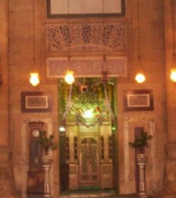

+++
title = "أحلامهم .. على أستار (أبو شباك)"
date = 2009-02-01
authors = ["مروة مظلوم"]
aliases = ["/articles/masr-places-of-egypt-11148/"]

[taxonomies]
authors = ["marwa-mazlom"]
sections = ["masr"]

[extra]
section_name = "ولاد البلد"
share_image = "/media/masr.20at.com/currentarticleassets/103_0094.jpg"
summary = "وقفت على أعتابه تغرق وجهها الدموع .. تناجيه \"يا حبيبي يا أبو الكرامات\" .. ثم بدأت بالهمس.. تلاه لصق وجهها بأخشاب الضريح المصنوعة من الصندل والأبنوس الذي تفوح من"
section_slug = "masr"
section_colour = "#666666"
thumb = "/media/masr.20at.com/currentarticleassets/103_0094.jpg"
n_comments = 2
original_url = "http://20at.com/masr/places-of-egypt/11148-2009-06-09-19-38-56.html"
archived = "20100105143054"
date_source = "byline/meta"
aliases_20at = ["/masr/7eta-mn-baladi/11148-2009-06-09-19-38-56.html", "/masr/places-of-egypt/11148-2009-06-09-19-38-56.html"]

[extra.provenance]
original_url = "http://20at.com/masr/places-of-egypt/11148-2009-06-09-19-38-56.html"
capture_url = "https://web.archive.org/web/20100105143054/http://20at.com/masr/places-of-egypt/11148-2009-06-09-19-38-56.html"
capture_label = "٥ يناير ٢٠١٠، ١٤:٣٠ UTC"
date_note = "من سطر التوقيع في المقال"
other_urls = ["/masr/places-of-egypt/11148-2009-06-09-19-38-56.html"]
comments = "٢"
missing_images = ""
+++

<figure></figure>

وقفت على أعتابه تغرق وجهها الدموع .. تناجيه "يا حبيبي يا أبو الكرامات" .. ثم بدأت بالهمس.. تلاه لصق وجهها بأخشاب الضريح المصنوعة من الصندل والأبنوس الذي تفوح من كل زواياه رائحة البخور.. وإذا بها تلقي بنفسها أرضاً وتتقلب ذات اليمين وذات اليسار طمعاً في أن يسمع نجواها سيدي أبو شباك..

طقوس غريبة يؤديها الرجال والنساء والفتيات أمام ضريح أبو شباك الكائن بمسجد الرفاعي بالقاهرة، يحدثنا عنه سعيد حلمي، مدير عام منطقة مسجد الرفاعي والسلطان حسن، فيقول: "يتردد على الضريح ناس من مختلف الأعمار منهم من يكتفي بقراءة الفاتحة لروح صاحب الضريح، ومعظمهم يلجأ للسؤال والدعاء ومناجاة أبو شباك وسؤاله أن يكون شفيعاً للشفاء أو الزواج أو رفع البلاء شأنهم في هذا كباقي المصريين المترددين على الأضرحة".

الغريب أن الأمر لم يعد قاصراً على كبار السن فحسب، إنما امتدت شهرة صاحب الضريح لطالبات الجامعات وفتيات لا تتجاوز أعمارهن العشرينيات، يأتين لأبو شباك يسألنه التوفيق والنجاح وأكثرهن يسألنه "الزوج الصالح".

<h3 class="center">قصة الشباك</h3>

عن قصة أبو شباك صاحب أسطورة العطايا والمنح، يوضح: "هو الشيخ السيد على الرفاعي "أبو شباك" ابن مولانا السيد عز الدين أحمد الصياد من قرية "دفين متكين" وهي قرية بالقرب من حماة في سوريا، نزل والده السيد عز الدين أحمد الصياد إلى مصر عام 638 هـ وأقام مجلسه وحلقة الذكر بالمسجد الحسيني وتتلمذ على يده العلماء والشيوخ، تزوج بالسيدة درية خاتون التي ولدت له بعد هجرته من مصر في تلك السنة غلاماً نجيباً وهو المعروف بأبي شباك الرفاعي، الذي تربى لدى أخواله وتكفلت به جدته بعد وفاة والدته إلى أن بلغ سن الرجال وذهب فتصوف وعظم شأنه بين الناس ثم سافر إلى قرية متكين مسقط رأسه والتقى بوالده وظل عنده لفترة ثم عاد إلى مصر وقد توفي عام 700هـ ودفن في مصر بمسجد الرفاعي، وتحتفل المشيخة الرفاعية بميلاده كل عام احتفالا دينياً رسمياً".

أما عن قصة الشباك التي اقترن بها اسمه فترجع إلى أنه عندما عزم والده السفر كانت زوجته على وشك الوضع فمنحها قلادة وقال لها "إذا رزقك الله أنثى فاجعلي هذا العقد في عنقها، وإن رزقك بغلام فاربطيه على ذراعه.. وها أنا سأذهب وإذا كبر المولود وأراد أن يجتمع علي وكنت حياً فليأتي إلى هذا الشباك وليضربه بيده فإنه ينفتح له ويراني حيثما كنت وأراه بإذن الله".

وقد روت درية خاتون قصة العقد لجدته وذات يوم دخل السيد علي أبو شباك وهو صبي إلى بيت جدته يبكي فسألته عن سبب بكاءه فقال لها أنه يود رؤية والده فأخبرته بقصة العقد وقامت بربط العقد على ذراعه، وعينت له الشباك الذي وصفه أبيه فضرب الصبي الشباك فانفتح له وأبصر نفسه في متكين بين يدي أبيه.

وهناك روايات تقول أن اسمه الأصلي أبو شباك بكسر الشين، ولكنها حرفت إلى أبو شباك لكثرة عطاياه للفقراء التي كان يوزعها عبر شباك بيته.

