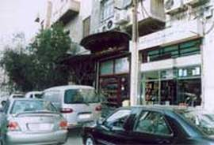

+++
title = "فيصل.. ربما في شارع آخر!"
date = 2007-05-03
authors = ["البراء أشرف"]
aliases = ["/articles/masr-n10053/", "/articles/masr-places-of-egypt-5712/"]

[taxonomies]
authors = ["elbaraa-ashraf"]
sections = ["masr"]

[extra]
section_name = "ولاد البلد"
share_image = "/media/admins.20at.com/masr/fesal2.jpg"
summary = "ستدخل إليه من مداخل عديدة.. كلها – بلا استثناء – خادعة وكاذبة!"
section_slug = "masr"
section_colour = "#666666"
thumb = "/media/admins.20at.com/masr/fesal2.jpg"
n_comments = 5
original_url = "http://www.20at.com:80/masr/places-of-egypt/5712-2009-06-10-09-27-47.html"
archived = "20100304064338"
date_source = "byline/meta"
aliases_20at = ["//masr.20at.com/newarticle.php?sid=10053", "/masr/7eta-mn-baladi/5712-2009-06-10-09-27-47.html", "/masr/places-of-egypt/5712-2009-06-10-09-27-47.html"]

[extra.provenance]
original_url = "http://www.20at.com:80/masr/places-of-egypt/5712-2009-06-10-09-27-47.html"
capture_url = "https://web.archive.org/web/20100304064338/http://www.20at.com:80/masr/places-of-egypt/5712-2009-06-10-09-27-47.html"
capture_label = "٤ مارس ٢٠١٠، ٠٦:٤٣ UTC"
date_note = "من سطر التوقيع في المقال"
other_urls = ["//masr.20at.com/newarticle.php?sid=10053", "/masr/places-of-egypt/5712-2009-06-10-09-27-47.html"]
comments = "٥"
missing_images = ""
+++

<figure></figure>

ستدخل إليه من مداخل عديدة.. كلها – بلا استثناء – خادعة وكاذبة!

تخيل معي أنها المرة الأولى التي تدخل فيها إلى شارع فيصل، ربما تختار الدخول إليه من الطريق الطبيعي، ميدان الجيزة، تعرف بالتأكيد الجيزة وزحامها، لكنك ستقطع المسافة من قلب الميدان إلى مطلع الكوبري بسرعة، تنطلق على الكوبري وكأنك "راكب الدائري".. ثم تلمح من بعيد الأضواء الخلفية الحمراء لمئات السيارات التي وقفت بإجلال في إشارة صغيرة هي فقط.. إشارة البداية في شارع فيصل!

ستلجأ إلى الحيلة في المرة الثانية، وتفكر في دخول الشارع من الطريق الدائري، ستمر من خلاله قادماً من شبرا، ثم منزل المريوطية، تسير طويلاً في طريق تحيطه أشجار وترعة، منظر يوحي لك وكأنك تملك الدنيا بما فيها، ولا شيء على الإطلاق قادر على توقيفك.. ثم.. الأضواء الخلفية الحمراء مرة أخرى، إنها سيارت – ربما هي ذاتها السابقة – تقف إجلالاً لإشارة شارع فيصل الأخيرة بالمريوطية..

تسلك شارع فيصل من مدخل آخر بدافع أخلاقي، جئت من طريق الإسكندرية الصحراوي، وتفكر أنه ربما من غير اللائق أن تشاهد زوجتك الجالسة إلى جوارك ما لا يرضيها في شارع الهرم، إذن فليكن فيصل هو البديل، وهناك.. ستشاهد ما لا يرضي أحد على الإطلاق.

كل مداخل شارع فيصل تخدعك في البداية، تبدأ سريعة، ثم تقع في المصيدة، المشكلة الحقيقية ليست في المداخل التي ستكتشف خدعتها بعد أن تجربها مرة واثنين، الأزمة يا صديقي.. في المخارج!

دعنا لا نظلم فيصل.. شوارع القاهرة كلها مزدحمة.. لكن من قال أن ازدحام الشارع هو ما يميزه.. إنها فقط مقدمة تليق بشارع ربما هو الأطول في شوارع العاصمة بعد صلاح سالم، وإن كان الحديث عن زحامه لن يكون مبالغة مهما تحدثنا.. لكنه فقط إهانة لبضعة أشياء أخرى تميزه..

أنت في فيصل داخل جمهورية مستقلة تنفصل تماماً عما يحيطها..

يحكي لي أبي أن هذا الشارع كان فيما سبق محاطاً بالأراضي الزراعية، ستلمح ذلك في قطع خضراء صغيرة في "حسن محمد" أو "الطوابق" أو "كفر طهرمس".. وكلها أسماء محطات بالشارع الشهير.

ويحكي لي أبي أيضاً أن شارع فيصل وشارع السودان كانا في الأصل شارعاً واحداً، وأن الكوبري الواصل بينهما تم بناؤه بمنحة من السعودية، ولهذا سمي الشارع باسم العاهل السعودي وقتها الملك "فيصل آل سعود".

سأحكي لكم عن الأشياء التي شاهدتها فعلاً، سأهمل جذور الشارع التاريخية، لأنه شارع بلا جذور.

في فيصل ستركب السرفيس، سيارة ميكروباص لن تجدها إلا فيه، هي دائما مرتفعة من الأمام ومنخفضة من الخلف، هي دائما تسمح بركوب أربعة أفراد في كل كنبة من الناحية النظرية فقط.. هي دائما مكان مفضل لسماع أغنيات سعد الصغير وشعبان عبد الرحيم وعماد بعرور..

هي دائما كذلك يقودها سائق لا يعرف والده من أمه.. لا يفرق بين طفل وعجوز، المهم أن تمتلئ السيارة من محطة إنطلاقها، وأن يتم إفراغها أكثر من مرة في كل محطة فرعية تمر بها.. تسألني عن المحطات الفرعية.. أنا أخبرك بها..

ولأن الطريق بين ميدان الجيزة وآخر فيصل طويل أكثر مما ينبغي، فإن سائقي الميكروباص الذين لن يرضوا بالتأكيد بنصف جنيه أعمى (شأن كل الجنيهات المصابة بالعمي في مصر)، فإن الحيلة - والكفاح من أجل البقاء – دلتهم على طريقة مبتكرة لتحسين دخلهم، تقسيم الشارع إلى محطات.. من الجيزة حتى العشرين، ومنه إلى حسن محمد، ومنه للمطبعة، ومنها للمريوطية، ومن الأخيرة إلى مشعل وآخر فيصل.. ومنهم لله..

وفي كل مرة ركاب جدد و"أنصاص" جنيهات جديدة تنهال على السائق الذي يقود طرباً بأنغام شعبية صاخبة تخرج ثائرة من كاسيت الميكروباص الصغير الذي يكافح هو الآخر من أجل البقاء أمام ميكروباص الجمعية المنتشر في ربوع المحروسة، والذي يجعلك تراه من بعيد كدابة خرجت في آخر الزمان عند فساد الناس..

لكن غير الميكروباص، هناك أيضا ما يميز شارع فيصل..

"كبابجي المنوفي"، محل الكباب الأشهر ربما في القاهرة والجيزة، حسن محمد.. المحطة التي لا يعرف أحد على الإطلاق صاحب اسمها، حتى صاحب الاسم نفسه ربما غادر الدنيا دون أن يعرف أنه سيكون الرجل الأشهر في شارع يبلغ تعداد سكانه 3 مليون نسمة على أقل تقدير..

أو "الطوابق".. دعني أولاً أخبرك سبب تسميتها..

الحكاية وما فيها أن المحطة بها ثلاثة شوارع متوازية، وهو ما جعل ذهن أحدهم – من الجدود الأوائل للفيصليين – أن يتخيل شكل الشوارع الثلاثة وكأنها أطباق رصت فوق بعضها.. وأطلق عليها اسم الطوابق!

اركب أي تاكسي وقل له "الطوابق".. سيقف لك.. ويسألك أسئلة قصيرة.. "أنهي طابق؟".. "على الشارع ولا جوه؟".. إن كانت إجابتك "الطابق التاني"، "جوه".. فأنت يا صديقي خاسر.. طريقك إلى الطوابق عبر التاكسي يجب أن يظل دائما منتهياً عند "بره".. لأن "جوه" عالم آخر وشارع آخر وموضوع آخر..

وفي فيصل أيضاً، ستسأل نفسك كل مساء وأنت تسلك الطريق إلى بيتك عن سر الجزيرة..

والجزيرة هي رصيف عريض يشق الشارع ويفصل بين الرايح والجاي، وفيه حوض عريض من الزرع، لو تمت تقليص مساحته لشملت حارة للسيارات في كل إتجاه، لكن المسؤولين عن الشارع يخشون بالتأكيد أن يفقد شارعهم مكانته باعتباره الأسوأ مرورياً في تاريخ مصر.. فإن تقلصت مساحة الجزيرة ربما يصبح الشارع أسرع وتصبح الحياة أسهل على مواطنيه.. وهي بالتأكيد أمور لا تهم القائمين على أمور الشوارع في مصر!

أخيراً، يبقى فيصل والإنترنت..

دخلت على "جوجل" أبحث عما يتعلق به، وعلى "ويكيبيديا" وجدت الرابط التالي..

يبقى لي اعتراف بسيط.. أن الكتابة عن فيصل ستظل عبثية وفاشلة لهؤلاء الذين اعتادوا عليه.. فيصل يبحث عن عين مصوراتي من مدينة نصر، يلتقط كل تفاصيله بانبهار، وفيصل يفتش عن قلم كاتب ارستقراطي مر به ذات مرة وهو تائه، ليكتب قلمه عن عجائب الدنيا السبعين.. الموجودة في تفاصيله الصغيرة..

أما أن يكتب "فيصلي" عن فيصل، فستمنعه النخوة من الحديث عن مقهى الشمندورة الملتقى الرسمي للدعارة النظيفة بالمنطقة، أو شارعي "حسن محمد" و"العريش" حيث اعتاد شباب الشارع تجربة المعاكسة للمرة الأولى ثم احترافها للأبد.. وسيمنعه الحرج من الحديث عن التوك توك والفواعلية.. وسيمنعه ذكاءه من التصريح بالطريقة السليمة لركوب الميكروباص من أول الخط لآخره دون أن ينزلك السائق أو أن تدفع الأجرة مرتين..

فيصل يبحث عن واحد من هؤلاء الذين سيدخلون إليه من مداخل عديدة.. كلها – بلا استثناء – خادعة وكاذبة!، أما سكانه.. فهم يعلمون طبيعة مداخله ومخارجه.. وعلى استعداد لقتال المارينز حتى داخل حارته ودروبه وثناياته الضيقة.. دون أن يمكنوهم من الإمساك بواحد منهم.

هي أسرار في الشارع الضيق، تبحث عن "أجنبي" للحديث عنها.. لكن أن تجد بين أهلها من هو قادر على البوح.. ربما في شارع آخر!

