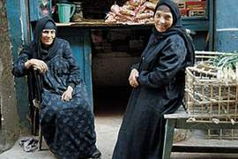

+++
title = "شارع \"مش\" برجوازي!"
date = 2007-05-03
authors = ["أحمد بلال"]
aliases = ["/articles/masr-places-of-egypt-5713/"]

[taxonomies]
authors = ["ahmed-balal"]
sections = ["masr"]

[extra]
section_name = "ولاد البلد"
share_image = "/media/admins.20at.com/masr/borg2.jpg"
summary = "قرية صغيرة في المحلة الكبرى، عدد كبير من سكانها عمال في شركة مصر للغزل والنسيج أو في مصانع القطاع الخاص، وبعض الجاليات من الفلاحين بالإضافة إلى عدد من الموظفين "
section_slug = "masr"
section_colour = "#666666"
thumb = "/media/admins.20at.com/masr/borg2.jpg"
n_comments = 6
original_url = "http://20at.com/masr/places-of-egypt/5713--qq-.html"
archived = "20100105140829"
date_source = "byline/meta"
aliases_20at = ["/masr/7eta-mn-baladi/5713--qq-.html", "/masr/places-of-egypt/5713--qq-.html"]

[extra.provenance]
original_url = "http://20at.com/masr/places-of-egypt/5713--qq-.html"
capture_url = "https://web.archive.org/web/20100105140829/http://20at.com/masr/places-of-egypt/5713--qq-.html"
capture_label = "٥ يناير ٢٠١٠، ١٤:٠٨ UTC"
date_note = "من سطر التوقيع في المقال"
other_urls = ["/masr/places-of-egypt/5713--qq-.html"]
comments = "٦"
missing_images = ""
+++

<figure></figure>

قرية صغيرة في المحلة الكبرى، عدد كبير من سكانها عمال في شركة مصر للغزل والنسيج أو في مصانع القطاع الخاص، وبعض الجاليات من الفلاحين بالإضافة إلى عدد من الموظفين في المصالح الحكومية المختلفة، في القلب منها يقع أكثر الشوارع حيوية، حيث ولدت ونشأت إلى أن أنهيت دراستي الجامعية، وبرغم ذلك إلا أنني لا أعرف له اسما حتى الآن، ففي قريتنا لا يهتم أحد بأسماء الشوارع، حيث يعرف كل منا الآخر!.

الشارع وإن كان متفرعا من الشارع العمومي في القرية، إلا أنه قد يكون أكثر حيوية منه، حيث يتحتم على كل سكان القرية تقريبا الحضور إليه، حيث يوجد العديد من الخدمات الهامة في حياة أي مواطن.

<h3>في الشارع</h3>

مع أول ضوء من كل صباح يرتفع صوت "الباجور" إيذانا ببدء "الحاجة صباح" عملها، حيث يتوافد عليها كل تحالف قوى الشعب العاملة، العمال الذاهبون إلى مصانعهم، والفلاحون الراحلون إلى أراضيهم، وطلاب المدارس والجامعات، بالإضافة إلى الموظفين قبل أن يمتصوا في أعمالهم، وذلك لشراء "الطعمية" المقدسة!

وعلى بعد عدة أمتار من "الحاجة صباح" يقع مخبز وحلواني "الصابرين"، حيث يضطر الجميع إلى الذهاب إليه لشراء الخبز كل صباح، "مخبز الصابرين" الذي يعمل 24 ساعة في اليوم، هو المخبز الوحيد في القرية، ومع ذلك قد يستغربك أحد الأهالي إن سألته على مخبز بهذا الإسم، فالكل هنا يعرفه باسم "فرن العزب"، نسبة إلى الحاج "محمود العزب" الذي أتى منذ عقود إلى القرية من المنوفية ليعمل بشركة مصر للغزل والنسيج، بعدها أسس هذا المخبز، وبرغم وفاة الحاج محمود منذ سنوات، إلا أن يافطة المخبز الذي يديره أبنائه حاليا لا تزال تحمل اسمه.

وفي نهاية الشارع، يقع "دكان الشيخ فتحي"، حيث تنتهي الوجبة الدسمة للمواطن في القرية بطبق فول، ولا يقتصر "دكان الشيخ فتحي" على الفول فقط، وإنما يمتد أيضا إلى الجبن واللانشون، إلى ما غير ذلك من بضائع البقالة.

<h3>يوميات الحاجة حسنة</h3>

الي الساعة الثامنة من صباح كل يوم تستيقظ "الحاجة حسنة" لتفتح محلاتها، حيث تمتلك محلين أحدهما لبيع البقالة والتموين، والتموين لمن لا يعرف هو السلع الحكومية المدعومة، والمحل الآخر لبيع الدقيق.. ما أن تفتح المحلات، حتى تسارع بعمل كوبين من الشاي، أحدهما لها والآخر لجارتها "الحاجة صباح"، بعدها تبدأ عملها في المحلين.

"الحاجة حسنة"، التي تبلغ من العمر حوالي 84 عاما، تقوم بكل أعمالها سواء في المحلين أو أعمالها الشخصية، حيث ترفض بكبرياء شديد أن يساعدها أحد، وذلك لحبها الكبير للعمل برغم تقدم سنها، حيث لا تكتفي بالعمل في المحلين فقط، وإنما تهتم كثيرا بتربية الدواجن والحمام، والغريب في الأمر أنها تربي طيورها في الشارع، حيث تضع أقفاص الحمام و"عشة" الدواجن في الشارع دون أي خوف.

شخصيتها المرحة مع تقدم سنها وعلاقتها الجيدة بالجميع، يجعل من "المصطبة" المقامة أمام بيتها – أو بيتي حيث أفخر أنني حفيد لها- مزاراً للجميع، فالكل يأتي إلى هنا في أي وقت من الأوقات، ليتسامر ويشرب الشاي، وفي أوقات الليل وخاصة في الصيف تجد كل ليلة العديد من الأهالي يتجمعون بعد عناء يوم طويل ليشربون "شاي الحاجة حسنة"!، ويتسامرون فيما بينهم فيما بين فكاهة أو قضية عامة في القرية.

وعلى بعد بيت واحد من "الحاجة حسنة" يقع بيت المرحوم "إبراهيم المراكبي"، الذي يسكن فيه حاليا بعضا من أبنائه وزوجته "الحاجة نجاح"، في هذا المنزل تقع الفرقة الموسيقية الشعبية الوحيدة في القرية، بقيادة "شكري المراكبي" و"عزت المراكبي"، والتي امتد نشاطها حاليا ليشمل العديد من المحافظات المجاورة.

<h3>زملكاوي متعصب</h3>

أما الحاج "مصطفى حامد"، هو صاحب محل لبيع المبيدات الزراعية ويعمل في تجارة الأراضي، وهو "زملكاوي" متعصب، تجده في كثير من الأحيان يتحدث عن الزمالك وكأنه حامي حمى الوطن، بل ويصل تعصبه في كثير من الأحيان إلى عمل بعض المواقف المضحكة، فعند هزيمة الأهلي في بعض المباريات، يجلب حمارا، ويضع عليه قماش أحمر يكتب عليه الأهلي، ويستدعي بعضا من الصبية ليلفوا به في شوارع القرية، وفي كثير من الأحيان أيضا يكون هذا التعصب نقطة ضعف كبيرة في شخصية الحاج "مصطفى حامد"، حيث يتجمع أمام محله الكثيرون من مشجعي الأهلي بعد هزيمة الزمالك في أي مباراة ويتبادلون معه الكلمات التي من شأنها استفزازه، وبعيدا عن هذا الموقف أرى أن أهم ما يقوم به الحاج مصطفى هو شراؤه الصحف اليومية بانتظام كل صباح، فتجد عددا كبيرا من قراء الصحف يتوافدون على محله لمجرد قرائة الجورنال، حيث لا يوجد منفذ لبيع الصحف في القرية.

<h3>يا عيني ع البساطة</h3>

بساطة الشارع وأهله امتدت حتى إلى مشاكل سكانه، حيث بلغت من بساطتها حد الفكاهة، على سبيل المثال، ما حدث مؤخرا حين فوجئ إحدى ساكنات الشارع بديك يسقط من أحد الأسطح، فأمسكته على أساس أن هذا الديك من أحد الطيور التي تربيها وأنه سقط من على سطح منزلها، إلا أن صوت الديك الذي ارتفع بعد الإمساك به كان كفيلا لاستدعاء سيدة اخرى من سكان الشارع، والتي خرجت على صوت الديك لتؤكد أن هذا الديك ملكا لها، وهنا صارت المشكلة، حيث تدعي كل منهما أن الديك ملكها، ويلتف حولهما آخرون محاولين إنهاء المشكلة بدون جدوى، حتى نزلت سيدة ثالثة من سكان الشارع وأدلت بأوصاف الديك، وكان "القماشة الحمراء" التي ربطت بها رجل الديك هي الدليل القاطع على ملكيتها للديك، وعدم ملكية أي من طرفي النزاع له!!.

شارعنا بالنسبة لي ليس مجرد شارع من بيوت وسكان، وإنما حياة كاملة، فحين انتقل أبي إلى بيت جديد أقامه في منطقة أخرى وعلى طراز آخر، اتهمته طبقا لمعتقداتي الفكرية بأنه بيتا برجوازيا!!، كنت في المرحلة الأولى من الثانوية العامة، وقتها رفضت بشدة الانتقال إلى البيت أو الشارع الجديد، ومكثت مع جدتي في ذلك الشارع حتى انهيت دراستي الجامعية مؤخرا، ثم انتقلت للبيت الجديد، إلا أنني لا أحس بالحياة الحقيقية إلا في ذلك الشارع الذي لا أعرف له اسما، ولكنني عرفت فيه حب الناس وبساطة الحياة.

