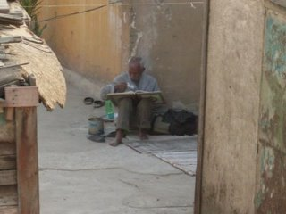

+++
title = "وأين ستمدد قدميك في الجنة ؟"
date = 2008-10-13
authors = ["مدونة أقولها على طريقتي"]

[taxonomies]
authors = ["blog-akolha-ali-tarikti"]
sections = ["masr"]

[extra]
section_name = "ولاد البلد"
share_image = "/media/masr.20at.com/currentarticleassets/sora.jpg"
summary = "هذا الرجل، يقطن سطح العمارة المجاروة لمقر عملي، تبينته من الدور الثامن حين انتهيت من أداء صلاة العصر في الركن القصيّ المهجور من الكافيتريا المجاروة لغرف المحرري"
section_slug = "masr"
section_colour = "#666666"
thumb = "/media/masr.20at.com/currentarticleassets/sora.jpg"
n_comments = 3
original_url = "http://20at.com/masr/egyptian-blogs/10257.html"
archived = "20100105152307"
date_source = "byline/meta"
aliases_20at = ["/masr/egyptian-blogs/10257.html"]

[extra.provenance]
original_url = "http://20at.com/masr/egyptian-blogs/10257.html"
capture_url = "https://web.archive.org/web/20100105152307/http://20at.com/masr/egyptian-blogs/10257.html"
capture_label = "٥ يناير ٢٠١٠، ١٥:٢٣ UTC"
date_note = "من سطر التوقيع في المقال"
other_urls = []
comments = "٣"
missing_images = ""
+++

<figure></figure>

هذا الرجل، يقطن سطح العمارة المجاروة لمقر عملي، تبينته من الدور الثامن حين انتهيت من أداء صلاة العصر في الركن القصيّ المهجور من الكافيتريا المجاروة لغرف المحررين والتي تطل من الناحية الشرقية علي الأسطح الفقيرة، والبنايات العتيقة في منطقة باب اللوق ووسط البلد.

كان يمسك المصحف بيديه يرتل ويتمايل، ثيابه وملامحه تنضحان فقرا، فالتقطت له علي التو تلك الصورة، ولا يشغلني سوي سؤالين فقط: كيف أعاد لقلبي طائر الإيمان الذي كاد أن يجفوني؟ وياتري في أي مرتبة في الجنة سيمدد قدميه ويتلو قرآنه كما فعل في الحياة الدنيا؟

__________

أمنية علي الهامش وتساؤل أخير:

لو أني بجواره، لو أني ببساطته، لو أني علي إيمانه.. وماذا لو أني لم أره؟

