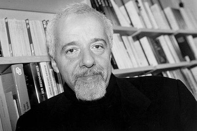

+++
title = "أن أكون باولو كويللو..!"
date = 2008-11-17
authors = ["وانا مالي"]
aliases = ["/articles/masr-n18401/"]

[taxonomies]
authors = ["wana-mali"]
sections = ["masr"]

[extra]
section_name = "ولاد البلد"
share_image = "/media/masr.20at.com/currentarticleassets/polo.jpg"
summary = "على الماسينجر تبدأ الحكاية وتنتهي، لعل هذا يجعلك تطمئن، لا تجاوزات أخلاقية حقيقية، لا أدري من المغفل الذي اعتبر تجاوزتنا الأخلاقية الإفتراضية على الإنترنت غير ح"
section_slug = "masr"
section_colour = "#666666"
thumb = "/media/masr.20at.com/currentarticleassets/polo.jpg"
n_comments = 0
original_url = "http://20at.com/masr/egyptian-blogs/10518.html"
archived = "20100105152505"
date_source = "byline/meta"
aliases_20at = ["//masr.20at.com/newarticle.php?sid=18401", "/masr/egyptian-blogs/10518.html"]

[extra.provenance]
original_url = "http://20at.com/masr/egyptian-blogs/10518.html"
capture_url = "https://web.archive.org/web/20100105152505/http://20at.com/masr/egyptian-blogs/10518.html"
capture_label = "٥ يناير ٢٠١٠، ١٥:٢٥ UTC"
date_note = "من سطر التوقيع في المقال"
other_urls = ["//masr.20at.com/newarticle.php?sid=18401"]
comments = ""
missing_images = ""
+++

<figure></figure>

على الماسينجر تبدأ الحكاية وتنتهي، لعل هذا يجعلك تطمئن، لا تجاوزات أخلاقية حقيقية، لا أدري من المغفل الذي اعتبر تجاوزتنا الأخلاقية الإفتراضية على الإنترنت غير حقيقية ومأمونة العواقب ولا داعي للقلق منها.. على كل.. أسمع..

الأيقونات المضيئة باللون الأخضر في ماسينجري ازدادت أيقونة جديدة، فتاة في مثل سني وسنك، هي أكبر مني أو أصغر، وأكبر منك أو أصغر، هي تماثلنا، تستخدم الإنترنت، ولا زالت ترى في الماسينجر أداة تستحق الاهتمام والاستخدام.

تسألني : "اسمك باولو كويلهو.. صحيح؟".. أضحك في سري، وأرسل ابتسامة رقيقة :) .. أسألها أنا عن الطريقة التي حصلت بها على عنواني الإليكتروني.. أعتقد أن باولو سيسأل السؤال ذاته إذا أضافته فتاة في مثل سنه على الماسينجر.

قالت أنها حصلت على البريد من مدونتي، بعد أن قرأت روايتي المشهورة الأخيرة، سألتها، أي واحدة، أجابت "11 دقيقة طبعاااااا" سبحان الله، فجأة أصبحت أنا مؤلف "11 دقيقة" رواية باولو كويلهو الروائي العالمي المعروف، لنرى ما ستفصح عنه نافذة الماسينجر.

السكوت على الماسينجر علامة لأمر من اثنين، الموافقة، أو التجاهل، وقد سكت أنا، وفهمت هي أنني مؤلف الرواية، وهو ما جعل الحديث ينتقل من التمهيد، إلى الفصل الأول والوحيد في الحكاية الإلكترونية المثيرة، مثيرة لأنها مثيرة، ليست مشوقة أو متعددة الأحداث، أحداثها قليلة، وكلها تتعلق بالـ"11 دقيقة" التي لم أكتبها.

قرأت الرواية المذكورة بعد أن اشتريتها نتيجة منع بيعها في معرض لبيع كتب باولو كويلهو في جامعة القاهرة التي زارها الروائي منذ سنوات، فهمت أن الرواية مهمة، أو أنها تستحق القراءة، وقد قرأتها مرة واحدة، وكتبت عنها تدوينة في مدونتي، التي زينت يمينها بعنواني الإليكتروني.

بشكل ما يمكن أن يجعلني جوجل مؤلف الرواية، تماما كما يجعل كلمة "روايات جنسية" هي الكلمة الأكثر استخداماً لزوار مدونتي، فزوار الصفحة للمرة الأولى يأتون عادة عبر كتابة تلك الكلمة في مستطيل البحث في صفحة جوجل الرئيسية البيضاء.

إذن. من الممكن أن يستمر هذا الحوار للأبد، فتاة، تعتقد أنني باولو كويلهو، ومعجبة بروايتي الجنسية الشهيرة، وتريدني أن أرسل لها نسخة (لو تكرمت)، وتستأذني في أن تناقش معي بعض أفكار الرواية (إذا سمحت وكان عندك وقت).. وقد أجبت على كل الطلبات السابقة بالإيجاب، ولاحظت أنها تعطيني صندوقاً بريدياً في السعودية، وهو ما أعطى للحكاية سخونة ملاءمة.

كل ما سبق يجعلني متحمساً لاستكمال "الحوار"، قلت، كيف تكوني سعودية وتقرأي رواية فاضحة مثل روايتي الأخيرة، قالت "ومن أخبرك بأن السعوديات لا يقرأن الروايات الجنسية؟"، أخبرتها أن معلوماتي السطحية تجعلني أفهم أن السعوديات لا يمارسن الجنس أصلاً، أو هكذا يروج الإعلام لهن..

أخبرتها أنني مرة كنت في الرياض، من سنوات خمسة، وكنت أعمل وقتها بائعاً للكتب في المعارض، وخصصت إدارة المعرض يوم للنساء فقط، حيث كانت الأيام كلها للرجال دونهن، وفرحت بهذا الخبر، معنى هذا أن مبيعات كتب الأطفال التي أبيعها ستزيد، فالنساء أكثر اهتماماً بكتب الأطفال والتربية، كما أن "شهوة" الشراء عندهن أكبر، أو هكذا كان أبي يقول.. أخبرت أحد العاملين في دار نشر سعودية بهذا الكلام في اليوم السابق ليوم النساء، قال في حزم "أسمع.. في المرة القادمة استخدم كلمة أفضل من شهوة.. نساءنا بلا شهوة يا صديق"..

ضحكت، أرسلت أيقونة حديثة في الماسينجر لأمرأة ناضجة تضحك وتحرك قدميها في الهواء، أثارني رد الفعل، واستمر الحوار، بدا أنها على استعداد للحكي.. قالت أنها لازالت طالبة، وغير متزوجة بالطبع، لكن هذا لا يمنع أنها مارست الجنس مرات من قبل.

كان لابد هنا أن أخمن أن زميلي في صالة التحرير هو الذي يحدثني، الفتاة تدخل مداخل جنسية مألوفة، كأنها تراودني عن نفسي إليكترونياً، فكرت في طريقة للتأكد من هويتها، سحبت إيميلها، وضعته في مستطيل البحث على جوجل، لم أجد شيئاً، أكد هذا شكوكي، كررت البحث في مستطيل الفيس بوك، وجاءت النتيجة، سعودية هي، وجميلة، ولها اسم وأخوة وأب وأم وأبناء عمومة، وفي مثل سني وسنك..

استمر الحديث حتى حانت لحظة مناسبة، فألقيت إليها باسمها الحقيقي، نسيت أن أخبرك أن الحوار أمتد منذ البداية وهي تخبرني أن اسمها "هيفاء"، وهو ما جعلني أتورط أكثر، لم تسألني عن الطريقة التي حصلت بها على الإسم، ضحكت، وقالت أن روائي مشهور مثلي هو شخص مأمون العواقب، لن يلجأ لاي تصرفات صبيانية..

بالفعل لم ألجأ، بل استخدمت رجولتي الإليكترونية كلها، لاسألها بفضول شديد اعتذرت عنه مقدماً عن تفاصيل علاقتها الجنسية السابقة، حيث أني أدرس حالياً كتابة رواية جديدة وأفتقد لبعض الخيال.

أخبرتني بأن لها صديق ما، زارته في شقته مرات، ومارسا سوياً الجنس في حدود بقاؤها عذراء، سألت "هل هذا متاح عندكم؟".. حاولت الإجابة عن السؤال الذي بدا فلسفياً، لكنها اختارت في النهاية أن تخبرني ببعض التفاصيل بخصوص العلاقة بينها وبين صديقها.

لا حياء مع كتاب الروايات الجنسية، أخبرتي بالتفاصيل كما حدثت أو أكثر قليلاً، مستخدمة في ذلك الألفاظ المناسبة، وهي للمصادفة ذاتها الألفاظ التي يمكن أن تسمع مشتقاتها في حديث منفعل بين سائقي ميكروباصات بولاق الدكرور وناهيا والكوبري الخشب.

سألت هيفاء، وكنت لازلت أفضل تسميتها بهذا الاسم، عن مصدر معرفتها بهذه الألفاظ، قالت أن الوطن العربي وإن تعددت لهجاته تبقى أسماء وألفاظ العملية الجنسية واحدة، وهو أمر توحد فيه العرب منذ القرون الأولى.. أضفت هذه المعلومة عندي وقررت استخدامها يوماً في بحث حقيقي في المسألة.

فيما كانت هيفاء تحكي، استلمت منها بعض الروابط، لأفلام جنسية نصف إباحية، حاولت أن تشرح لي التفاصيل بأكبر قدر من الدقة، قالت أنها مهمة بالنسبة لكاتب روايات جنسية متخصص مثلي، وقد تلقيت الروابط باهتمام، حيث كنت مسافراً وقتها، وكان الحديث يتم عبر جهازي المحمول الذي يسمح بتصفح الانترنت دون قيود رقابية من شركاء الشبكة.

كل الروابط من "YOUTUBE"، عناوين خادعة، عن الانتخابات الأمريكية مرة، أو اسماء أغاني أجنبية، أو حتى كلمات غير مفهومة، أخبرتني أن أي عناوين جنسية مباشرة يتم حجبها في السعودية، تأكدت من قدرة البني آدم الفرض على تجاوز أي قمع من أي نوع، حتى إن كان من جهة هيئة المعروف.

عرضت هيفاء بشكل صريح الإنتقال مباشرة من الماسينجر إلى الهاتف، متجاوزين بذلك مرحلة الكاميرا المنزلية المهمة، وعارضت أنا فكرة الانتقال لما في ذلك من تكلفة لا أعتقد أنني مستعد لتحملها نظير متعة لا أرغب بها في الوقت الحالي على الأقل.

غابت أيام، وعادت قبل رمضان، في ليلة من الليالي التي كنت أجلس فيها وحيداً في غرفة المونتاج بجوار مهام عديدة في انتظار من ينجزها، إلا أن الملل والتعب يكونان قد أنهكاني بحيث ألجأ للماسينجر علي أجد عليه ونيس غير زملاء العمل.

وجدتها، ألقيت تحية المساء، أخبرتني أن "السلام عليكم ورحمة الله وبركاته"، فهمت أن الأمور قد دنت من نهايتها، وأن القصة على وشك العثور على نهاية ملاءمة، وأخبرتني هي بأنها ذهبت للعمرة، وتابت إلى الله توبة نصوح، وسألتني عن معنى كلمة نصوح، فلم أخبرها لأني كنت غير متأكد من المعنى الذي أعرفه، وقالت أنها قامت قامت بعمل بلوك لكل الأشخاص الذين كلمتهم يوماً على الماسينجر، ولا تدري كيف بقيت أنا دون بلوك، أخبرتها أنني أحدثها من بريد آخر غير بريدي، وأنني أنشأت هذا العنوان لأحدثها وحدها، حيث أصبحت خائفاً من أن تعثر زوجتي على محادثة معها تنهي قصة زواج بدأ منذ شهور ولا أرغب في أن ينتهي الآن.

أخبرتها بأنني كنت أرغب في سماع المزيد من الحكايات عنها وعن صديقها لأني سأكتب يوماً رواية عن لقاءتهما السرية، قالت أن الحكي في مثل هذه الموضوعات حرام، وأنها أخيراً عرفت الطريق إلى الله وإن كانت تشكرني على اهتمامي بتفاصيل حكايتها، فقد كانت تتوقع أن يتجاهلها أديب ومؤلف مشهور مثلي يردد أسمه الملايين ويقرأ له العالم كله.

أيقنت أن الوقت مناسب للاعتراف بأني لست باولو كويلو، لكن المحادثة انتهت بشكل أسرع، وفكرت أنني لست في حاجة للاعتراف بأمر لم أرتكبه، فلست أنا من قال أنني باولو، هي اعتقدت ذلك واقتنعت به، ولازالت. كما أنها لن تصبح فخورة بالتأكيد بأن أسرارها الجنسية الكبيرة كانت تفشى لبريد مدون بدين من القاهرة اسمه البراء أشرف.

لا تزال هيفاء تسكن ماسينجري، لم تعد تظهر عليه ولا على بريدي السري الذي لا يعرفه غيرها، ربما عرفت الطريق إلى الله فعلاً، ونسيت ما كانت تبوح به هنا، لا زالت صورتها موجودة على الفيس بوك دون حجاب، لعلها نسيت..

تلقيت صباح اليوم رسالة جديدة منها على بريدي، تلومني على عدم إرسال نسخة من روايتي الشهيرة "11 دقيقة"، وقالت أنها لا زالت تتمنى أن تضع نسخة موقعة مني في مكتبتها الخاصة، أرسلت أقول أن الطبعة الخامسة عشر لا تزال في المطبعة، وأني أنتظر خروجها لأرسلها لها نسختين أو ثلاثة وليس فقط واحدة، وأني غاضب جداً من ناشري لأنه تأخر في نشر طبعة جديدة..

وضعت توقيعي الجديد : باولو كويلو، روائي، وشعرت أنه من الجيد أن أصبح شخصاً مشهوراً.

