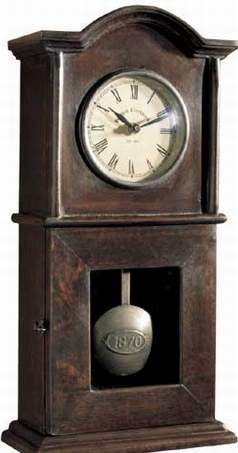

+++
title = "البندول يحتاج بعض الوقت"
date = 2008-12-03
aliases = ["/articles/masr-n18727/"]

[taxonomies]
authors = []
sections = ["masr"]

[extra]
section_name = "ولاد البلد"
share_image = "/media/masr.20at.com/currentarticleassets/pendulum-clock.jpg"
summary = "أستيقظ على صوت أعمال التشطيبات في البناية المجاورة، تحديدا في الجدار الذي يلصق ظهره بظهر جدار غرفة النوم. مرآة الجدار تهتز فعلا؟ أم أنه أثر الأدوية التي دفعتني "
section_slug = "masr"
section_colour = "#666666"
thumb = "/media/masr.20at.com/currentarticleassets/pendulum-clock.jpg"
n_comments = 0
original_url = "http://20at.com/masr/egyptian-blogs/10677.html"
archived = "20100105152348"
date_source = "byline/meta"
aliases_20at = ["//masr.20at.com/newarticle.php?sid=18727", "/masr/egyptian-blogs/10677.html"]

[extra.provenance]
original_url = "http://20at.com/masr/egyptian-blogs/10677.html"
capture_url = "https://web.archive.org/web/20100105152348/http://20at.com/masr/egyptian-blogs/10677.html"
capture_label = "٥ يناير ٢٠١٠، ١٥:٢٣ UTC"
date_note = "من سطر التوقيع في المقال"
other_urls = ["//masr.20at.com/newarticle.php?sid=18727"]
comments = ""
missing_images = ""
+++

<figure></figure>

أستيقظ على صوت أعمال التشطيبات في البناية المجاورة، تحديدا في الجدار الذي يلصق ظهره بظهر جدار غرفة النوم. مرآة الجدار تهتز فعلا؟ أم أنه أثر الأدوية التي دفعتني للنوم لأكثر من 10 ساعات، أو هكذا أظن. أتذكر سدس ظفر الإصبع الأكبر لقدمي اليمني الذي انترعته جراحة من داخل لحم الإصبع، أشعر بدغدغة في مكان الجراحة، أشعر بالجوع وبالرغبة في كوب شاي. غلاية الشاي تسرب البخار وتبخر كل الماء، أستخدم واحدة أخرى لا تصدر صوتا عند انتهائها من غلي الماء، أنساها وأعود إليها لأشغلها مرة أخرى ثم أنساها، عدة مرات حتى أنسى أمر الشاي تماما. يجب أن أرد على العديد من الرسائل، يجب أن أتصل بالعديد من الناس، لدي أفكار أود أن أكتبها، وأخرى بدأت في كتابتها وعلي أن أتمها. جرس الباب يدق، محصل شركة الغاز.

يدق، نورا الصغيرة حفيدة صاحبة العمارة تريد الإيجار. يدق، المكوجي الذي توقفنا عن التعامل معه "مافيش مكواة". يدق، المكوجي الذي نتعامل معه، أيضا "مافيش مكواة". يدق، وصلتني مجلة اشتركت فيها مجانا. يدق، مجلة أمريكية متخصصة في علم النفس اشتركت فيها رضوى، يوم المجلات! يدق، نورا الصغيرة تحمل في يدها حصاد الإيجار "لأ، مش إنت، أنا عاوزة حمدي" تضحك وتنزل السلم جريا.

تدق الساعة هذه المرة، ليس لساعتنا صوت، ولكنها مستطيلة ببندول طويل يعمل بجد طوال النهار ذهابا وإيابا. لسبب ما اختل توازن الساعة، والبندول يدق على جانب الساعة. أفكر في أن أحدا لم يلمسها، ولكن أثر الفراشة يفعل أكثر من ذلك. أحاول ضبطها رأسية تماما، لا أنجح، لم لا يعيدها لاتزانها أثر فراشة أخرى! أعرف الآن لماذا صحت في رضوى"ساعة ببندول ليه؟!"، ولكني استسلمت لأنني لن أنزل للبحث عن ساعة، ولأنها أنيقة وحمراء مثل الكنبة وملائمة للون الأسود للسفرة والبوفيه.

أقرأ بعض الأخبار والمقالات وأشعر بزغللة في عيني وصداع يتسلل لرأسي، وأتذكر أني لم آكل شيئا منذ الصباح، أنسى الإفطار دائما عندما تسافر رضوى، أتناول الأسهل في إعداده وأنا أشاهد جزءا من فيلم "خد الفلوس واجري" لوودي آلان. يشهر فيرجيل/وودي آلان مسدسه في وجه رجل ويطلب منه محفظته، يذكره الرجل بأنه صديقه من أيام زمان، ويسأله "إنت بتعمل إيه في الدنيا؟"، يهز فيرجيل رأسه ويقول "أنا عازف في الأوركسترا الفيلهارموني!". يأخذ منه فيرجيل محفظته وساعته وهما يتذكران ضاحكين أيام زمان، وبعد أن يفترقا يعود الرجل ويقول"آسف فيرجيل، تذكرت الآن أني ضابط بوليس"، ويأخذ أشيائه وفيرجيل إلى السجن وهما يستمران في تذكر المواقف الطريفة من أيام الشباب.

أشاهد الفيلم إلى نهايته، لا يمكنني مقاومة أفلام وودي آلان. الفيلم مكتوب بطريقة ساخرة على غرار أفلام "الجريمة لا تفيد" والتقارير التي تذيعها البرامج التليفزيونية عن حياة المجرمين الخطيرين، في نهاية الفيلم يجلس فيرجيل الذي لم يقم بأي سرقة ناجحة، في مواجهة مذيع تليفزيوني يسأله"هل أنت نادم على اتخاذك طريق الجريمة؟" يرد فيرجيل بجدية وبراءة "أعتقد أن حياة الجريمة لها ثمنها، ولكن ذلك طبعا بسبب ما تعلمه من أن الجريمة كارير رائع، أوقات ممتعة، أنت رئيس نفسك، تسافر كثيرا، وتلتقي أشخاص مثيرين للاهتمام". يسأله عن رفاقه في العصابات التي انضم إليها أين هم الآن، يقول بفخر وهو يتذكر ويرفع حاجبيه "كثير جدا منهم ..مممم... أصبحوا مثليين جنسيا، وآخرون اتجهوا للسياسة و الرياضة".

ينتهي الفيلم ويتوقف العمال عن الضجيج، يحل الظلام، يتوقف بندول الساعة عن الدق على جانبها، ربما أمكنه أن يزحزح بدقاته جسم الساعة حتى أعاد اتزانها. أستغل الهدوء وأطفيء كل الأنوار وأشغل موسيقى بول سالم، أستلقى على الكنبة وأحدق في الظلام وأسمع، أشعر بالصداع وأحاول ألا أفكر في شي، فأفكر في آلاف الأشياء وأضحك عندما أتذكر مشاهد من الفيلم أو نورا الصغيرة.

عندما استيظقت صباح اليوم التالي ووجدت نفسي على الكنبة، كان العمال يدقون أيضا، ولكن الساعة كانت متزنة وهادئة ولم يدق جرس الباب، والصداع خف قليلا هو ودغدغة مكان الجراحة في إصبعي. قررت أن أقوم بأشياء كثيرة وألا أشاهد أيا من أفلام وودي آلان أثناء الأكل، وأن أتجاهل تماما أي إحباط قد يسببه لي تذكر يوم أمس الضائع، وألا أذكر منه إلا القرارات التي اتخذتها قبل أن يغلبني النوم. لن أشرب ذلك الدواء سيء الطعم الذي أعتقد أنه سبب كل هذا النوم والإرهاق إلا مرة واحدة بدلا من مرتين. أن أذّكر مرة أخرى المكوجي الذي نتعامل معه، إن أتى، ألا يرن الجرس إلا مرة واحدة، وأن أذكره للمرة الألف أن يحضر لي رقم تليفونه لنتصل به وقتما نحتاجه. وأن لا أصارح صبي المكوجي الذي توقفنا عن التعامل معه أننا توقفنا عن التعامل معه، سأتركه يأتي هكذا للأبد، ويدق الجرس، لأقول له دائما "مافيش مكواة"، إما أن يفهم أو يظل هكذا يأتي ويروح عقابا على غبائه وغباء معلّمه وجليطتهما معنا. كما يجب ألا أنسى أن أشتري علبة بونبون، وأمنع نفسي ورضوى من أكلها كلها، لأعطي نورا الصغيرة منها رغم أنها تأتي أحيانا قبل نهاية الشهر تدق الجرس وتطلب الإيجار.

