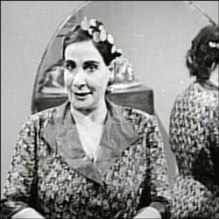

+++
title = "ياإما مني زكي .. يابلاش"
date = 2009-01-25

[taxonomies]
authors = []
sections = ["masr"]

[extra]
section_name = "ولاد البلد"
share_image = "/media/masr.20at.com/currentarticleassets/__1581___1605___1575___1577_1.jpg"
summary = "حماتي الغالية فيها طبع انتم عارفينه ومتابعينه وهو انها عندها ميول استخباراتية وطرق تعذيب ذهنية تفوق الموساد في قوته وضراوته وعندها مقدرة غريبة علي دحلبة اللي بت"
section_slug = "masr"
section_colour = "#666666"
thumb = "/media/masr.20at.com/currentarticleassets/__1581___1605___1575___1577_1.jpg"
n_comments = 0
original_url = "http://20at.com/masr/egyptian-blogs/11054.html"
archived = "20100105152629"
date_source = "byline/meta"
aliases_20at = ["/masr/egyptian-blogs/11054.html"]

[extra.provenance]
original_url = "http://20at.com/masr/egyptian-blogs/11054.html"
capture_url = "https://web.archive.org/web/20100105152629/http://20at.com/masr/egyptian-blogs/11054.html"
capture_label = "٥ يناير ٢٠١٠، ١٥:٢٦ UTC"
date_note = "من سطر التوقيع في المقال"
other_urls = []
comments = ""
missing_images = ""
+++

<figure></figure>

حماتي الغالية فيها طبع انتم عارفينه ومتابعينه وهو انها عندها ميول استخباراتية وطرق تعذيب ذهنية تفوق الموساد في قوته وضراوته وعندها مقدرة غريبة علي دحلبة اللي بتكلمه وتقنعه بأمور يعتقد إنها خارجة من دماغه هو شخصياً

وياااما وقعتني في الكلام وانا ذي الشاطرة كنت بأقع ذي المدب واطلع كل اللي جوايا

الست دي خسارة انها ماكملتش في سلك التعذيب كانت هاتبقي ظابط شرطة ممتاز علي كتفه نياشين بالكووووم، فمثلاً لو أتأخرنا في الذهاب إليها تبدأ هي في أخذ أقوالنا لتعرف ليه أتأخرنا ثم تسأل الشهود عن الواقعة والشهود طبعاً هما أطفالي الصغار لأننا في نظرها كلنا كذابين وتبقي ليلتنا مطينة بطين لو الأقوال تضاربت يبقي أكيد الحكاية فيها إنّا.

عشان كدة دايماً تلاقيني رايحالها بمصحف عشان أحلف عليه كلما دعت الحاجة لذلك وبرضه مش بتصدق، علي رأي المثل قالوا للحرامي أحلف قال جالك الفرج وأنا في نظرها شيخة منصر.

طبعاً حماتي عرفت عن موضوع الكتاب وهي مرحبة بطريقة مريبة تدعو للقلق والحذر جايز برضه عشان تخليني اقرالها اليوميات دي وتستخدمها ضدي

الجديد بقي أنها بتحكي عن يومياتها من أول ماأتولدت لحد ماأدحدر بيها الحال وبقت حماتي.

وبعد ماحكت عن زواجها الأول من دبلوماسي سوري علي ضرة والمعاملة الوحشة اللي كانت بتتعاملها هناك عشان هي مصرية ثم هروبها منه ولجوءها للقنصلية المصرية ثم طلب الطلاق من زوجها السوري وتدخل الرئيس عبد الناصر شخصياً ليطلقها منه ثم زواجها من حمايا الذي كان يعمل في شركة رمسيس نجيب للإنتاج السينمائي مما جعلها علي علاقة صداقة بالعديد من الممثلين والملحنين منهم الموجي وأحمد رمزي وسعاد حسني وفتونة علي رأيها أو فاتن حمامة مش قلنا أصحاب بقي وبيدلعوا بعضيهم وزهرة العلا .

كل ده وانا باسمع ولأني علي نياتي فبصدق جايز بتسرح بيا كالعادة بس أهي حكايات مُسلية بتقتل الوقت اللي بيمشي يتمخطر طول ماأنا في صحبتها ورغم ان الحكايات دي كانت بتتحكيلي علي حلقات علي مدار سبع سنين بس هي لاقت اني ممكن اشهرها واطلعها السما...فبدأت تزود الجرعة.

الجميل في الموضوع انها عاوزة تعمل قصة حياتها فيلم بس حقوق الملكية تبقي ليها هي بس وبشرط ان مني زكي تمثل دورها لانها شايفة نفسها في شبابها شبه مني زكي الخالق الناطق.

دي وجهة نظر يا مني ماتزعليش نفسك وقالت ان حمايا طلب منها توكيل عشان يكتب لها قصة حياتها. واخدين بالكم من التكتيك بتاعها بتحاول تعمل نفسها عليها طلب عشان تخليني اقول وليه تتعبي حمايا أكتبه أنا.

بس علي مييييييييييييين خلي الطلعة دي لحمايا ده لو فيه طلعة أصلاً... كفاية عليا كتاب واحد ولو انها ممكن يتعمل منها موسوعات.

