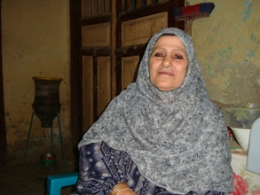

+++
title = "جدتي الحاجة .. جمال وقوة"
date = 2009-01-29
authors = ["أنس وهب"]

[taxonomies]
authors = ["ans-wahb"]
sections = ["masr"]

[extra]
section_name = "ولاد البلد"
share_image = "/media/masr.20at.com/currentarticleassets/grandma.jpg"
summary = "مازالت جدتي أو (تيتة الحاجة) ذات الثمانين ربيعا تبهرني في كل شيء حتى الآن، بقايا جمال قديم وذاكرة قوية وذهن حاضر وروح نشطة، نفتقدها نحن الشباب في أيامنا هذه، وف"
section_slug = "masr"
section_colour = "#666666"
thumb = "/media/masr.20at.com/currentarticleassets/grandma.jpg"
n_comments = 3
original_url = "http://20at.com/masr/egyptian-blogs/11127.html"
archived = "20100105151858"
date_source = "byline/meta"
aliases_20at = ["/masr/egyptian-blogs/11127.html"]

[extra.provenance]
original_url = "http://20at.com/masr/egyptian-blogs/11127.html"
capture_url = "https://web.archive.org/web/20100105151858/http://20at.com/masr/egyptian-blogs/11127.html"
capture_label = "٥ يناير ٢٠١٠، ١٥:١٨ UTC"
date_note = "من سطر التوقيع في المقال"
other_urls = []
comments = "٣"
missing_images = ""
+++

<figure></figure>

مازالت جدتي أو (تيتة الحاجة) ذات الثمانين ربيعا تبهرني في كل شيء حتى الآن، بقايا جمال قديم وذاكرة قوية وذهن حاضر وروح نشطة، نفتقدها نحن الشباب في أيامنا هذه، وفوق ذلك كله قدر من الإعجاب بالنفس والزهو يصل لكل من يتعامل معها من أول مرة .. فما بالكم بحفيدها ؟

في كل مرة تحكي لي القصص المختلفة دون كلل ولا ملل، وفي كل مرة تعتقد أنها تحكيها لأول مرة على الرغم من تكرارها كثيرا، ولا أقدر على البوح بأي شيء وإلا كان لي الويل والثبور وعظائم الأمور!.

تجلس في مجلس العائلة فتذكرني بالحاجة "فاطمة تعلبة" في مسلسل "الوتد"، أو بماري منيب في أي فيلم من أفلام الأبيض والأسود، أو حتى كالأميرات التركيات المشتهرات بقوة النفوذ ووفرة الإعجاب بالنفس، تأمر فنطيع.. وتنهي فننتهي.. إن غضبت فنظرتها وعيد وكلامها تهديد، وإن فرحت فابتسامتها حلوة وتعليقاتها فيها ضحكة.

<h3>ولادة في الغيط</h3>

عجيب ذلك الجيل من الناس، فلديه من الروح المتفائلة مع شظف العيش حينها ما يثير الاستغراب والدهشة، دخل بسيط ومعيشة رقيقة الحال وضعف إمكانيات، ورغم ذلك كله تجد الصبر والتحمل والرضا بشكل غريب، بعكس حالنا نحن الشباب هذه الأيام، مازلت أتذكر كيف كانت تحكي لي جدتي أنها ولدت عمي الكبير في (الغيط) دون (داية) ولا دكتورة أطفال، فقط كل ما تقوله أن وقت الولادة قد حان وهي في عملها مع أهلها ولا وقت للذهاب لأي مكان، بكل بساطة وضعته ثم لفته في لفافة من قماش ووضعته بجانبها ثم أكملت عملها حتى نهاية اليوم!.

ذات مرة – قبل زواجها- (طب) البوليس عليهم في البيت، ولم يكن إلا أبوها المريض فقط وأخوها كان بالخارج، الذي كان مطلوبا بالتحديد لحيازته قطعة سلاح فقد كان (شيخا للخفر)، دخل العسكر بيتهم بينما تضع هي القطعة تحتها وهي على السرير بجانب أباها، طلبوا منها أن تقوم فرفضت وأصرت حتى خرجوا، وكأن شيئا لم يكن!.

مازالت جدتي تتذكر ذلك البيت الكبير الذي كان يضم العائلة الكبيرة، جدي الأكبر (حماها) رحمه الله الذي كان يمتلك عبدا مملوكا لا يقدر على شيء.. كان قد كبر سنه فهو كل على مولاه.. لكن جدي أحسن إليه في أواخر عمره حتى توفى رحمه الله، أظنه كان الوحيد من أهل البلدة الذي يملك عبدا، البلدة كلها تأتمر بأمره وتنتهي بنهيه.. كيف كانت المعيشة في بيت يضم حوالي 30 فردا والكل يعمل في نظام محكم ولا يجرؤ على تكسير الأوامر، وتحكي كيف كان جدي (زوجها) رحمه الله قوي الشخصية وافر الذكاء، لا يمر أحد من أمام داره إلا وجب عليه خلع حذاءه والمرور حافيا حتى يبتعد.

<h3>"الله يرحم أيام زمان"</h3>

دائما ما تسخر جدتي مني أنا وأبناء أعمامي من طريقة أكلنا وشربنا وحتى ملابسنا التي تثير استغرابها تتبعها بكلمة "الله يرحم أيام زمان كان كل حاجه فيها بركة"، كما تكرر على أسماعنا باستمرار أنه يجب علينا الاهتمام بالأكل أكثر من ذلك فنحن في نظرها مفرطون وأن "الشتاء للرجالة" على حد قولها كما أن الاستحمام بالماء البارد في الشتاء سبب كافي لجمال البشرة حتى مع الكبر، كل شيء تحاول أن تتكلم فيه حتى العناية بالبشرة والشعر والغزل، حتى المعاكسات كانت لها معها "حوارات".

لها من الاهتمامات السياسية ما يثيرني حقا، حيث يصل الحال أحيانا لأن تقضي الليل كله باكية على حال فلسطين أو تمضي النهار بأكمله تتكلم في قضية الانتخابات الأمريكية والرئيس الجديد، كما لابد من أن تدلي بدلوها في القضايا الداخلية أيضا فتحلل أزمة العيش وتبحث في أصل مشكلة التموين بجانب متابعتها المستمرة لجلسات مجلس الشعب!.

بينما تحكي جدتي وتسرد حكاياتها يدخل أبي عليها أو أي ابن من أبنائها أو أحفادها فيكون استقبالها بالدعاء لهم (الله يوقف لك ولاد الحلال ويكفيك شر الطريق).. بينما أردد بيني وبين نفسي "كم هي رائعة تلك الجدة التي تبعث على الفخر بحق.. أمد الله في عمرها ".

