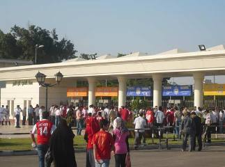

+++
title = "مهزلة علي أرض القاهرة"
date = 2009-02-08
authors = ["مدونة مايكليتو"]
aliases = ["/articles/masr-n19837/"]

[taxonomies]
authors = ["blog-maiklito"]
sections = ["masr"]

[extra]
section_name = "ولاد البلد"
share_image = "/media/masr.20at.com/currentarticleassets/9103-1.jpg"
summary = "شاءت الظروف أن أحضر مباراة الأهلي والصفاقسي التونسي بإستاد القاهرة وأن أكون متواجدا في مدرجات الصفاقسي رغم أهلاويتي الشديدة حتي النخاع"
section_slug = "masr"
section_colour = "#666666"
thumb = "/media/masr.20at.com/currentarticleassets/9103-1.jpg"
n_comments = 0
original_url = "http://20at.com/masr/egyptian-blogs/11226.html"
archived = "20100105152014"
date_source = "byline/meta"
aliases_20at = ["//masr.20at.com/newarticle.php?sid=19837", "/masr/egyptian-blogs/11226.html"]

[extra.provenance]
original_url = "http://20at.com/masr/egyptian-blogs/11226.html"
capture_url = "https://web.archive.org/web/20100105152014/http://20at.com/masr/egyptian-blogs/11226.html"
capture_label = "٥ يناير ٢٠١٠، ١٥:٢٠ UTC"
date_note = "من سطر التوقيع في المقال"
other_urls = ["//masr.20at.com/newarticle.php?sid=19837"]
comments = ""
missing_images = ""
+++

<figure></figure>

شاءت الظروف أن أحضر مباراة الأهلي والصفاقسي التونسي بإستاد القاهرة وأن أكون متواجدا في مدرجات الصفاقسي رغم أهلاويتي الشديدة حتي النخاع

وده بسبب أني كنت داخل مع زميلة تونسية عزيزة وطبعا مكنتش عاوز أبقي ندل واسيبها تدخل الاستاد وحدها خصوصا بعد ما فهمت منها أنها لم تدخل أي استاد لمشاهدة مباراة كرة قدم بتونس،فبما أني عندي خبرة واسعة في الحضور وعارف أن المباراة ما بين فريقين عربيين فتوقعت أن الزبيب حيشتغل(ضرب الحبيب زي أكل الزبيب) ولهذا قررت المغامرة والدخول خصوصا وأن فكرتي لم تكن جيدة بالنسبة للجمهور التونسي بسبب بعض الصدامات بينا وبينهم علي مدار سنين طويلة

ودي بعض الملحوظات اللي أخذتها بكل أمانة عن أجواء ما قبل وما بعد المباراة

أولا..الأمن المصري واصل همجيته وقمعيته المعروفة عنه وقاموا بتفتيش مهين جدا للجمهور التونسي بحجة منع دخول الشماريخ والالعاب النارية ولو حد شايف أن ده واجب الأمن لخروج المباراة في جو امن،فحقوله أن التفتيش ممكن يتم بأسلوب متحضر ولكن رجل الأمن بيعامل المشجع وهو داخل الاستاد وكأنه إرهابي جاء لتفيذ عملية في قلب القاهرة وده كافي جدا بإستثارة أعصابهم وشحنهم معنويا قبل الدخول بالإضافة لطريقة التفتيش المقززة التي تمت للمشجعات التونسيات ووصلت لدرجة العبث بأجسادهن مما دفع الكثيرات منهن للبكاء والشجار مع ضابطة الأمن الوقحة

ثانيا..التوانسة مثل المصريين تماما في تشجيعهم حيث يأخذون مباريات كرة القدم بحساسية شديدة علي أعصابهم ويصيحون ويسبون وينشدون أثناء المباراة وتقريبا بنفس ألفاظنا ولكن كان أكثر ما أعجبني هو إحترامهم لبعضهم الاخر فلم أجد تونسي يعاكس بنات بلده اللي بيشجعوا بمنتهي الحرية والمرح ولو كان المشهد ده عندنا في مدرجاتنا كان لازم حيقلب بتحرش وخناق وأظن أن كليب اليوتيوب في بطولة إفريقيا 2006 ليس ببعيد

ثالثا..بمجرد إحراز الصفاقسي هدف التعادل ،أشعل أحد المشجعين التوانسة شمروخا للإحتفال ولم يقذف به لأرض الاستاد،وفي هذه اللحظة،فوجئت بهجوم تتاري بربري من رجال الأمن وهم يسحلون هذا المشجع ويشبعونه ركلا وهو ُملقي علي الأرض في مشهد غير ادمي بالمرة ليتطور الموضوع إلي معركة بين الأمن ومشجعي الصفاقسي الذين دافعوا عن زميلهم والطريف أن الأمن بدل ما يحتوي الموضوع اللي هو تسبب فيه بغبائه،زاد الموضوع إشتعالا حين أصر علي إجبار الجماهير لتشاهد المباراة وهي جالسة بدلا من الوقوف..طب إيه علاقة ده بالأمن وإيه علاقة الأمن بواحد خلع تي شيرته فرحا بهدف التعادل..يعني المفروض يلطم مثلا؟

رابعا..بعد إنتهاء المباراة،رحل الجمهور التونسي في صمت ونظام ولم أري مشهد تدافع بين الجماهير مثلما يحدث لدينا عقب نهاية أي مباراة،وعندما صعدوا للأوتوبيس لمغادرة الاستاد،فوجئت بمشهد همجي اخر لا يمت للرياضة بصلة عندما اصطف العديد من جماهير الأهلي (معظمهم من الصبية الصغار) للتلويح بإشارات بذيئة للجماهير التونسية بالأصبع والأذرع ثم تطور الموضوع لرشق بعضهم بالحجارة للأوتوبيس ولكن الحمد الله عدي الموضوع علي خير ولم تحدث إصابات

السؤال..إيه القرف اللي إحنا بقينا فيه وليه الهمجية عندنا بقت هي العرف والعادة وماذا تتوقعون حدوثه عندما يذهب أي فريق مصري لتونس في القريب العاجل؟

