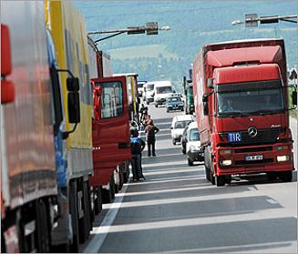

+++
title = "سواقين اخر زمن"
date = 2009-02-15
authors = ["مدونة قصص من حياتى"]
aliases = ["/articles/masr-n19987/"]

[taxonomies]
authors = ["blog-kass-men-hiata"]
sections = ["masr"]

[extra]
section_name = "ولاد البلد"
share_image = "/media/masr.20at.com/currentarticleassets/1_802183_1_34.jpg"
summary = "يعني انا عاوز افهم سواقين الميكروباص و المقطورات بيعملو اضراب لية اية البجاحة دي يعني يقتلو القتيل و يمشو في جنازتة يعني مش عاجبهم القانون و بيحملو طاقة العربية"
section_slug = "masr"
section_colour = "#666666"
thumb = "/media/masr.20at.com/currentarticleassets/1_802183_1_34.jpg"
n_comments = 2
original_url = "http://20at.com/masr/egyptian-blogs/11301.html"
archived = "20100105152108"
date_source = "byline/meta"
aliases_20at = ["//masr.20at.com/newarticle.php?sid=19987", "/masr/egyptian-blogs/11301.html"]

[extra.provenance]
original_url = "http://20at.com/masr/egyptian-blogs/11301.html"
capture_url = "https://web.archive.org/web/20100105152108/http://20at.com/masr/egyptian-blogs/11301.html"
capture_label = "٥ يناير ٢٠١٠، ١٥:٢١ UTC"
date_note = "من سطر التوقيع في المقال"
other_urls = ["//masr.20at.com/newarticle.php?sid=19987"]
comments = "٢"
missing_images = ""
+++

<figure></figure>

يعني انا عاوز افهم سواقين الميكروباص و المقطورات بيعملو اضراب لية اية البجاحة دي يعني يقتلو القتيل و يمشو في جنازتة يعني مش عاجبهم القانون و بيحملو طاقة العربية الضعف و يقولو يا بية ما تخليك حلو و لو اتكلمت مع حد فيهم يا تنزل من العربية يا نظام البلطجة يشتغل و عارفين كلنا و محدش يطلعني غلطان أن اغلب السواقين بيسوقو من غير رخصة او صغار في السن و مش مدركين بالمسئولية الي في العربية.

دة غير طريقتهم في السواقة بيسوقو بسرعة جداً و يقعدو يخمسو في الطريق ولا أكنهم بيلعبو اندر جروند و أغلبهم كمان مبرشم او ضارب حشيش او اسبرين عشان لو وقف في لجنة دة لو مهربش منها خلينا نكون واقعين الي بيعملو سواقين الميكروباص استعباط عشان عمال الضرايب العقارية عملو أضراب و كانو ناس محترمة و ليهم اهداف محددة و بردو عمال المحلة انما السواقين لية لية لية ولا هي بقت كلمة وخلاص عشان تلوي ايد القانون و يبقو هما فوق القانون.

طيب نشوف حوادث الطرق الي بقو ضحايا الطرق اكثر من ضحايا الانتفاضة العامل المشترك في حوادث الطريق سواق ميكروباص تحصل الحادث الاعلام و الناس يقولو فين القانون فين الناس الي بتتحاكم عشان القانون يكون فوق الكل الي بيعملو السواقين دة اسمو تحدي الدولة في فرض القانون عليهم

اما بقى المقطورات فحدث ولا حرج أكيد كلنا عارفين المقطورات بتمشي ازاي على طريق السويس السلام و كم من ضحايا الطريق ايضاً تكون بسبب المقطورات في الاخر يقولك القانون ظالم لا أنا بقى كمواطن مصري مع قانون المرور شوفو امريكا القانون ماشي على الكل محدش عمل هناك اضراب سواقين أكيد و انتو ماشين بردو في الطرق الي قولتها بتشوفو بيمشو ازاي في نص الطريق بيسلمو على بعض و يرمو السجاير لبعض و أغلبهم بيكون برضو ضاربين حشيش يا بانجو يا كيمياء و كمان المقطورات الي بتطلع مرة وحدة من الصحراء و هي لا تكون مولعة كشاف ولا كلكس ولا اي انذار

بجد احنا شعب اتعود على انو ميحترمش تطبيق القانون ولا القانون ولا الالتزام بقانون المفروض انو بيحافظ على حياة الناس الي في الطريق و دة سبب اخر من اسباب الفوضى السلوكية في مجتمع عشوائي بجد فية سواقين تستاهل بالي بتعملو في ارواح الناس على الطريق يكون ليهم ظباط من اياهم يطلعو عليهم غضبهم عشان يعرفو ان الله حق

الناس لازم تعرف ان القانون فوق الجميع و احترام القانون يعني احترام البلد و الطريق هو شركة بين المواطنين و ليس ملك سواقين الميكروباص وحدهم ولازم يعرفو كمان ان السواق الي مش هيلتزم بأحترام الطريق في قانون هيعاقبو عشان البلد مش سايبة

