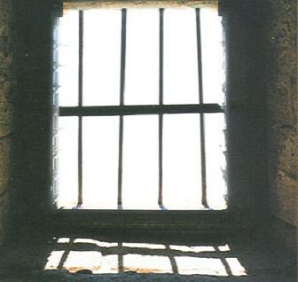

+++
title = "قبــلات مـسـجـونـة"
date = 2009-03-01
authors = ["البراء أشرف", "وانا مالي"]
aliases = ["/articles/masr-n20148/"]

[taxonomies]
authors = ["elbaraa-ashraf", "wana-mali"]
sections = ["masr"]

[extra]
section_name = "ولاد البلد"
share_image = "/media/masr.20at.com/currentarticleassets/cadge.jpg"
summary = "إذن، فأبويا مسجون في سجن المرج منذ شهرين وأكثر، بقرار من وزير داخليتنا باعتقاله و150 شخص قرروا التظاهر يوم جمعة لفتح معبر رفح.. وقد انتهت الحرب، ولا يزال أبي مع"
section_slug = "masr"
section_colour = "#666666"
thumb = "/media/masr.20at.com/currentarticleassets/cadge.jpg"
n_comments = 6
original_url = "http://20at.com/masr/egyptian-blogs/11443.html"
archived = "20100105151630"
date_source = "byline/meta"
aliases_20at = ["//masr.20at.com/newarticle.php?sid=20148", "/masr/egyptian-blogs/11443.html"]

[extra.provenance]
original_url = "http://20at.com/masr/egyptian-blogs/11443.html"
capture_url = "https://web.archive.org/web/20100105151630/http://20at.com/masr/egyptian-blogs/11443.html"
capture_label = "٥ يناير ٢٠١٠، ١٥:١٦ UTC"
date_note = "من سطر التوقيع في المقال"
other_urls = ["//masr.20at.com/newarticle.php?sid=20148"]
comments = "٦"
missing_images = ""
+++

<figure></figure>

إذن، فأبويا مسجون في سجن المرج منذ شهرين وأكثر، بقرار من وزير داخليتنا باعتقاله و150 شخص قرروا التظاهر يوم جمعة لفتح معبر رفح.. وقد انتهت الحرب، ولا يزال أبي معتقلاً.

أزوره كل خميس، وأجد نفسي مجبراً على مراقبة ما يحدث في الساعتين – مدة الزيارة – داخل القاعة الواسعة، التي تجمع المساجين والزائرين، مقسمة إلى قسمين، واحد للجنائي وآخر للسياسي، وهو تقسيم غير مرئي، فالجميع في حقيقة الأمر يجلسون في قاعة واحدة، كل نوع في ركن. تميزهم الألوان، الأزرق للجنائي والأبيض للسياسي، ولشخص مثلي، متفرغ للملاحظة، فإن ثمة أشياء أخرى تفرقهم.

في الخميس السابق للسبت، يوم الفالنتين، أدهشتني الكمية الكبيرة من الورود في يد زوجات لمعتقلين سياسين، لم أكن أعلم أن الإخوان يحتفلون بالعيد الرومانسي، الذي يحمل اسم قديس مسيحي، زوج الشباب سراً في وقت منعت فيه الدولة الزواج، فأعدم، وخلده العاشقين بعيد يحمل اسمه.

في اليوم السابق قرأت خبراً عن حملة لشباب الإخوان في جامعة القاهرة، تزامناً مع عيد الحب، مفادها أن حب الله ورسوله هو الحب الحقيقي، وكان رد فعلي متناسباً مع ما قرأت.. وفي المساء ذاته، توقفت قليلاً لشراء بضعة حاجات من سوبر ماركت على ناصية شارعي، فوجدت في الداخل شاشة تليفزيون مثبتة على قناة "الناس" وبها شخص ضخم، يجلس في منتصف الكادر، ويقول "يا مسكين.. تعرف إنت إيه عن الحب.. تعرف تحب ربنا؟ تعرف تحب الرسول.. أنت متعرفش حاجة عن الحب".. كان مظهره أقرب من الداعية لمدرب كرة السلة في النوادي المحلية.. سألت البائع في براءة بعد أن لاحظ وقوفي أمام الشاشة دقيقة أودقيقتين "مين الكابتن ده؟".. فرد باستهجان واضح "كابتن إيه يا كابتن.." وسكت برهة واستعد لقول شيء جديد.. إلا أني سحبت حاجاتي بسرعة، ورحلت.

لكن في داخل قاعة الزيارة كان الأمر مختلفاً.

رأيت من بعيد شاب معتقل يخرج لتوه من الباب الفاصل بين العنابر والقاعة، يبدو في حالة جيدة، هو على الأرجح استحم منذ قليل، ويضع عطراً جميلاً، يبدو متأنقاً، رغم أن ثيابه بالكامل بيضاء، تراه فتعرف أنه اهتم لأمر نفسه قبل أن يأتي إلينا.

ألقى بنظرة واسعة على المكان، يبحث عن أهله، حدد موقعهم وبدأ يتجه إليهم، هم أيضاً فعلوا، والتقوا في منتصف الطريق.

أتى إليه هذه المرة، أبوه، وأمه، وزوجته الشابة، وطفل صغير عمره أقل من عام، ينام معظم الوقت.

قبل رأس أبيه، واحتضنه بقوة، وكذلك فعل مع أمه، وكنت قد عرفت أنه لن يفعل ذلك مع زوجته، مراعاة للزحام، ولكونه من الإخوان المسلمين، الذين يتحدثون خارج السجن عن حب الله والرسول فقط.. أيضاً وجود الأب والأم يضفي على اللقاء جواً من الإحترام والرسمية..

لكن، وكأني مراهق يشاهد فيلم "تيتانك" للمرة الأولى، جذب الشاب زوجته تجاهه، بقوة، وكانت قد سلمت رضيعها إلى حماتها قبل ذلك بثانية، وأسكنها بين ذراعيه في حضن، ستحذفه الرقابة إن وجدته في فيلم لتامر حسني ومي عز الدين.

هي مخمرة، لها عيون جميلة، وأقصر منه ببضعة سنتيمترات، وتحبه، ويظهر ذلك في عيونها المثبتة تجاهه.. وفي هدوئها بين ذراعيه.

وهو رفيع، طويل، بشرته سمراء، وذقنه محددة ومهذبه، قصيرة للغاية، ستحتاج بعض الوقت لتعرف إن كان يتركها كعنوان إلتزام أم ضرورة روشنة.. يعشقها، سيظهر ذلك في أمرين.. القبلة القصيرة التي سيعطيها لها بعد الإحتضان.. ويده التي ستتحرك بعد ذلك مباشرة، تجاه بنطلونه، تشده لأسفل، وكأنها تحاول أن تداري تضخم عضوه.

وسينتهي الحضن والقبلة، وسيجلسون.

وسترى، إن كنت معي، في ركن الجنائيين، فتاة في العشرين، تقبل هي الأخرى يد أبيها.. وستخبر نفسك بقدر من التخمينات اللاإرادية.

تبدو الفتاة وكأنها غير موجودة، تنظر لساعتها كل دقيقتان، ولا تتحدث على الإطلاق.. كما أنها تثبت نظرها تجاه "طفاية حريق" معلقة على الحائط المقابل، وكأنها ترى فيها أمر يستحق الإهتمام عن أبوها الجالس إلى جوارها.

ستفهم أنها قررت في لحظة سابقة أن تلغي هذا الجزء من حياتها، ألا تصنع فروقاً بين زيارة أبيها في السجن، وزيارته في القبر، تغلق هذا الجزء وتضعه ضمن ذكريات الطفولة القديمة.

لهذه الفتاة صديق في الخارج، لا يعرف شيئاً عن أمر أبيها المسجون، وهي تمنعه من زيارة البيت، وستقبل الزواج منه دون علم الأهل.. أما عن القبلات التي وضعتها على يد والدها، فهي – على أفضل الأحوال – عادة طفولية قديمة، تشبه قراءة الفاتحة أمام القبر.

ستفكر في التخمينات السابقة، وتلوم نفسك، وسترى في الركن السياسي مشهد مطابق، فتاة أكبر قليلاً تقبل يد والدها، وستضع التخمينات ذاتها، وستتوقف عن لوم خيالك.. وترك له العنان.

وفي الركن السياسي أيضاً، وفي مكان منزوي به، سترى زوج وزوجة، أكبر من السابقين، تجاوزا الأربعين بقليل، وأمامهما طفلان، ينظران إليك، وظهرهما للأب والأم، المقتربان قليلاً وثمة حركة أيادي خفية في الأسفل يكاد لا يلمحها أحد.. وإن راقبت أكثر، فسترى قبلات مسروقة بين الفمين، وستعرف أن ممارسة الجنس بعد الأربعين ليست كابوساً كما كنت تتخيل.

سألت أبي، "كلكم هنا إخوان؟"، فقال "أيوة، واحد بس سلفي هناك أهو".. ونظرت إلهي، يرتدي ترينج أبيض من ماركة يرتديها الجميع اسمها "SKY TOP SPORT" وتباع في التوحيد والنور بمقاسات متعددة، لكنه يرفع بنظلونه إلى أعلى، ويثني أطرافه عند القدمين، فلا فارق بينه وبين أي سلفي في الطالبية بالهرم.

ويقف أمام زوجته المنقبة، التي ترتدي نقاباً أسود وأسفله يظهر بنطلون جينز، وحذاء رياضي أبيض، وتقف في مواجهته تماماً، وبينهما مسافة أقل من المسافة التي سيتركها المخرج بين ممثل وممثلة في فيلم رومانسي أمريكي يعرض للكبار فقط.

فضفاضة الجلباب التي ترتديه الزوجة، لا يسمح لأحد بالتفكير في أن الجسدين متلاصقين، لكنهما كذلك، وهناك قبلات كثيرة تؤخذ من ناحية اليسار حيث لا يجلس أحد، كما أن الشفايف تتلامس وبينهما نقاب، وهو أمر جيد.

أدرت نظري، فرأيت الشاب الأول وزوجته، يقفان بجوار البوابة بعيداً عن الزحام، ويمسك الشاب بشيكولاتة، ويكسرها أجزاء صغيرة، فيمسك بجزء جزء، يضعه في فمه، ويقطم نصفه، ويسكن النصف الثاني في فم الزوجة الشابة.

في الجانب الآخر، السياسي أيضاً، كان شاب وفتاة أصغر في السن، أخبرني أحدهم بأنهم كانوا على وشك الزواج، إلا أنهم "كاتبين كتابهم"، كانت الفتاة تريح رأسها إلى كتفه، وكان هو يمسك أطراف كفها، ويعبث بأظافرها الطويلة المهذبة.. وعلى وجه كل منهما، ابتسامة مطمئنة.

في طريق العودة، سألتني زوجتي، خدت بالك؟.. قلت "طبعاً، وكان أمراً مثيراً".. سكت قليلاً، ورأيت أن أصلح المعنى، فقلت أنه كان جميلاً أن أرى وجه أخر لهؤلاء، وأني اسمتعت بتلك الحرية الجماعية التي قرر الجميع ممارستها.. وأضفت أشياء كثيرة.. منها أن ما رأينها ليس أكثر من قبلات حلال مسجونة.. في سجن المرج

