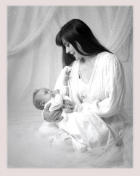

+++
title = "عـيـد الأم وحاجات تانيـة"
date = 2009-03-23
authors = ["أسماء عوني"]

[taxonomies]
authors = ["asmaa-aoni"]
sections = ["masr"]

[extra]
section_name = "ولاد البلد"
share_image = "/media/masr.20at.com/currentarticleassets/xnimmm7556.bmp"
summary = "الله يرحمك يا ماما , كنتي ام جميله اوي بس للاسف يا حبيبتي مالحقناش نطول مع بعض ونعد نحكي زي ما الامهات ما بتعمل مع بناتها بتعمل مع بعض اخرنا كان نتفرج عالكارتون"
section_slug = "masr"
section_colour = "#666666"
thumb = "/media/masr.20at.com/currentarticleassets/xnimmm7556.bmp"
n_comments = 0
original_url = "http://20at.com/masr/egyptian-blogs/11674.html"
archived = "20100105151706"
date_source = "byline/meta"
aliases_20at = ["/masr/egyptian-blogs/11674.html"]

[extra.provenance]
original_url = "http://20at.com/masr/egyptian-blogs/11674.html"
capture_url = "https://web.archive.org/web/20100105151706/http://20at.com/masr/egyptian-blogs/11674.html"
capture_label = "٥ يناير ٢٠١٠، ١٥:١٧ UTC"
date_note = "من سطر التوقيع في المقال"
other_urls = []
comments = ""
missing_images = ""
+++

<figure></figure>

الله يرحمك يا ماما , كنتي ام جميله اوي بس للاسف يا حبيبتي مالحقناش نطول مع بعض ونعد نحكي زي ما الامهات ما بتعمل مع بناتها بتعمل مع بعض اخرنا كان نتفرج عالكارتون نلعب كوره سوا تقعدي تهزايني علي الكوره شويتين , بس انا كنت بموت فيكي ولسه بموت فيكي ووحشتيني جدا وعلي فكره بقي انا عاوزه اعترفلك في اعتراف

انا دلوقت بلعب كوره اكتر من الاول هع هعععع

فعلا انا مش عارفه ازاي الواحد ممكن يعيش من غير ام

وطبعا بمناسبة عيد الام ده احب اوضح حاجه العسل اللي في الصوره دي مش امي .. لع . دي مرات ابويا

وده بقي الجزء التاني من حلقة النهارده

امي التانيه والقبل الاخيره والاخيره

مش عارفه هاقولك ايه

الكلام عليكي مش كفايه , لو هاقعد اوصف فيكي وفي حنيتك وفي حبك لينا انا واخواتي مش هاعرف اديلك حقك

ماحدش اصلا هيعرف يديكي حقك في الدنيا

انتي هتاخدي حقك في الجنه لانك تستاهليها

يارب يخليكي ليا

ويطول في عمرك

ومايحرمنيش منك ابدا ويرجعني بالسلامه مش عشان خاطر الشعب وكده لا لا لا

الشعب جمبك ايه بس

انا نفسي ارجع عشان ابوسك واحضنك وبس

وكل سنه وانتي طيبه يا احلي ام في الدنيا

