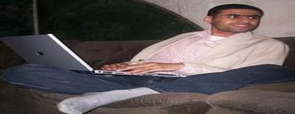

+++
title = "منعم هيفضل اخوان"
date = 2007-04-24
aliases = ["/articles/masr-n9887/"]

[taxonomies]
authors = []
sections = ["masr"]

[extra]
section_name = "ولاد البلد"
share_image = "/media/admins.20at.com/masr/men3em.jpg"
summary = "ويا ريت كل الاخوان زي منعم"
section_slug = "masr"
section_colour = "#666666"
thumb = "/media/admins.20at.com/masr/men3em.jpg"
n_comments = 3
original_url = "http://20at.com/masr/egyptian-blogs/5562.html"
archived = "20100105152941"
date_source = "byline/meta"
aliases_20at = ["//masr.20at.com/newarticle.php?sid=9887", "/masr/egyptian-blogs/5562.html"]

[extra.provenance]
original_url = "http://20at.com/masr/egyptian-blogs/5562.html"
capture_url = "https://web.archive.org/web/20100105152941/http://20at.com/masr/egyptian-blogs/5562.html"
capture_label = "٥ يناير ٢٠١٠، ١٥:٢٩ UTC"
date_note = "من سطر التوقيع في المقال"
other_urls = ["//masr.20at.com/newarticle.php?sid=9887"]
comments = "٣"
missing_images = ""
+++

<figure></figure>

ويا ريت كل الاخوان زي منعم

التقيته للمرة الأولى في يونيو 2005 حيث قمت بترجمة لقاء أجرته معه قناة بي بي اس. رأيته بعدها مرات عدة في مظاهرات ومؤتمرات متعددة الهوية وان جمعتها معارضة النظام، ولكن لم نتبادل حديثا قط. بدون اتفاق مسبق لعب الموبايل الدور الأكبر في بناء الثقة بيننا. لم يكن منعم قد بدأ التدوين بعد. أبعث اليه رسائل قصيرة عبر الموبايل عن آخر الاعتقالات ومؤتمرات كفاية، فيقوم بنشرها دون أن أطلب منه. وبالعكس، يوافيني برسائل قصيرة عن أخبار اعتقالات الاخوان فأعيد ارسالها الى هواتف النشطاء والاعلاميين والحقوقيين دون أن أقول له شيئا. وبالطبع لا أسلم من الانتقاد - لماذا تروجين للاخوان من هاتفك المحمول؟ هل جننتِ؟

ظلت علاقتنا هكذا عملية، مخلصة، غير مباشرة.. ولكن مع الوقت، والانتخابات الرئاسية ثم البرلمانية، وصدامنا - كل في طريقه - مع قوات وأجهزة أمن النظام، نما لدي احساس أن منعم هو “جيلي“.. يمثل مصر قدر ما أمثلها.. وأن له في قلبي مكان خالد عبد الحميد أو شرقاوي رغم أني لا أعرفه عن قرب.. وحين تم اعتقاله في مارس 2006 وجدتني أبكي.. ظللت على اتصال بزميلته ايمان عبد المنعم التي وافتني أخباره أثناء الاعتقال.. من أصعب المواقف التي مرت بي حينها اجراء مقابلة صحفية حول جماعة الاخوان مع لواء أمن الدولة السابق فؤاد علام في بيته بالمهندسين.. من الصعب جدا أن تلتزم الموضوعية - وليس الحياد - وتخفي مشاعرك أمام اللواء فؤاد علام وهو يتحدث عن التنظيم الارهابي السري للاخوان وخطرهم على أمن المواطنين بينما عبد المنعم محمود، الواد الاسكندراني المصري الجدع أبو مخ نضيف، في السجن

ذات مساء بينما أقود سيارتي في ميدان التحرير دق هاتفي برقم مجهول.. عادة لا أرد في مثل هذه الظروف ولكنه ما حدث.. جائني صوته قويا مبتهجا “أنا خرجت من السجن النهاردة ومن هنا ورايح دي هتبقى نمرتي، سجليها عندك.. هأسافر اسكندرية دلوقتي أطمن أهلي وأطمن عليهم وأرجع مصر (القاهرة) بعد بكرة”.. صرخت من الفرحة وبعدما قفلت السكة بكيت.. شاب أطلق سراحه منذ ساعات قليلة سيرى أهله مدة 48 ساعة فقط ويعود لدوره في التنظيم.. مش محتاج وقت.. مش محتاج يفكر.. مش محتاج يراجع نفسه.. وفي نفس الوقت مش دجمة، مش مغيب، مش جزء من القطيع.. صوته فرحان، مطمئن، وبخير.. تمنيت نفس الثبات والهدوء والوضوح للشباب الليبرالي والقومي واليساري والفرط

أنا أخوان

بدأ منعم التدوين في اكتوبر 2006.. عنوان مدونته جاء صادما، عنيدا، معترفا بتهمته الأزليه فخورا بها.. ذكرني بمشهد اعتقال نبيلة عبيد في فيلم الراقصة والسياسي حين قررت الراقصة نشر مذكراتها لفضح الفساد السياسي في مصر فلفقت لها أجهزة الأمن تهمة ارتداء بدلة رقص فاضحة.. لحظة القبض عليها قال لها الضابط “مش تخشي الكباريه تغيري هدومك يا مدام؟” ردت “لأ يا باشا أنا أحب أفضل لابسة التهمة بتاعتي” ن

في “أنا اخوان” أثبت منعم أن الاخوان ليسوا مجرد أرقاما تكتب وتردد بجوار كلمة “معتقل”.. رأينا من خلاله جيلا من الاخوان، اختلفنا معهم أو اتفقنا ولكننا رأيناهم لأول مرة كأفراد.. يتحدثون عن مشاكلهم ورؤيتهم ويختلفون مع بعضهم وينتقدون مسئوليهم وقياداتهم كما ننتقد نحن بيانات كفاية أحيانا ونختلف مع قياداتها.. وبدأ الاخوان في التدوين، والتعليق، والرد.. ولعل من أفضل ما كُتب هنا مقال مارك لينش الذي نشر في الجارديان تحت عنوان اخوان التدوين

أنا حر.. أنا انسان

في مارس 2007 وقت صدور الحكم بأربع سنوات سجن للمدون كريم عامر كلفت باستنفار موقف من الاخوان.. أرسلت لمنعم وفوجئت برده “أنا نشرت يا ستي من خمس دقايق شوفي البلوج بتاعي وبلاش نظام محاكم التفتيش ده :-)”.. كتب منعم في مدونته الحرية للاخوان.. الحرية لعبد الكريم.. الحرية لمصر.. وبالطبع لم يسلم منعم من النقد فكيف يتضامن الناشط الاخواني مع كريم عامر الذي انتقد الأزهر وأهان المسلمين؟ كيف يطالب بالحرية والآدمية لمن يختلف معه عقائديا وفكريا؟ كيف يخرج أحد شباب الاخوان عن القطيع؟

أنا محاصر

فجر الجمعة 13 ابريل وصلتني رسالته “قد يكون هذا آخر ما أستطيع مراسلتكم به خبر كتبته مدونه انسى عن مداهمة منزل والدي ومن المنتظر أن أقدم نفسي للنيابة”.. في مراسلات أخرى خاطفة قال لي أنه قلق جدا على صحة والده فهو مريض جدا، وشقيقه الأوحد خارج البلاد، وأنه حانق على نظام مبارك الذي بعث بكتيبة قوات خاصة لترويع رجل وامرأة مسنان من أجل القبض على الارهابي عبد المنعم محمود.. قال منعم أنه يفكر في تسليم نفسه ومنتظر رأي المحامين.. بعدها قرر اختبار أمر القبض عليه وبالفعل تم انزاله من طائرة كان يستقلها لرحلة عمل ويلفت أحمد غربية نظرنا أنه بدلا من تحويله لنيابة مصر الجديدة القريبة من مطار القاهرة تم تحويله لنيابة شبرا (؟) اليوم تدهورت حالة والد عبد المنعم الصحية وتم نقله الى العناية المركزة وهناك قلق على حياته

هزل

منعم مثل أمام نيابة شبرا التي قررت حبسه خمسة عشر يوما واتهمته بحفنة تهم هزلية منها التشهير بالنظام المصري واثارة الشكوك حول عمليات تعذيب منهجية بأقسام الشرطة والسجون.. يبدو المنطق، ان وجد، وراء المشهد كله هزليا.. فمنعم، وان عذبوه كما عذبوه من قبل (فيديو)، سوف يخرج في نهاية المطاف.. وسيظل مدونا.. وسيظل اخوان

ويا ريت كل الاخوان زي منعم.. ولكن هذا بالضبط ما لا يريده النظام

حملات الاقصاء المبكر للكوادر المستنيرة من التيارات المختلفة، أو انهاكها، تتم منهجيا من أجل الحفاظ على ثبات الحالة في مصر وحجم الفراغ على الساحة السياسية.. من المهم جدا للنظام أن تستمر فزاعة الاخوان بخطاباتهم الظلامية وقطعانهم العمياء، وبذلك يستمر تخبط المعارضة وتحللها ويبقى جمال مبارك في صورة البديل

مفارقة

يستمر منعم في اثارة جدلا واسعا حتى وهو في محبسه.. شباب الاخوان من المدونين ينظمون وقفة تضامنية بلوحات المفاتيح (كي بورد) بنقابة الصحفيين ويدل مستوى التنظيم والدعاية أنها مبادرة فردية خارج اطار الجماعة، ومع ذلك استطاعوا نشر الدعوة على موقع الاخوان.. فكرة الكي بورد تنبئنا بقدرتهم على الابداع والتطوير.. حتى الفتيات أخذن المخاطرة وخرجن بدون اذن (للمرة الأولى) من أجل التضامن مع زميلهن منعم

ويأتي بيان مركز النديم لحقوق الانسان وبعض المراكز المصرية الأخرى حول اعتقال عبد المنعم دليلا على الاتساق مع الذات والمباديء والأهداف التي أنشأت تلك المراكز من أجلها.. في ذات الوقت يضع منعم دعاة الحرية والديموقراطية في الادارة الامريكية في مأزق.. فالذين تضامنوا أو أصدروا بيانات أو نادوا بحرية علاء، ثم شرقاوي، ثم كريم عامر، ربما يرغبون في صم آذانهم عن اعتقال مدون اخواني.. ولكن منعم ليس أي اخواني.. انسانيته، فرديته، واعلاؤه لقيم الحرية والديموقراطية تجعل مهمتهم أصعب وتستدعي منا جميعا وقفة

مكان منعم في بيته، أمام شاشة الكمبيوتر، بجوار والده المسن المريض.. أما السجن فله آخرون

