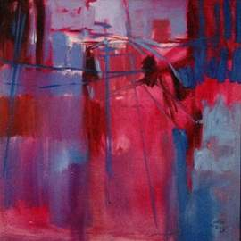

+++
title = "الطريق السريع"
date = 2007-05-02
authors = ["مدونة حنين"]

[taxonomies]
authors = ["blog-hanin"]
sections = ["masr"]

[extra]
section_name = "ولاد البلد"
share_image = "/media/admins.20at.com/masr/7nen2.jpg"
summary = "تستيقظ فجاه ذات صباح"
section_slug = "masr"
section_colour = "#666666"
thumb = "/media/admins.20at.com/masr/7nen2.jpg"
n_comments = 0
original_url = "http://20at.com/masr/egyptian-blogs/5702.html"
archived = "20100105153118"
date_source = "byline/meta"
aliases_20at = ["/masr/egyptian-blogs/5702.html"]

[extra.provenance]
original_url = "http://20at.com/masr/egyptian-blogs/5702.html"
capture_url = "https://web.archive.org/web/20100105153118/http://20at.com/masr/egyptian-blogs/5702.html"
capture_label = "٥ يناير ٢٠١٠، ١٥:٣١ UTC"
date_note = "من سطر التوقيع في المقال"
other_urls = []
comments = ""
missing_images = ""
+++

<figure></figure>

تستيقظ فجاه ذات صباح

لتجد نفسك فى منتصف طريق سريع

عند المنعطف تماما

لا تحملك قدماك

فأنت لم تعد تشعر بهما

تأتيك أصوات من بعيد

لا تدرى من أي اتجاه

يبدو أنها شاحنه وربما اثنتان

أنت ميت لا محالة

تتمنى لو كان حلما

آخر ما تذكر أنك كنت في فراشك الدافئ أمس

تلمح شاحنه قادمة من بعيد

تشيح بوجهك عنها لتجد أخرى قادمة من الجانب الآخر

تحاول أن تتمنى أمنية خلاص ولكن لا كلمات ولا وقت

لا تجد ما ومن تفكر به

كم كنت تتمنى نهاية أخرى أكثر آدميه

تلمح عجلات الشاحنة تقترب

تحاول أن تتفاداك ولكن كيف وهناك أخرى على الجانب الآخر من المنعطف

تتهاوى

تغمض عيناك وأنت ترى جسدك بين العجلات الأمامية

مرت العربة فوقه

كان في المنتصف تماما

توقف السائق

ليتفحصه

تأكد أنه مازال حيا لم يصب بخدش

صحبه إلى المستشفى

كان يسمع كلمات الأطباء

كتب له عمر جديد

كانت أكثر من مجرد صدمه عصبيه

سيشفى منها بعد أيام قليله

ولكنه أبدا لن يعد هو

ليست الجروح فقط هي أقوى ما قد يخدشنا ويترك علامات فينا

الجروح تشفى

ولكن بعض الكلمات والمواقف تحمل ندوبا أكثر عمقا من الكسر والجرح

