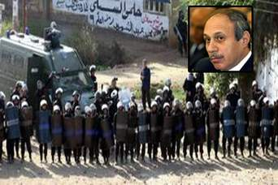

+++
title = "تحيا البلطجة يحيا الرئيس"
date = 2008-07-06
authors = ["بكري حسن"]
aliases = ["/articles/masr-n16645/"]

[taxonomies]
authors = ["bakri-hassan"]
sections = ["masr"]

[extra]
section_name = "ولاد البلد"
share_image = "/media/masr.20at.com/currentarticleassets/hosh16.jpg"
summary = "تحيا البلطجة يحيا الرئيس"
section_slug = "masr"
section_colour = "#666666"
thumb = "/media/masr.20at.com/currentarticleassets/hosh16.jpg"
n_comments = 2
original_url = "http://20at.com/masr/egyptian-blogs/9542.html"
archived = "20100105150842"
date_source = "byline/meta"
aliases_20at = ["//masr.20at.com/newarticle.php?sid=16645", "/masr/egyptian-blogs/9542.html"]

[extra.provenance]
original_url = "http://20at.com/masr/egyptian-blogs/9542.html"
capture_url = "https://web.archive.org/web/20100105150842/http://20at.com/masr/egyptian-blogs/9542.html"
capture_label = "٥ يناير ٢٠١٠، ١٥:٠٨ UTC"
date_note = "من سطر التوقيع في المقال"
other_urls = ["//masr.20at.com/newarticle.php?sid=16645"]
comments = "٢"
missing_images = ""
+++

<figure></figure>

تحيا البلطجة يحيا الرئيس

حتي لا اؤخذ بجرم لم ارتكبه اعترف انني اجبن من ان انقد الرئيس مبارك.وانه بالنسبة لي كما هو لغيري من المصريين.بمثابة الإله.وان من ينقده لابد وان تحل عليه لعنة النظام.فيعيش وحيدا وقد يموت وحيدا.ويمكن ان يصل الامر به ألا يشيعه احد من المسئولين.حتي وهو يستقبل بجسده ورحه عالمه الجديد.الذي لا يدري فيه.هل هو احسن ام اساء.

اقول ذلك حتي لا يدخل في روع احدهم انني اربط بين البلطجة وبين الرئيس.ذلك لانني احترم مقام الرئاسة. وهذا ما تعلمته من اساتذتنا ومن استاذنا الكبير هيكل.بيد انني لا اضع الرئيس في مرتبة القداسة.فهو بشر يخطيء ويصيب.ونقده حق لكل مواطن مصري ان كان هناك ما يستدعي النقد.بيد ان من يطالع الصحف المصرية هذة الايام.لابد وان يزعجه ما يحدث من بلطجة في طول البلاد وعرضها.وكأنه لا دولة ولا نظام.فان كان لابد من قمع المعارضين.فلماذا لا يتم بالمثل قمع البلطجية.وان كانت الدولة تستأسد علي الكهول واصحاب الاقلام الشريفة.فلماذا لا تفعل هذا مع البلطجية. الذين يعيثون في البلاد الفساد.اين الرئيس رأس النظام من امن يترك مجموعة من البلطجية يثيرون الرعب والفزع في قلوب الناس الابرياء.وعندما تنزف الدماء وتنتهي المهزلة.يتدخل اسود العادلي.اسود علي الشرفاء المحترمين.وغير ذلك مع البلطجية والمجرمين.

لا تكاد تخلو منطقة في مصر اليوم من البلطجية.حتي الكبار باتوا يتعاملون مع بعضهم بشريعة البلطجة.ولا حول ولا قوة إلا بالله.فماذا يفعل الضعفاء والابرياء من المصريين. فامامهم سلطة باطشة غاشمة لا تنظر إلا لحفظ كرسي الرئيس.وخلفهم كبار وصغار البلطجية.فمن يحمي ضعفاء مصر من اذي البلطجة ولمن يلجأون.

