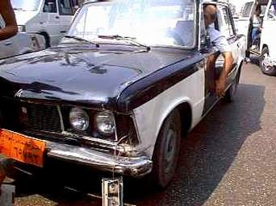

+++
title = "احنا بنرضي الزبون"
date = 2008-07-27
aliases = ["/articles/masr-n16967/"]

[taxonomies]
authors = []
sections = ["masr"]

[extra]
section_name = "ولاد البلد"
share_image = "/media/masr.20at.com/currentarticleassets/taxi2.jpg"
summary = "احنا المصريين بنتميز عن كل شعوب الأرض بكمية نفاق رهيبة ومش موجودة عند اي حد تاني في أوروبا والدول المتقدمة والأمثلة على ده كتيرة ومعدودة لأننا ببساطة بنحاول بشت"
section_slug = "masr"
section_colour = "#666666"
thumb = "/media/masr.20at.com/currentarticleassets/taxi2.jpg"
n_comments = 1
original_url = "http://20at.com/masr/egyptian-blogs/9721.html"
archived = "20100105151235"
date_source = "byline/meta"
aliases_20at = ["//masr.20at.com/newarticle.php?sid=16967", "/masr/egyptian-blogs/9721.html"]

[extra.provenance]
original_url = "http://20at.com/masr/egyptian-blogs/9721.html"
capture_url = "https://web.archive.org/web/20100105151235/http://20at.com/masr/egyptian-blogs/9721.html"
capture_label = "٥ يناير ٢٠١٠، ١٥:١٢ UTC"
date_note = "من سطر التوقيع في المقال"
other_urls = ["//masr.20at.com/newarticle.php?sid=16967"]
comments = "١"
missing_images = ""
+++

<figure></figure>

احنا المصريين بنتميز عن كل شعوب الأرض بكمية نفاق رهيبة ومش موجودة عند اي حد تاني في أوروبا والدول المتقدمة والأمثلة على ده كتيرة ومعدودة لأننا ببساطة بنحاول بشتى الطرق اننا نتحايل على الظروف وبنلعب بالبيضة والحجر مش لشئ مش لحاجة غير ان الناس بتحاول تعيش وسط الظروف الهباب اللي عايشينها في مصر المهروسة وبتحاول كمان إنها ترضي جميع الأطراف .

فعلى سبيل المثال ومحدش يفهمني صح اي بني آدم مننا بيجي عليه ساعات والعظمة بتاخده والجلالة بتضرب في دماغه يقوم واخد تاكسي عشان يوصله لمكان معين مش بعيد ودي بتبقى نادرة لأن المرتب مافيهوش اللي يكفي مشوارين تاكسي من أبو بريزة ..الواحد من دول تلاقيه رمى السلام على الأسطى وبصله بطرف عينه ويقوم قافل الباب قفله كأنه متعود يركب تاكسيات ويطلع ايديه اليمين من الشباك وأول ما يطلع السواق يبدأ الحوار التقليدي عن الزحمة والأسعار والناس اللي مش لاقية تاكل _مع إنه واحد منهم_ واذ فجأة تلاقي ميكروباص طلع من أي شارع جانبي وسواق التاكسي يتلخبط ويبدأ يتف على سواق الميروباص ويشتمه بشتايم من اللي يحبها قلب الجزمة وبدون سابق انذار وعلى سهوة تلاقي الراكب مننا نط في وسط الكلام وقايل بصوت واثق :"تلاقيه كان عربجي جعان وباع الكارو واشترى ميكروباص .. دول بهايم راكبة عربيات" ويتجه الحوار ناحية مهنة السواقة اللي لمت العربجية والتباعين وبقى بتوع الميكروباصات واكلين الجو من التوكسة "جمع تاكسي " وبمنتهى اللطافة تلاقي الزبون عمال يراضي سواق التاكسي ويقله معلش دي بلد فوضى ربنا يتوب علينا منهم.

المشهد التاني :الحالة آخر الشهر طبعا مش ولابد والبيه اللي ركب تاكسي امبارح النهاردة كل اللي في جيبه يوديه ويجيبه في ميكرباص بالعافية ولو اتزنق في حد معرفة ممكن يروح ماشي يبقى الحل الميكروباص اللي كان سايقه العربجي امبارح وطبعا حكاية العربجي اتنست وبعدين ماله العربجي ماهو كان سايق حمار زي الفل ولا عمره زعل حد .. يا سلام لو ركوب الزبون جه جنب السواق وفي حين ماهما ماشيين اذ بملاكي تقوم كاسرة على الميكروباص تقوم عجلة القيادة تختل في ايديه ويرتبك والناس تقول يا ساتر يارب ، وبعد البوليكة ما تخلص صاحبنا اللي كان بيشتم العربجية بتوع الميكروباص هتلاقيه بمنتهى العزم والثقة في النفس بيقول :" الله يخرب بيت اللي ركبهالك .. البيه فاكر الطريق بتاعه وبتاع أبوه وعاوز يدوس على الناس .. ياخي ملعون ابو التناكة " يقوم السواق _ العربجي سابقا_ يهدي الزبون المتغاظ من بتوع الملاكي تلك الطبقة الفاسدة اللي عايزة تدوس على الناس بعربياتها ويقوله اهي الأشكال دي بتقابلنا كل يوم يابيه فيرد الزبون معلش منه لله اللي كان السبب وساب الأشكال دي تركب عربيات وتدوس على الناس فينك يا عبدالناصر ؟!.

المشكلة ان الزبون بينزل في الحالتين منتشي ومبسوط انه فتح حوار مع السواقين بتاع التاكسي والميكروباص واستعرض أمامهما امكانياته في نقد الآخرين مش لحاجة غير انه كان عاوز يرضي الطرفين .

ـــــــــــــــــــــــــــ

* نقلا عن مدونة نعكشة

