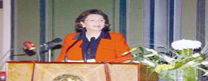

+++
title = "القاعدة والاستثناء"
date = 2010-01-05
authors = ["مجدى مهنا", "المصري اليوم"]

[taxonomies]
authors = ["magdy-mahna", "elmasry-alyoum"]
sections = ["masr"]

[extra]
section_name = "ولاد البلد"
share_image = "/media/admins.20at.com/masr/sozan.jpg"
summary = "السيد/..."
section_slug = "masr"
section_colour = "#666666"
thumb = "/media/admins.20at.com/masr/sozan.jpg"
n_comments = 0
original_url = "http://20at.com/masr/egyptian-newspapers/5513.html"
archived = "20100105161337"
date_source = "first-capture"
aliases_20at = ["/masr/egyptian-newspapers/5513.html"]

[extra.provenance]
original_url = "http://20at.com/masr/egyptian-newspapers/5513.html"
capture_url = "https://web.archive.org/web/20100105161337/http://20at.com/masr/egyptian-newspapers/5513.html"
capture_label = "٥ يناير ٢٠١٠، ١٦:١٣ UTC"
date_note = "تاريخ أول لقطة في الأرشيف (لا يوجد تاريخ في المقال)"
other_urls = []
comments = ""
missing_images = ""
+++

<figure></figure>

السيد/...

اسمح لي بعرض واقعة مغايرة للعشوائية الأمنية التي تعرضت لها أنا شخصيا مع زوجتي، وهي إسبانية الجنسية، عند زيارتنا لمتحف الفن الحديث في الأوبرا بعد ظهر يوم الأربعاء الماضي الذي كان ليلة حفل فرقة البولشوي، فعند قيامنا بمغادرة المتحف في السابعة مساءً تقريبا، وجدنا بعض رجال الأمن يرفضون أن نمشي في الممر المحازي لقاعة العرض، بدعوي أن الأشخاص المصرح لهم بذلك هم من يحملون تذاكر العرض، وطلبوا مني وزوجتي الخروج من المدخل الآخر القريب من كوبري قصر النيل،

وهو ما قمنا به، إلا أنه بعد قيامنا بالعبور وسط إشارات المرور باتجاه كوبري قصر النيل من ناحية حديقة الجزيرة، وجدنا أحد ضباط الشرطة يرفض مرورنا من هذا الجانب، بدعوي أسباب أمنية، ويطلب منا العودة مجددا للعبور من الضفة الأخري للكوبري، وهو ما قمنا بعمله، ولكننا فوجئنا عند قيامنا بذلك بأن أناسا آخرين كانوا يعبرون الجانب الذي تم منعنا منه دون أي معايير.

واسمح لي أيضا أن أنوه بأنه عند خروجنا من أرض دار الأوبرا فوجئنا بأن الأمن يفتش الداخلين بعد التأكد من حملهم تذاكر العرض، ويطلب منهم إغلاق الموبايلات ويمنع الأشخاص الآخرين من الدخول، بدعوي أن دار الأوبرا مخصصة فقط لحاملي تذاكر حفلة البولشوي.

وقد خرجت أنا وزوجتي بانطباع عن حجم العشوائية الأمنية، التي يتعرض لها المواطنون في مصر، دون وجود دوافع منطقية أو عملية من شأنها توفير إجراءات التأمين والحماية التي ينشدها رجال الأمن، ولكن فقط الإحساس بأنهم يفرضون قيودا تعسفية تزيد من معاناة المصريين في الحركة بسهولة وحرية داخل وطنهم، وذلك بالمقارنة بدول أخري نزورها ونعيش بها.

التوقيع: طارق محمود ـ صحفي بوكالة أنباء «الشرق الأوسط»

.. ربما ما سميته «العشوائية الأمنية» هو القاعدة عند زيارة أي مسؤول أو شخصية كبيرة أي موقع من المواقع، خاصة إذا كان في حجم ومكانة السيدة سوزان مبارك، وهي التي حضرت حفل «البولشوي» الروسي في ذلك اليوم الذي تحدثت عنه، ولعل الاستثناء هو ما شاهدته أنا بنفسي في ذلك اليوم، حيث لم ألق أي معاناة قبل دخولي، أو بعد خروجي من الحفل، ولاشك أن المئات غيري مروا بالتجربة نفسها أمامي، حيث لم نشهد أو نلحظ أي شيء غير عادي، لدرجة أنني لم أعرف بحضور السيدة سوزان مبارك، إلا بعد انتهاء العرض من أحد جمهور الأوبرا،

والإجراءات الأمنية كانت هي الأخري عادية، لكن هذا لا يعني أن ما ترويه من أحداث غير حقيقي، كما قال لي أحد رواد حفل البولشوي أنه أجبر علي الجلوس في مكان غير المخصص له في التذكرة، وأن قيمة المكان الذي جلس فيه من الناحية المالية أقل من القيمة التي دفعها في التذكرة، ولاشك أيضا أن هناك العشرات أو المئات من المواطنين مروا بنفس هذه التجارب السيئة.

إنني تحدثت في مقال سابق عما شاهدته، ورأيت من الأمانة والموضوعية أن أشير إليه، لأنني منذ أسبوع تقريبا وجهت انتقادا عنيفا لرجال الأمن بسبب الإجراءات الأمنية التي اتخذت في حضور السيدة سوزان مبارك للأوبرا.

وما شاهدته يوم الأربعاء الماضي لا أتصور أنه القاعدة، بل لعله الاستثناء، فالقاعدة هي تعذيب المواطنين والمبالغة في الإجراءات الأمنية أو ما تسميه أنت «العشوائية الأمنية»، والاستثناء هو البحث عن راحة المواطن أثناء زيارة أو مرور إحدي الشخصيات الكبيرة لأحد المواقع، وقد تناولت ذلك بالنقد عشرات المرات، خاصة في جولات رئيس الجمهورية التي تحولت إلي عمليات تعذيب للمواطنين.. فأمن الرئيس أو المسؤول الكبير يسبق أمن المواطن، وهذه قاعدة ليس لها استثناء.

