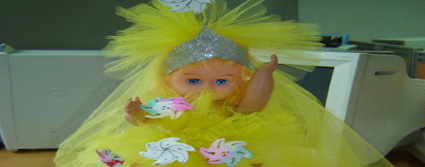

+++
title = "حلاوة المولد.. ناس وناس"
date = 2006-04-09
authors = ["دعاء الشامي"]
aliases = ["/articles/component-content-article-1-archive-3766/", "/articles/masr-144/"]

[taxonomies]
authors = ["doaa-elshamy"]
sections = ["masr"]

[extra]
section_name = "ولاد البلد"
share_image = "/media/admins.20at.com/masr/molod.jpg"
summary = "عروسة.. حصان.. أو جمل صغير، كانت هذه هي أقصى ما نحلم به في ليلة المولد، حصان حلاوة صغير أو كبير المهم حصان وعروسة لونها شربات ومتزوقه بورق يلمع أو من غير ورق ال"
section_slug = "masr"
section_colour = "#666666"
thumb = "/media/admins.20at.com/masr/molod.jpg"
n_comments = 9
original_url = "http://www.20at.com:80/masr/hot-topics/3766-2010-02-25-15-29-54.html"
archived = "20100228202850"
date_source = "byline/meta"
aliases_20at = ["//masr.20at.com/article.php?sid=144", "/component/content/article/1-archive/3766.html", "/masr/hot-topics/3766-2010-02-25-15-29-54.html"]

[extra.provenance]
original_url = "http://www.20at.com:80/masr/hot-topics/3766-2010-02-25-15-29-54.html"
capture_url = "https://web.archive.org/web/20100228202850/http://www.20at.com:80/masr/hot-topics/3766-2010-02-25-15-29-54.html"
capture_label = "٢٨ فبراير ٢٠١٠، ٢٠:٢٨ UTC"
date_note = "من سطر التوقيع في المقال"
other_urls = ["//masr.20at.com/article.php?sid=144", "/component/content/article/1-archive/3766.html"]
comments = "٩"
missing_images = ""
+++

<figure></figure>

عروسة.. حصان.. أو جمل صغير، كانت هذه هي أقصى ما نحلم به في ليلة المولد، حصان حلاوة صغير أو كبير المهم حصان وعروسة لونها شربات ومتزوقه بورق يلمع أو من غير ورق المهم عروسة، ولأنها مصنوعة من السكر والألوان كنا نلعب بها في أول النهار ونأكلها بالليل لنؤكد ونعترف لأول مرة بمقولة "بلها واشرب ميتها" وكانت ميتها زى السكر وزى ليه ماهي فعلا سكر.

ورغم أننا كنا نصر على شرائها قبل المولد بعدة أيام لكي تطول فترة اللعب وتصل إلى اكبر وقت قبل الأكل، إلا إن أي منا لم يبحث أو يتعب نفسه في البحث أو حتى التفكير في تاريخ العروسة أو الحصان، ولما كبرنا وسألنا أو بمعنى اصح بحثنا عرفنا إنها دخلت مصر في عصر الفاطميين الله يمسيهم بالخير.

<h3 class="center"> مدد يا رسول الله</h3>

ولآن المصريين يحبون فكرة الاحتفالات واحتفائهم بيت الرسول، انتشر موضوع الاحتفال وأضافوا إليه الكثير، فترى الاحتفال على حق حتى الآن بنفس الطقوس تقريبا في الأماكن الشعبية والتي يوجد بها مقامات أو أضرحة لآل البيت مثل السيدة زينب والسيدة نفيسة والحسين.

حيث تقام الاحتفالات لسبعة أيام متتالية وتنتهي يوم مولد الرسول صلى الله عليه وسلم وتنتهي بالزفة التي يرقص فيها الحصان وحوله الرجال يهتزون من فرط النشوة من التفقير(مصطلح معروف اللي مش عارف يبحث تاني) وراء الشيخ.

وكذلك أجواء وليالي المديح وقراءة الأشعار وإنشاد المديح في حب النبي صلى الله عليه وسلم بأصوات المداحين المعروفين وكان أكثرهم شهرة محمد الكحلاوي (الله يرحمه)، ومن المفيد أن هذه الأضرحة موزعة على مختلف أنحاء الجمهورية فتجد سيدي إبراهيم الدسوقي في دسوق والسيد البدوي في طنطا والسيدة زينب والحسين في القاهرة وهكذا.

كما أن هناك بعض الأكلات المفضلة لدى المصريين في هذا اليوم مثل الفتى(أرز باللحمة للي مش عارف ومعندوش وقت للبحث) واللحوم وطبعا الحلويات وعرائس وعرسان المولد (لعب مش بجد) لتصبح هذه الليالي فرصة للاحتفاء بالنبي على الطريقة المصرية جدا.

<h3 class="center">على قد لحافك</h3>

ولكن يبدو أن مولد النبي هذا العام جاء بطعم مختلف في ظل انتشار انفلوانزا الطيور والحمى القلاعية وحمى أسعار الحلويات أيضا، فعلى أيامنا لم تكن العروسة أو الحصان أو حتى كيلو الحلويات المشكل يكلف الأسرة الكثير فالموضوع كله على بعضه لا يتعدى عشرة جنيهات للأسرة كلها، أما الآن ومع انقلاب الموازين واختلاف المقاييس وغلا ء الأسعار وحيث أن الدنيا ولعت الحلاوة أصبحت نادرة بعد إغلاق المصانع التي بناها الفاطميون الموضوع كبر وخرج من لوحة التحكم.

وفي جولة في محلات بيع العرائس والحلويات اكتشفنا مفاجأة من النوع الثقيل اختفت عروسة المولد المصنوعة من الحلوى والسكر تماما فلا توجد ولا عروسة توحد ربنا في المحلات كلها، وكان رد البعض أنها مضرة بالصحة وغير مأمونة العواقب.

وليست العرائس وحدها هي المختفية عن العيون بل الأسعار أيضا، ففي الوقت الذي كانت العشرة جنيهات تسعد أسرة في هذا اليوم أصبحت ألان لا تكفي ثمنا لنصف عروسة لبنت واحدة في البيت، لان سعر اقل عروسة متذوقة 25 جنيه في اقل المحلات يعني في المناطق الشعبية مش في الهاي كلاس"الأغنياء يعني"، بحسبة بسيطة لو عندك بنتين وولد على الأقل محتاج 100 جنيه عرائس وعرسان يا بلاش.

وكمان أسعار الحلويات ارتفعت لان سعر الكيلو الواحد من الحلويات الدرجة العاشرة ثمنه 10جنيه على اقل تقدير واحسبها وفقا لعدد أسرتك.

<h3 class="center">عندك واحد هاي كلاس</h3>

واكتشفت عبر الصور أن كل شيء في مصر يكرس لنظرية "الناس مقامات " وعلى رأي المثل الشعبي المصري " على قد لحافك مد رجليك" ففي حين يتراوح سعر كيلو الحلويات في المناطق الشعبية العادية أو البسيطة بين 8-15 جنيه ترى الموضوع قفز مرة واحدة ليصل إلى 200-500 جنيه في مناطق أخرى ربنا يبعت.

"وطبعا الشكل مختلف والجودة مختلفة والتنسيق كمان، لكن من فضلك بلاش تنزلي صورنا مع صور الأماكن البيئة لأننا بنبيع للأجانب فقط وللمصرين الهاي كلاس أحنا محل حلويات محترم"

الجملة السابقة هي رد مدير محل حلويات في منطقة محترمة(؟!) المحل يحتفل بالمولد النبوي الشريف بديكور فظيع ومبتكر من الورد والدانتيل وغيره وكاتب لوحة كبيرة باللغة الانجليزية لأنه زى ما لاحظتم بيبيع للأجانب بس نسيت اسأله هم الأجانب مسلمين ولا الحلويات زينه ولا إيه؟، عموما هو قال كده لما سألني أنا صورت محلات إيه ولما جاوبت وكانت محلات عادية ولو إنها في نفس المنطقة كان رده كما قرأتموه.

عموما واختصارا للوقت والمجهود وتوفيرا لحرقة الدم تعالوا نشوف مع بعض جاليري صور الناس العادية والناس الهاي كلاس على رأي أخينا المدير.

