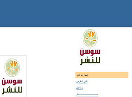

+++
title = "مع \"سوسن\".. أنت مبدع !"
date = 2007-05-05
authors = ["أميرة حسن"]

[taxonomies]
authors = ["amira-hassan"]
sections = ["masr"]

[extra]
section_name = "ولاد البلد"
share_image = "/media/admins.20at.com/masr/saw02.jpg"
summary = "\"إعلان لكل المبدعين والعباقرة والفشلة والعاديين الذين على الورق ومن يكتبون على الحائط لم يعد النشر شاق.. المهم تكتب.. دار سوسن للنشر البلوجيّ, تعلن في تحد سافر "
section_slug = "masr"
section_colour = "#666666"
thumb = "/media/admins.20at.com/masr/saw02.jpg"
n_comments = 0
original_url = "http://masr.20at.com:80/newArticle.php?sid=10072"
archived = "20080526031534"
date_source = "byline/meta"
aliases_20at = ["//masr.20at.com/newarticle.php?sid=10072"]

[extra.provenance]
original_url = "http://masr.20at.com:80/newArticle.php?sid=10072"
capture_url = "https://web.archive.org/web/20080526031534/http://masr.20at.com:80/newArticle.php?sid=10072"
capture_label = "٢٦ مايو ٢٠٠٨، ٠٣:١٥ UTC"
date_note = "من سطر التوقيع في المقال"
other_urls = []
comments = ""
missing_images = ""
+++

{{ <figure src="/media/admins.20at.com/masr/saw1.jpg" alt="" /> }}

{{ <figure src="/media/admins.20at.com/masr/saw2.jpg" alt="" /> }}

{{ <figure src="/media/admins.20at.com/masr/saw3.jpg" alt="" /> }}

{{ <figure src="/media/admins.20at.com/masr/saw4.jpg" alt="" /> }}

<figure></figure>

"إعلان لكل المبدعين والعباقرة والفشلة والعاديين الذين على الورق ومن يكتبون على الحائط لم يعد النشر شاق.. المهم تكتب.. دار سوسن للنشر البلوجيّ, تعلن في تحد سافر عن قبولها للنشر للجميع ودون وجود لجان قراءة أو تصاريح مرور، ننشر مجانا جميع الأعمال الأدبية وغير الأدبية وقليلة الأدب".

ما سبق إعلان عن "دار سوسن للنشر والتوزيع"، أول مدونة خاصة بنشر الأعمال الادبية على الانترنت، والتي لم تجد أي منفذ آخر كي ترى النور على الورق..

قد تستغرب الاسم والفكرة، ولكن هذه التجربة البسيطة غير المكلفة ولا الساعية للربح، أدت بالفعل إلي إلتفات بعض دور النشر الورقي إليها مثل "دار ميريت" و"دار اكتب"..

بدأت التجربة شخصية ثم تطورت الفكرة بعد ذلك لتشمل دعوة كل من لديه موهبة أدبية لنشر أعماله، لتلقى رواجا وتأييداً وتشجيعاً لتلك الفكرة المبتكرة..

عن "<a href="https://web.archive.org/web/20080526031534/http://darsawsan.blogspot.com"> سوسن </a>" حاورنا "محمود عزت" أحد مؤسسي الدار..

<h3>كيف بدأت فكرة الدار؟</h3>

بدأت فكرة الدار لما حبيت أنشر ديواني "شغل كايرو" كاملا على الإنترنت, ففكرت أعمل له غلاف كبانر للدعاية له على مدونتي الأصلية، وبعد ما خلصت تصميم الغلاف كتبت عليه دار سوسن للنشر والتوزيع كنوع من التريقة، بس فوجئت إن فيه ناس إفتكرت إني نشرت الديوان فعلا في دار اسمها سوسن!

المهم الفكرة طلعت في دماغي أنا وخطيبتي (اللي اسمها الحركي سوسن) وعملنا المدونة وعملنا إعلان وفعلا لقينا سيل من الأعمال لناس عايزة تنشر على النت!

<h3>من هم أعضاء الفريق؟</h3>

أنا واسمي محمود عزت، 23 سنة، طالب بكلية الطب قصر العيني، وخطيبتي منى زيدان الملقبة بسوسن نفس الكلية، والشاعر محمد سيد حسن طبيب امتياز، والشاعر خالد عبد القادر طالب في هندسة أسيوط، والمصمم محمود عبده وهو مصمم جرافيك ومخرج فني محترف وهو مصمم شعار الدار.,ا1.بقالها أد إيه الدار؟بقالها حوالي خمس شهور, من ديسمبر2006

<h3>الدار موقع على النت بس، هل في أي محاولات لتطوير الدار وتكون دار نشر تنشر كتب فعلاً؟</h3>

هي الدار للنشر للإلكتروني فقط، لكن محدش عارف يمكن في المستقبل الحلم يتطور وتبقى دار نشر مع إني شايف إن وجودها على النت هو الفكرة الأساسية حيث النشر المطلق وبدون قيود، أما النشر الورقي حيقدينا بتكاليفه, وأعتقد لازم ساعتها يكون لينا فكرة مختلفة ندعم بيها نشر أعمال الشباب أو النشر الحر عموما, وإلا حنتحول لدار نشر زي أي دار موجودة.

<h3>إيه رأيك في نظام دور النشر في مصر؟..و هل هي متاحة لأي شاب قدراته المالية مش عاليه أوي..؟</h3>

نظام عادي زي أي دار نشر في العالم, سوق النشر كله بيتحكم فيه قوانين السوق زي ما بيقولوا، ومش متاحة طبعا للي معهوش تكاليف النشر، حتى الآن مشفتش حد بينشر مجانا غير "دار ميريت" التي تنشر مجانا أحيانا للشباب اللي بيقتنع بأعمالهم أعضاء لجنة القراءة.,ا1.كل اللي نشروا عندك كنت تعرفهم معرفة شخصية؟لا بالعكس، فيه كتير راسلوني عن طريق الإيميل ومنهم اللي بره مصر.

<h3>كل اللي بيتقدم لك بتنشره، ولا رفضت تنشر حاجة؟</h3>

يتم نشر أي عمل بيقدمه صاحبه على إنه عمل هو بيحترمه لدرجة إنه يقدمه للناس كعمل حقيقي فعلا, وعلى ذلك وبما إن مفيش حد يقدر ينصب نفسه قاضي من أي نوع فبيتم النشر للجميع بشكل مطلق، وده كاتبينه في إعلان الدار بشكل ساخر شوية إننا حننشر أي شئ لأي حد.

<h3>في حد من اللي نشورا عندك عندهم كتب اتنشرت؟</h3>

هو فيه أعمال منشورة في طريقها قريبا للنشر بعد ما تمت قرائتها على موقع الدار زي "شغل كايرو" حيصدر عن دار ميريت، وكذلك ذات وطن لمحمد سيد حسن حيصدر عن دار الكتب، التي التعاون معانا وبتقدم تخفيض خاص في تكاليف النشر للأدباء اللي ناشرين في دار سوسن.

<h3>جربت أن يكون لك تمويل وتوسع الدار وتنشر كتب للشباب؟</h3>

مجاش في ذهني موضوع التمويل، يمكن عشان الخوف من تقييد التجربة أو الفكرة الحرة.

<h3>وليه اخترت اسم سوسن؟</h3>

سوسن ده الاسم الحركي لخطيبتي اللي بكتب ليها على مدونتي من خلاله، وإخترته برضه لأنه طلع كويس جدا كاسم فيه نبرة تريقة على الأسماء الفخمة لدور النشر صاحبة الجلالة!

<h3>انت بتعتبر مصر حالياً بلد ممكن تعيش فيه مواهب شابة وتنمو وتلاقي فرصتها؟</h3>

أكيد مصر فيها مواهب حتعيش وتنمو وتلاقي فرصتها حتى لو تم تجاهلها بشكل كامل سواء من المؤسسة الثقافية الرسمية أو دور النشر عالية التكاليف، ده شئ له علاقة بالفن الحقيقي وقدرته على الوجود رغم كل شئ، والمطلوب إن دور النشر تفكر إنها تحاول تتبنى مشاريع أو تعمل شئ يشجع الشباب أو الفنانين عموما ويفتح السوق خارج نطاق العرض والطلب وقوانين السوق المادية.

<h3>إيه المصاعب اللي واجهتك لما جيت تنشر كتاب ليك؟</h3>

الصعوبة المعروفة "التكاليف المادية".

<h3>إيه أحسن دار نشر في مصر من وجهة نظرك؟</h3>

ممكن أقول دار ميريت، مش عشان حتنشر لي أكيد، بس أنا فعلا معجب بفكرة النشر المجاني للشباب اللي بتعملها دار ميريت، لكن حقيقة معنديش فكرة متكاملة عن بقية دور النشر.

<h3>ليكم أي تواصل مع كتّاب كبار؟</h3>

الشاعر "إبراهيم داوود" متابع الفكرة والأعمال اللي بتتنشر، وهو اللي قرا ديوان "شغل كايرو" على النت ورشحه للنشر في دار ميريت، والشاعر محمد حلمي الريشة بعت ديوانه الأخير "معجم بك" لنشره في الدار.,

<h3>ليه متحاولش تخلي كتّاب كبار يكتبوا عندكم ولو مقال عشان يزيد من شهرة الدار؟</h3>

فكرة حلوة فعلاًُ.. بس إحنا لسه في مرحلة التجريب وربنا يسهل!

<h3>هل فيه أفكار جديدة أو مشاريع قريبة ولا هتكتفوا بالمدونة بس؟</h3>

فيه أفكار كتير جدا ناويين عليها, كلها بتتوقف لظروف الدراسة أو الانشغال, أما عن المشاريع القادمة .. ففكرنا نعمل ميزانية بسيطة توفر نشر بعض الأعمال ورقيا ولو بشكل بسيط، وعن المستقبل ربنا يسهل ونعمل دار نشر حرة تنشر للجميع، بس ده حلم صعب جدا جدا إن تبقى فيه دار نشر تنشر بشكل مطلق للجميع, الموضوع على النت متاح ومقبول جدا لكن مين عارف..ربنا كبير.

<h3>اقرأ احد قصائد "طلال فيصل" في ديوانه" الملائكة لا تشاهد الأفلام الإباحية"، الصادر عن دار سوسن للنشر:</h3>

أحمل قلبي بين ضلوعي

محترق يحمل محترقا

أشعر شيئا ما يأكلني..وأحس بقلبي أشياء

لا أدرى ما تدعى لكن

أتلمسها وهى تحولني أشلاء

وتمزقني مزقا مزقا

ويحركني موج حنيني للأوراق وأبدأ أكتب

مكتئبا مضطربا قلقا

وأحاول أن أفهم نفسي

وأجرب أن أرسم وجهي

أبنى فوق اللغة بيوتا..أزرع حقلا.. أصنع شمسا.. أرصف طرقا

تدخل أمي

وكمن أجرم أو من سرقا

نفسي ضاق ..عيوني زاغت.. قلبي خفقا

أخفى القصة وسط كتابي

أخفى القلم وأخفى الورقا

أحبس بين ضلوعي الطائر

وكأني فعلا مجتهد

وكأني فعلا منهمك

وكأني بالفعل أذاكر

(واقفة في باب الغرفة تتحسسني نظرة عين

وتقلبني وتفتش عما يتبقى)

وللحظات أشعر أنى أكره أمي

أتفكر في عمق الورطة

لم صارت أمي في وعيي شكلا من أشكال السلطة

أسألني أين هي الغلطة

أرغب أن أصبح مختلفا..أحتاج لأختار طريقي

يجرحني الليل فيدميني

أخطئ أخطاء قاتلة

إن السير وليس سواه طريقك إن تكتشف الطرقا

(تمسح شعري تسألني لو أطلب شيئا

يضغط كفى فوق كتابي

-كي لا تسقط منه القصة-

وأهز دماغي في صمت)

جرحى أوله والدتي..آخره بيد المتنبي

وأنا بينهما يا ربى

ضوء لا لاح ولا برقا

طبعا هي ليست تكرهني

فالأمر الواقع يحكمها

تخشى أن سأضيع نفسي

أنى لا أدرى ما أفعل

-وأنا أدرى-

وأنا أفهم ذاك الخوف وذاك القلقا

لكن لم ليست تفهمني

لا تبصرني..لا تعرفني

لا تدرك أنى مشنوق

وأحاول ألا أختنقا

أتحرك ما بين رضاك ورغبة قلبي

وأحاول أن أنسى ذاتي

لكن هل يوجد عصفور يخشى الطير مخافة أن يحزن صاحبه أن يفترقا

هل عندك حل يتربى

أن أمشى لنهاية دربي

لكن ألا أتورط في عزلة حلمي

ألا أكسر قلبي لكن

ألا أكسر يوما أمي

(خرجت أمي

لكن شيء ما مكسور

شيء ما مكسور ..يبقى(

<h3>c456</h3>

وجهه نظر

الافكار ليها اجنحه محدش يقدر يمنعها توصل للناس

الكلمه دى اتقالت ف فيلم المصير

و متهيالى افضل شىء يحصل لاى مبدع لما افكاره سواء ليها قيمه او حتى تافهه توصل لاكبر عدد من الناس

و ساعات كتيره بيبقى تفاهه العمل الابداعى سر من اسرار انتشاره و اعجاب الناس بيه و الامثله كتيره على اعمال تافهه و حبيناها و هنفضل نحبها

بالمناسبه شكرا جزيلا يا اميره على القصيده

حلوه بجد

