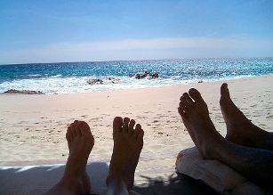

+++
title = "حكاوى المصايف"
date = 2007-06-19

[taxonomies]
authors = []
sections = ["masr"]

[extra]
section_name = "ولاد البلد"
share_image = "/media/admins.20at.com/aly/a139_5.jpg"
summary = "المصايف ليست مجرد بحر وحر ورمل وجروف وجردل ومايوه ولكن هى كمان لعب وصداقة وحب وافيهات ومواقف استحالة تتنسى"
section_slug = "masr"
section_colour = "#666666"
thumb = "/media/admins.20at.com/aly/a139_5.jpg"
n_comments = 0
original_url = "http://masr.20at.com:80/newArticle.php?sid=10723"
archived = "20071216010921"
date_source = "byline/meta"
aliases_20at = ["//masr.20at.com/newarticle.php?sid=10723"]

[extra.provenance]
original_url = "http://masr.20at.com:80/newArticle.php?sid=10723"
capture_url = "https://web.archive.org/web/20071216010921/http://masr.20at.com:80/newArticle.php?sid=10723"
capture_label = "١٦ ديسمبر ٢٠٠٧، ٠١:٠٩ UTC"
date_note = "من سطر التوقيع في المقال"
other_urls = []
comments = ""
missing_images = ""
+++

<figure></figure>

المصايف ليست مجرد بحر وحر ورمل وجروف وجردل ومايوه ولكن هى كمان لعب وصداقة وحب وافيهات ومواقف استحالة تتنسى

عارف ايه اهم ميزة فى المصيف .. انك بتروح وواخد قرار التحرر من همومك .. تفكيرك فى مستقبلك وفى اللى فات .. ببساطة ترانزيت او فاصل ونعود

فإذا كنت حزمت شنطك او مازلت تحت سطوة التدبير والتفكير .. اكتب عن ذكرياتك والمصيف، وابعت على weladelbald@yahoo.com

<h3>9835</h3>

صيف الصرف الصحى !

أرسل هذا التعليق بواسطة : باروما

آخر أسعار المتر فى الساحل حتى 30/6/2007 للقرى الجديدة طبعا !!

5500 جم اول صف ، 4500 ثانى صف ، 3500 ثالث صف و البركة فى المستثمرين الوطنببن

أخبار الساحل عام 2015 ( الساحل اغلق تماما أمام الجمهور العادى و تغير الأسم الى الأسمنت الشمالى) و على المتضررين اللجوء الى البرك و مستنقعات الصرف الصحى فلا تقلقوا فتلك من مخلفات الصحى الشمالى !!

بهواك يا هوى المصايف

الله يا جماعه احلى ايام السنه هى ايام المصيف

و فعلا الواحد بيروح واخد القرار انه يرمى همومه ف البحر بس عصب عننا بنلاقى نفسنا ادام البحربنفكر برده ف المستقبل و بنساله عن بكره

c'est la vie

