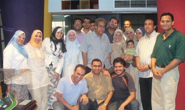

+++
title = "جلال أمين: جيلكم أفضل من جيلنا"
date = 2007-07-18
authors = ["مروة صلاح"]

[taxonomies]
authors = ["marwa-salah"]
sections = ["masr"]

[extra]
section_name = "ولاد البلد"
share_image = "/media/admins.20at.com/mosab/amin-main.jpg"
summary = "الدكتور (جلال أمين) أستاذ الاقتصاد بالجامعة الأمريكية وضيف صالون (عشرينات) هذا الشهر، أمتعنا خلال ساعتين بحواره مع ضيوف الصالون الذين أرادوا أن يقتربوا منه أكثر"
section_slug = "masr"
section_colour = "#666666"
thumb = "/media/admins.20at.com/mosab/amin-main.jpg"
n_comments = 0
original_url = "http://masr.20at.com:80/newArticle.php?sid=11115"
archived = "20071009061937"
date_source = "byline/meta"
aliases_20at = ["//masr.20at.com/newarticle.php?sid=11115"]

[extra.provenance]
original_url = "http://masr.20at.com:80/newArticle.php?sid=11115"
capture_url = "https://web.archive.org/web/20071009061937/http://masr.20at.com:80/newArticle.php?sid=11115"
capture_label = "٩ أكتوبر ٢٠٠٧، ٠٦:١٩ UTC"
date_note = "من سطر التوقيع في المقال"
other_urls = []
comments = ""
missing_images = ""
+++

<figure></figure>

الدكتور (جلال أمين) أستاذ الاقتصاد بالجامعة الأمريكية وضيف صالون (عشرينات) هذا الشهر، أمتعنا خلال ساعتين بحواره مع ضيوف الصالون الذين أرادوا أن يقتربوا منه أكثر خاصة بعد قراءتهم لكتابه "ماذا علمتني الحياة؟".

الرجل كان بسيطا رقيقا.. كسر بضحكاته فارق السن والمكانة.. والشباب العشريناتي استغل الفرصة، فاقترب واغترف في وجبة ثقافية ممتعة من معين رجل لانت له الكلمة والفكرة. محور الصالون هو نهجه وطريقته في بسط العبارة وتشبيك الفكرة، فلخص في جلال وأمانة حالته الكتابية.. وهو الفناء في الصدق والتوحد مع البساطة.. السطور القادمة تدنينا أكثر من عالمه...

<h3>كان السؤال الأول.. يحاول استكشاف هدفه من طرح ذكراه التي مست أقرب الناس إليه لأن جلال أمين عندما اختار أن يكون شاهدا وراصدا للعصر بدأ بعشيرته الأقربين..</h3>

و كشف في إجابته أنه منذ 20 عاما وهو مسكون بغواية الكتابة.. شعر أنه لابد أن يكتب سيرته الذاتية، رأي حوادث معينة كون عنها آراء وخبر أناس كثيرون، كان من الضروري أن يكتب عنهم.

يقول : "مررت بمواقف وظروف لابد أن تنقل، فكتبت ماذا علمتني هذه الدروس، ففي حياتنا أحداث شيقة جدا تستحق أن نسردها كما أن سرد سيرتنا الذاتية يجعل من أمامنا يتمكن من تحليل وتفسير العديد من الأحداث، فلو سرد لنا مثلا الرئيس عبد الناصر نصف ما مر به من حوادث لوفر علينا الكثير من العناء في تفسير الأحداث وقتها".

ولأن ما سطره محرج جدا ومقلق جدا جدا قرر عرض كتابه على ثلاثة أشخاص، لم يفيدوه كثيرا حسبما وضح. من هؤلاء أخوه الكاتب المعروف حسين أمين، ويضيف :" وكان أحد من عرضت عليه صديقا لي يقرأ كثيراً في السير الذاتية واعتقدت أنه قد يفيدني لكن لم أستفد منه لأنه كسول، فقررت أن أكون رقيبا على نفسي.

لكن رغم ذلك غضب مني بعض الأشخاص مثل بنات أخواتي ووبخوني بشدة، فغضبت لساعة أو ساعتين وأعدت قراءة الكلام الذي أغضبهم فوجدته عاديا، فقلت لنفسي ولا يهمك.

<h3>من "ولا يهمك".. عرفنا أنه شخصية متفائلة مرحة، لكن كيف استطاع أن يخلط بين التحليل المبكى لأحداث المجتمع والروح المرحة</h3>

يجيب :"من الممكن أن أضرب أمثلة على ذلك لمؤلفين وفنانين استطاعوا أن يبكوا الناس ويضحكوهم في وقت واحد مثل نجيب الريحاني، ومن الممكن أن تصف الحقيقة مهما كانت مرة مختلطة بروح المرح وهى أحسن طريقة لعرض الجوانب المرة من الحياة.

وأنا شخص متفائل جدا، وأشعر بالضيق من التشاؤم الذي ينتشر في المجتمع المصري ويساعد في هذا الصحافة، التي أصبح هدفها الأساسي إشاعة الحزن واليأس، يظنون أنهم ينقلوا الحقيقة للناس، وهى نفس الروح المنتشرة أوائل الخمسينات، حتى فتحت الراديو ذات يوم وسمعت عن حركة الضباط ورأيت البهجة على وجه كل مصري.

وهذا الأمر ليس بعيداً علينا، مع عدم توقعي أن يقوم بهذه الحركة عساكر مثل حركة الضباط الأحرار.

<h3>لكن لا تستلم لنبرة تفاؤله العليا فهو محلل بين الرقم والجدول دارت أيامه ففضل في فصله الأخير عرض أطلال الحقيقة ولو كانت بطعم المرارة حتى تصبح الشهادة فكرة دافعة وللصبر على التفاؤل حدود..</h3>

اعترف لنا أنه منذ أن كتب هذا الفصل الأخير وهو خائف، فكل من قرأه قال أنه محزن جداً رغم أنه نهاه بأربعة أسطر متفائلة يقول:" حديثي عن التشاؤم كان تحليلا لمؤشرات وللأمانة التغيرات السلبية مست معظم العالم، فالعالم كله أصابه المرض وليست مصر وحدها، وأعتقد أن الخمسينات والستينات أفضل من الآن ليس في مصر وحدها بل في العالم كله، وعندما أتحدث عن شباب العائلة والطلاق المتسارع أضع في الحسبان تلك الظروف والمتغيرات مثل تأثير الانفتاح الاقتصادي.

<h3>تنوعت الأسئلة وسخن الحوار حتى وقف الجميع أمام النغمة المصرية الحزينة وهي عدم تمرد المصري على فراعينه وطرح المتسائلون حيرتهم من إيقاع الشارع الذي ترك كفاية وحدها تتظاهر دون تأييد بل وسخر منها ثم بعد أن خفت صوتها علا صوته..صوت المصري.. حركة الإضرابات وثورة العطش حركة الكستور لا الدستور وكان السؤال متى تحدث الثورة هل بكثرة الظلم أم بالوعي به متى يكسر توازن الخوف وتحدث الهبة الشعبية مثل مظاهرات 1977 وأحداث الأمن المركزي..</h3>

تدلت إجابته فكانت قاب قوسين من الحكمة المصرية وقال :"من الصعب أن ينفجر الشعب المصري بسرعة فهو بطئ جدا في الثورة، وهو أمر له مميزاته وعيوبه، أحد مميزاته الحكمة، فالشعب العراقي أسهل شيء بالنسبة له أن يسحل ويقتل، لكن المصري متمدن جدا، وهذا التمدن يتضح في بعض الأحيان أنه ضعف أو ذل، لكن الظروف الاقتصادية السيئة والمتحرشين والعبارة والتوربيني دليل على ضرورة حدوث انفجار، لكنه سيكون بعيداً عن 77 والأمن المركزي والتي كانت مفتعلة من الخارج.

فعام 77 قرأت مقالة لصلاح حافظ عن "نمط إشعال الحرائق في 77" والتي أوضح أن السفارة الأمريكية هي التي قامت بها للضغط على السادات، فالأحداث كانت في يناير وسفر السادات للقدس كان في نوفمبر، وهى تخمينات لأن السادات كان يخشى أن يسافر لإسرائيل حتى لا يقتل، وكانت 1977 رسالة. أما أحداث الأمن المركزي فكان عبارة عن تصفية خلافات داخلية مع أحمد رشدي وزير الداخلية وقتها.

ورغم سلبية الشعب المصري فالحكومة المصرية تخشي منه، والدليل على ذلك عبد الناصر عندما قال في خطاب شعبي "بطلوا نكت بقى"، والحكومة المصرية الحالية تحاول تفادي أحيانا إثارة الشعب أو لا تتعمد إثارته.

لكن ما أراه هو أن هناك ما يدعو للتفاؤل لأنه من المستحيل أن يستمر التدهور لوقت طويل، ونهضة الصين باعث على الأمل في العالم كله، وإذا كانت الصين قدرت فغيرها ممكن يقدر والعالم ينعكس اتجاهه وسينعكس اتجاه مصر أيضا.

<h3>بالطبع أنت مثلنا ومثل كل من اقترب من عالم جلال أمين تريد "السر" وتقف على "الوصفة" التي يطهو بها حكاياته راقب إجابته..</h3>

"جورج أرويل" وهو كاتبي المفضل كان يكتب كأنه يتكلم، اترك نفسك على طبيعتها إذا أردت أن تكون صادقا كن على سجيتك ضع العبارة بدون تكلف، لأن التكلف قائم على الرغبة في الكذب وهو أكثر شيوعا مما تظن فالصدق وعدم التكلف وللبساطة انحزت إضافة للجرأة "إذا لم تقل الصدق فاسكت.. هذا بجانب الموهبة طبعا."

تشيكوف يقول "لما تيجى تكتب قصة قصيرة اكتب الموضوع واقطع أول صفحة وارميها"، ولا تكتب إلا عندما تكون منفعل، وأعلم أن الكتاب الجيد هو الذي يقول لك ما كنت تعرفه من قبل.

<h3>خدت بالك من الجملة الأخيرة عيش حياتك ياعم وادع للعم جلال..إلا صحيح يا عم جلال.. ماذا كنت تفعل وأنت في العشرينات كان السؤال..</h3>

وقبل أن يجيب استدار للوراء وابتسم وأطلت الإجابة من وجهه تخيل كل كلمة تترك على وجهه بصمة..

يقول :" طلعت الأول على الجمهورية في الثانوية العامة بمجموع. 38.5% وهو المجموع الذي جعل بن أخي حاليا يعلق قائلا: "دى كانت تدخلك تجارة انتساب" !

كنت جاد جداً وخجول أوى دخلت في الحزب البعثي، وكنت أجلس مع ميشيل عفلق وأناقشه في المادية الجدلية، وكنت أحب بنت الجيران ولا أستطيع أقول لها ذلك.

<h3>حلوة حكاية عفلق والمادية الجدلية عجبتكم طيب ما رأيكم لو عرفتم رأيه فينا في جيلنا.. جيل العنب والخيار وبرضه جيل التدوين ومقلقي الشخير العام..</h3>

عنا يقول:" أميز ما فيكم أنكم تتعرضوا لخبرات متنوعة أكثر ربما لا يكون مصدرها القراءة، وأنتم أكثر شجاعة، وبجانب التعرض لوسائل المعرفة مثل الكتب التلفزيون والكمبيوتر مما جعلكم أكثر ذكاء، وأنا لا يهمني كثرة المعلومات لكن ما يهمني هو العمق.

<h3>أكيد تعرف أن جلال أمين ابن المفكر المعروف أحمد أمين خريج القضاء الشرعي وقد كان عالما أزهريا، وفي سيرته اهتم ضيفنا بعقد مقارنة بين 3 أجيال في موضوع الالتزام الديني..</h3>

كان رأيه أن أباه حسبما قال أكثر تدينا منه وابنه أقل تدينا منه، وكان مستغربا أكثر من أبيه وابنه أكثر استغرابا عنه، وهو لا يرى في هذا قانون بدليل نزعة التدين المتزايدة في المجتمع فالدين مستمر.

<h3>وصف الفترة الناصرية بأنها خائفة والساداتية بأنها رخوة فبم وصف الفترة المباركية..</h3>

قبل أن يجيب دعانا لجولة تشخيصية يقول :" السمة المميزة لعبد الناصر.. البوليسية لاسيما من 65، فالناس كانوا مع الناصر الوحدة والتأميم، وعندما انفصلت سوريا، وحدث تمرد علي المد القومي، أحس أن الأمريكان يدبروا مقلبا، خاصة بعد سقوط بن بيلا.

السادات كانت فترة فيها رخاوة وعبودية للغرب، أما هذا العصر فما يميزه أنه عصر "بيع البلد"، السادات كان يفتح البلد لكن مش كل شئ للبيع.

<h3>يعني مصر رايحة على فين..</h3>

قال:"الجهة الوحيدة التي تملك الإجابة أميركا، وبالتأكيد في ناس مستفيدة من مجيء جمال أكثر منه شخصيا وهذا الأمر يمثل بالنسبة لهم حياة أو موتا".

<h3>هناك ثلاث شخصيات يروج أنهم أكثرها احتراما "أبو غزالة" و"كمال الجنزورى" و"عمرو موسي" وكان السؤال.. هل تتحمس لأي منهم..</h3>

يقول :"أنا لست متحمساً لأي شخص منهم فعمرو موسي ظل وزير خارجية لفترة طويلة جدا ولم يصنع شيئا أو يعترض على السياسية الخارجية المصرية التي أخذت مواقف متدهورة جدا خلال فترة وزارته، الجنزوري لم يكن له تاريخ سياسي، وكان مشروع توشكى في أيامه، وأبو غزالة لا أعرف عنه شيئا جيدا".

<h3>نعيش هوجه من المحللين السياسيين والخبراء.. فكيف فسر لنا هذه الظاهرة؟؟</h3>

"هي مظهر من مظاهر الانحطاط الثقافي، ومنها أيضا حالة الأدب في مصر حيث لا تجد نقادا ومحللين للروايات الأدبية والموجود نقاد يرفعون من يريدون أن يرفعوه ويخسفون بمن لا يعجبهم الأرض، كان عندنا سيد قطب والقط وطه حسين، وهم من نفتقدهم حالياً.

<h3>وعن التليفزيون والسينما كان لنا معه حديث</h3>

"اتصلوا بي للاشتراك في في أحد البرامج، فاشترطت أن أشاهد حلقة منه أولا، وكان حظي مع حلقة ضيفها مفتي مصر، فصعقت بتفاهة كلامه، بالإضافة للفواصل التي كانت بها فتيات عاريات، وعندما وجهت نقدي لمقدم البرنامج، قال لي تلفزيونات العالم كلها كدا، فرفضت أن أظهر فيه.

أما بالنسبة للسينما فأحب أفلام بلال فضل خاصة "حرامية في kg2"، وأفلام ساندرا نشأت خاصة "مبروك وبلبل".

انتهت الساعات المحددة للصالون، ولم ينته حديثنا، فالتففنا حول أستاذنا الكبير في حلقة عشريناتية، ودارت ندوة بعد الندوة اختلط فيها الضحك والجد، ولكن للأسف دائما هناك نهاية.. غادر الدكتور جلال أمين مقر عشرينات، وتركنا محملين بسعادة كبيرة، وعرفان أكبر.. شكرا يا أستاذنا.. شرفتنا.. وعلمتنا...

<h3>64d1</h3>
