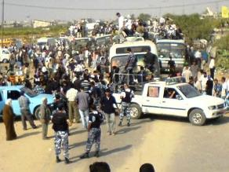

+++
title = "العالقون أصبحوا لاجئين !"
date = 2007-07-20

[taxonomies]
authors = []
sections = ["masr"]

[extra]
section_name = "ولاد البلد"
share_image = "/media/admins.20at.com/cherine/rafa7.jpg"
summary = "الحكومة المصرية قررت أن تحول الفلسطينيين العالقين في العريش إلى لاجئين إلى أجل غير مسمى !"
section_slug = "masr"
section_colour = "#666666"
thumb = "/media/admins.20at.com/cherine/rafa7.jpg"
n_comments = 0
original_url = "http://masr.20at.com/newArticle.php?sid=11121"
archived = "20070720223523"
date_source = "first-capture"
aliases_20at = ["//masr.20at.com/newarticle.php?sid=11121"]

[extra.provenance]
original_url = "http://masr.20at.com/newArticle.php?sid=11121"
capture_url = "https://web.archive.org/web/20070720223523/http://masr.20at.com/newArticle.php?sid=11121"
capture_label = "٢٠ يوليو ٢٠٠٧، ٢٢:٣٥ UTC"
date_note = "تاريخ أول لقطة في الأرشيف (لا يوجد تاريخ في المقال)"
other_urls = []
comments = ""
missing_images = "٣"
+++

الحكومة المصرية قررت أن تحول الفلسطينيين العالقين في العريش إلى لاجئين إلى أجل غير مسمى !

<figure></figure>

الحكومة المصرية قررت أن تحول الفلسطينيين العالقين في العريش إلى لاجئين إلى أجل غير مسمى !

فقد صرح أحمد عبد الحميد محافظ شمال سيناء أن المحافظة قررت فتح سبع مخيمات لإيواء آلاف الفلسطينيين العالقين بمدينة العريش بعد نفاد نقود معظمهم ولجوء عدد كبير منهم للنوم في الشوارع والحدائق العامة.

وقال عبد الحميد للصحفيين أن المخيمات أقيمت في ثلاث مدارس ونزل للشباب وثلاثة معسكرات للإقامة الدائمة بمدينة العريش وأنها جهزت بكافة وسائل الإعاشة اللازمة لإقامة الفلسطينيين العالقين.

وتابع أن وجبات غذائية ستقدم يوميا للفلسطينيين المقيمين بهذه المخيمات، وانه أمكن تدبير جزء من المبالغ اللازمة لهذه الوجبات فيما سيتم تدبير الباقي في وقت قريب، كما تم فتح المستشفيات العامة والمركزية بمدن العريش والشيخ زويد ورفح لعلاج المرضى الفلسطينيين من العالقين مجانا.

وكانت نقطة عبور رفح، وهي المنفذ الرئيسي للقطاع الفقير على العالم الخارجي، قد أغلقت منذ التاسع من يونيو قبل أن تسيطر حركة المقاومة الإسلامية (حماس) على قطاع غزة. وعلى الرغم من أن المعبر يخضع من الناحية الفنية لسيطرة المسؤولين الفلسطينيين والمصريين فإن بوسع إسرائيل إغلاقه. وفي وقت سابق من هذا الشهر قرر الاتحاد الأوروبي خفض بعثاته لمراقبة المعبر نظرا لعدم معرفة موعد إعادة فتحه.

ومن ناحية أخرى قال مسؤول مصري بمعبر رفح الحدودي أمس الاربعاء أن السلطات الإسرائيلية رفضت طلبا مصريا لإدخال كميات كبيرة من الطحين مقدمة كمساعدات للشعب الفلسطيني من برنامج الأغذية العالمي التابع للأمم المتحدة عبر معبر كرم أبو سالم.

وقال المسؤول لرويترز "اسرائيل رفضت على مدار اليومين الماضيين طلبات مصرية بإدخال 650 طنا من الطحين إلى قطاع غزة الفلسطيني عبر معبر كرم أبو سالم بدعوى عدم وجود تنسيق مسبق لإدخالها."

وأضاف أن 15 شاحنة مصرية كانت محملة بالمساعدات اضطرت للعودة إلى مدينة رفح المصرية لتوضع في المخازن حتى توافق اسرائيل على إدخالها إلى قطاع غزة. وكانت هذه المساعدات قد وصلت إلى معبر رفح الحدودي على ثلاث دفعات منذ يوم الجمعة الماضي.

ويقع معبر كرم أبو سالم في منطقة حدودية مثلثة بين مصر وإسرائيل وغزة وتشرف عليه اسرائيل بالكامل.

