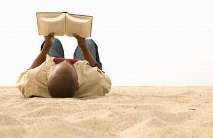

+++
title = "صيفك .. ثقافي ؟"
date = 2006-06-20
authors = ["دعاء الشامي"]
aliases = ["/articles/b971/"]

[taxonomies]
authors = ["doaa-elshamy"]
sections = ["masr"]

[extra]
section_name = "ولاد البلد"
share_image = "/media/admins.20at.com/cherine/culture.jpg"
summary = "حر،عرق، نوم، مصيف، مسرح، بحر، مايوه، راحة، لعب، رياضة، قراءة، سينما، سفر، أجازة، كل الكلمات السابقة مرتبطة بالصيف، ولأن الصيف طويل ندخل في حيرة في توظيف أوقاتنا"
section_slug = "masr"
section_colour = "#666666"
thumb = "/media/admins.20at.com/cherine/culture.jpg"
n_comments = 0
original_url = "http://masr.20at.com:80/newArticle.php?sid=2607"
archived = "20080319235937"
date_source = "byline/meta"
aliases_20at = ["/article2.php?sid=971", "//masr.20at.com/newarticle.php?sid=2607"]

[extra.provenance]
original_url = "http://masr.20at.com:80/newArticle.php?sid=2607"
capture_url = "https://web.archive.org/web/20080319235937/http://masr.20at.com:80/newArticle.php?sid=2607"
capture_label = "١٩ مارس ٢٠٠٨، ٢٣:٥٩ UTC"
date_note = "من سطر التوقيع في المقال"
other_urls = ["/article2.php?sid=971"]
comments = ""
missing_images = ""
+++

<figure></figure>

حر،عرق، نوم، مصيف، مسرح، بحر، مايوه، راحة، لعب، رياضة، قراءة، سينما، سفر، أجازة، كل الكلمات السابقة مرتبطة بالصيف، ولأن الصيف طويل ندخل في حيرة في توظيف أوقاتنا.. طبعا لا نختلف كثيرا على الترفيه أو النوم، ولكن هل فكرت أن تجعل صيفك ثقافياً؟

<h3>تصاحب كتاب ؟</h3>

بعد انتهاء الامتحانات ووداع الورق والأقلام.. فوراً وبدون مقدمات نتخلص من كتب الدراسة وضغط الدكاترة وذل ورق الامتحانات، بل ويمكن أن يتحول الموضوع عند البعض إلى عقدة نفسية، ويعتبر موضوع الأجازة والصيف فرصة انتقام من الكتب وسنينها الطويلة وذكرياتها السيئة، فيرمي من ذاكرته مجرد معرفته بالقراءة أو الكتابة...

لكن بما أن الاختلاف رحمة، وعلى عكس الفئة السابقة فينا ناس صاحبها الكتاب، يعني ببساطة دائما هناك كتاب في أيديهم، أو تحت مخداتهم، أو ربما على مائدة الطعام، وكذلك في الحمام لزوم التشطيبات والصفحات الأخيرة، وطبعا أثناء مشاهدة التلفزيون للخلاص من الإعلانات المملة، وفي الشرفة أو على البحر لزوم السلطنة والهواء والشمس.

<h3>الأستاذ ميكانيكي</h3>

"ورشة مرة واحدة، إيه أنت قلبت ميكانيكي؟" بهذه الجملة رد زميل دراسة على صديقنا الفنان، عندما أخبره صاحب الريشة اللولبية-كما نطلق عليه- أنه اشترك في ورشة عمل في الرسم. المضحك أن صديقنا صاحب الإفيه "مالوش في الثقافة"، فلا يعرف الفرق بين ورشة الميكانيكا وورشة الرسم التي تقيمها الكثير من دور الثقافة، وتجد رواجاً كبير في الصيف.

والورش الفنية تتيح فرصة التعليم على مستوى عال من الأداء والفكر والابتكار، حتى لو كانت في غير مجال دراستك، فمثلا تجد ورش عمل في القصة القصيرة والشعر والأدب وغيرها في الرسم والنحت، وقد تكون إحداها في التفصيل والخياطة-وهو فن كذلك- وتعطي في النهاية خبرات من نوع خاص، تخرج بنا من فكرة التعليم المدرسي المطلق، وتساعد البعض على استثمار هواياتهم بشكل مثمر ومفيد ومجزي في نفس الوقت.

<h3>هل اشتركت ؟</h3>

الاشتراك الذي أقصده قد يكون واحد من تلك الاقتراحات.. اشتراك بأحد المراكز الثقافية التي تعمل طوال العام ولكنها تنشط في الصيف، اشتراك في مكتبة عامة توفر خدمة الانترنت والقراءة والندوات وغيرها، اشتراك في مجموعات بريدية تمطرك برسائلها البريدية التي تذكرك بمواعيد العروض الخاصة للأفلام والمسرحيات.

في المركز الثقافي سوف تجد الندوات واللقاءات والمهرجانات متاحة كل يوم، أما في في "الجروب" أو المجموعة البريدية فلا تكلفك سوى الضغط على حروف كيبوردك عدة مرات لتعرف كل جديد، والمكتبة لا غبار عليها ففيها كل خيرات الله كتب، قصص، جرائد، انترنت، موسوعات، ندوات.. كله متاح.. أحمدك يا رب.

<h3>سينما.. البيت بيتك</h3>

وإذا كانت كل الاختيارات السابقة تحتمل القبول أو الرفض فالسينما والأفلام لا تدخل في هذا الجدل وتحسم النقاش في صالحها، فالصيف معروف بموسم السينما الخطير والمنتظر، لنجد الأفلام والنجوم والمخرجين يتألقون ويتنافسون لخطف الأموال والضحكات واهتمام الجمهور في دور العرض.

وفي الغالب ترجح كفة السينما والأفلام لأنها تعطيك جرعة متوازنة من عدة جوانب فهي تصلح كنوع من الترفيه والتسلية من خلال جو المرح كالفشار واللب والبيبسي، إلى جانب إفيهات الجمهور طبعا، كما تلعب دورها الثقافي من خلال الأفكار والمعالجة، ودور اجتماعي من خلال طريقة العرض وظروف الشخصيات لتخرج من صالة العرض وكأنك كنت في البيت، هذا إلى جانب أن الذهاب إلى السينما يتم في جو عائلي مع الأسرة والأصدقاء المقربين لتشعر وكأن البيت بيتك.

<h3>غاوي مسرح ؟!</h3>

إذا كنت من هواة المسرح وهم قليلون فهناك عدة اختيارات وفقا لرغباتك إما أن تلجا إلى مسارح الدولة التي تعاني من قلة إمكانيات وظروف مأساوية ووقتها قد تفقد حياتك في حريق مفاجئ أو في انهيار درامي، ولكنك ستوفر مبلغ كبير من المال، يساعدك على تكرار الزيارة إذا تبقى لك عمر ! وإما أن تلجا إلى المسرح التجاري فلا تستطيع أن تغلق فمك من كثرة الضحك وتجد الكرسي المريح والملابس المبهرة والممثلين المشاهير والديكور الفظيع.. ولا تقلق فلن تعاني من ألم الحريق ولا السقوط ولكنك ستعاني من انهيار مصروفك أو مرتبك مع أول زيارة...

ولكن هناك اختيار ثالث قد يكون مناسب أكثر وهو الذهاب إلى تلك المسارح التي تقدم الفن الجيد وبنقود معقولة مثل الفرق المسرحية الشابة والمراكز الثقافية المنتشرة في كل مكان، وتكون وقتها قد ضربت عصفورين بحجر واحد.

انتظر ليس هذا كل شيء.. إذا أردت أن تعرف أين تذهب وكيف تستمتع بصيفك في كل بلد عربي.. تابع معنا ملف صيفك ثقافي مع قلم رصاص.. وساهم معنا بتجاربك.. وآراءك...

<h3>1184</h3>
