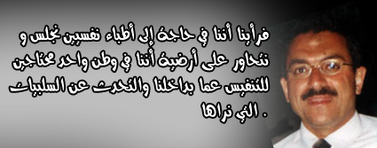

+++
title = "معا.. في الشارع \"45\""
date = 2006-04-18
authors = ["أحمد الهواري"]
aliases = ["/articles/masr-193/"]

[taxonomies]
authors = ["ahmed-elhawary"]
sections = ["masr"]

[extra]
section_name = "ولاد البلد"
share_image = "/media/admins.20at.com/masr/3amr-abo-khalel.jpg"
summary = "\"الخوف الأكبر هو أن يتحول الموضوع من فتنة طائفية هدأت إلى ثأر شخصي يتفجر من جديد في شارع 45.. وهو مكان الأحداث الدامية الأخيرة في الأسكندرية.."
section_slug = "masr"
section_colour = "#666666"
thumb = "/media/admins.20at.com/masr/3amr-abo-khalel.jpg"
n_comments = 0
original_url = "http://masr.20at.com:80/newArticle.php?sid=8133"
archived = "20090308013159"
date_source = "byline/meta"
aliases_20at = ["//masr.20at.com/article.php?sid=193", "//masr.20at.com/newarticle.php?sid=8133"]

[extra.provenance]
original_url = "http://masr.20at.com:80/newArticle.php?sid=8133"
capture_url = "https://web.archive.org/web/20090308013159/http://masr.20at.com:80/newArticle.php?sid=8133"
capture_label = "٨ مارس ٢٠٠٩، ٠١:٣١ UTC"
date_note = "من سطر التوقيع في المقال"
other_urls = ["//masr.20at.com/article.php?sid=193"]
comments = ""
missing_images = "٢"
+++

<figure></figure>

"الخوف الأكبر هو أن يتحول الموضوع من فتنة طائفية هدأت إلى ثأر شخصي يتفجر من جديد في شارع 45.. وهو مكان الأحداث الدامية الأخيرة في الأسكندرية..

الذي أفزعنا، كيف أن مختل عقليا يقوم بحادث عارض فيثير حرب شوارع ومعركة بالأسلحة.. هناك حالة من الاحتقان والتربص غير عادية علي مستوي البلد.. سنعالج حتى الإشاعات لأن هذا جزء من دورنا كأطباء نفسيين".

ما مضي هو جزء من فضفضة د.عمرو أبو خليل مدير مركز الاستشارات النفسية والاجتماعية بالإسكندرية وأخصائي الطب النفسي بمستشفي المعمورة لـ"ولاد البلد".

ولمن لا يعرف فمستشفى المعمورة هي ذاتها التي كان يتلقى فيها محمود عبد الخليل الـ"مختل عقليا" علاجه من مرض الفصام..

أطلق الدكتور عمرو مبادرة على المستوي الشخصي لعلاج المصابين في أحداث الإسكندرية علاجا نفسيا يهدف إلى تخليصهم من الآثار النفسية للحادث حتى لا يتحول الأمر إلى مزيد من الاحتقان مولداً المزيد من الانفجار.

<h3>الشباب الصغير</h3>

ويحكي د.عمرو قائلا أن مبادرته لم تظهر الآن ولكنها كانت مطروحة بينه وبين زملائه من الأطباء النفسيين سواء المسلمين أو المسيحيين عندما وقعت الأحداث المؤسفة للمسرحية التي تم عرضها في احد كنائس محرم بك من قبل.

وكانت فكرة المبادرة وقتها قائمة على أن هناك شباب صغير يغرر به، ولابد من توعيته نفسيا ومعالجة المتضررين منهم فترك الخطأ حتى يكبر لا يصح، ولكننا انشغلنا بعدها ولم يتم تفعيل المبادرة حتى وقعت الأحداث الأخيرة.

<h3>احتقان نفسي</h3>

وعندما وقع الحادث الأخير كنا مهتمين به جدا لأن الشاب الذي ذكرت السلطات انه قام بالحادث هو مختل بالفعل، وكان يعالج في مستشفي المعمورة هنا، وما أثار فزعنا أكثر هو كيف أن مختل عقليا يقوم بحادث عارض فيثير حرب شوارع ومعركة بالأسلحة.

فمعني ذلك أن هناك حالة من الاحتقان والتربص غير عادية على مستوي البلد، وأقصد بالاحتقان هنا الاحتقان النفسي الذي يولد صدام يقتل فيه ناس و يصاب العشرات ويلقي القبض على عشرات آخرين وتحرق فيه محلات وسيارات.

فرأينا أننا في حاجة إلى أطباء نفسيين نجلس و نتحاور على أرضية أننا في وطن واحد محتاجين للتنفيس عما بداخلنا والتحدث عن السلبيات التي نراها .

نجلس بطريقة موضوعية لرؤية أسباب هذه المشكلة ومن ثم الخروج بحل حتى لا يتحول الأمر إلي مزيد من الانفجار.

<h3>مواطنون لكل الوطن</h3>

وبالفعل جلسنا مع الزملاء وشكلنا لجنة من الأطباء النفسيين بمستشفي المعمورة وبدأنا في إطلاق المبادرة تحت اسم "مواطنون لكل الوطن" و اشترك بها إلى جانبي د. طلعت بشرى نائب مدير المستشفي ود.نيفين سعد ود.محمد سامي وهذه المجموعة هلي نواة لمجموعة اكبر جاري العمل علي تكوينها وواجب على الجميع المشاركة بها لأنه لو حدثت خسارة فهي من نصيبنا جميعاً.

<h3>ثأر شخصي</h3>

وتستهدف هذه المبادرة رؤية الآثار النفسية للحادث على المصابين والتعامل مع الأسباب الخفية للازمة والأسباب التي تؤدي إلى حدوث الاحتقان الذي يولد الانفجار.

ولكن نخاف أن يتحول الموضوع من فتنة طائفية هدأت أو بدأت في الهدوء إلى ثار شخصي يتفجر من جديد في الشارع "45" .

فالمواطن مصطفي مشعل الذي قتل في أحداث العنف في شارع 45 بعد حادث الكنيسة تم قتله بطريقة انتقامية حيث تم اختطافه من مكتبه بطريقة إجرامية ثم قتله وأسرته رفضت أن تتلقي العزاء.

والموضوع لم يتم معالجته بأي شكل لأنه لم يتم القبض على الجناة، وفي هذا نحن نحاول بان نخرج بالأمر من إطار كونه مسلمين و مسيحيين إلى إطار آخر هو المواطنة لان ما حدث هو اعتداء من بلطجية علي مواطن بعيدا عن دياناتهم و عن الظروف التي تم ارتكاب الحادث فيها.

<h3>خوف وهلع</h3>

وعن كيفية تنفيذ المبادرة يقول د. عمرو أبو خليل أن هناك مجموعة كبيرة من المصابين، خرجت بالفعل من المستشفيات وسيتم التواصل معها لما تركه هذا الحادث في نفوسهم من خوف وهلع وقلق سنحاول التعامل معه.

وبناء على هذا يتم الاتصال بالمصابين، و بالفعل بدأت د.نيفين في الاتصال بالكنيسة والأخوة المسيحيين لمعرفة رد فعلهم علي المبادرة .

وفي حال تفعيل المبادرة سيتم العلاج علي أربعة مراحل وهي عملية الحوار حول الموقف مع المصاب في المرحلة الأولي بمعني أن نقوم بفتح الموضوع الذي تسبب في إثارة خوفه لأنه أصبح مختزلا بداخله ويظهر على هيئة قلق وأحلام .

وفى المرحلة الثانية سيتم مناقشة الموضوع مع المصاب بطريقة معرفية لان العقل في مثل هذه الحالات غالبا ما يضخم الأمور فنعمل علي العودة به إلى صورة الحادث الطبيعية ,ثم جلسات استرخاء ومضادات للقلق في المرحلة الثالثة وأخيرا إعادة تأهيل المصاب لحالته الطبيعية التي كان عليها قبل الحادث .

<h3>حتى الإشاعات</h3>

وينهي د.عمرو كلامه قائلا بان المبادرة ستهتم أيضا بمعالجة الإشاعات لأنه في بعض الأحيان يبدأ الموضوع بإشاعة و التي تعد مواجهتها من جزء من الدور النفسي من خلال دراسة ومعالجة الجانب النفسي عند مرسل الإشاعة ومتلقيها .

إن كنت اقتنعت شارك دكتور عمرو ورفاقه بالمتابعة والاقتراحات خلال البريد الالكتروني التالي : weladelbald@yahoo.com

سواق التوكتوك

أرسل هذا التعليق بواسطة : عز الدين

هو كل مصيبة الجانى مختل عقليا

هى البلد كلها مختلة ولا ايه

