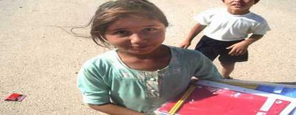

+++
title = "شبـاب تعبان .. وبنات في الروقاااااان!!"
date = 2007-12-04
authors = ["أميرة قاسم"]

[taxonomies]
authors = ["amira-kasm"]
sections = ["masr"]

[extra]
section_name = "ولاد البلد"
share_image = "/media/admins.20at.com/masr/banat.jpg"
summary = "\"الرجال هم الأكثر معاناة من الاحتباس الحراري \""
section_slug = "masr"
section_colour = "#666666"
thumb = "/media/admins.20at.com/masr/banat.jpg"
n_comments = 0
original_url = "http://masr.20at.com:80/newArticle.php?sid=8761"
archived = "20080405033155"
date_source = "first-capture"
aliases_20at = ["//masr.20at.com/newarticle.php?sid=8761"]

[extra.provenance]
original_url = "http://masr.20at.com:80/newArticle.php?sid=8761"
capture_url = "https://web.archive.org/web/20080405033155/http://masr.20at.com:80/newArticle.php?sid=8761"
capture_label = "٥ أبريل ٢٠٠٨، ٠٣:٣١ UTC"
date_note = "تاريخ أول لقطة في الأرشيف (لا يوجد تاريخ في المقال)"
other_urls = []
comments = ""
missing_images = ""
+++

<figure></figure>

"الرجال هم الأكثر معاناة من الاحتباس الحراري "

قد تصدمك الجملة وتعتقد أنها علمية بحتة ترجع إلي التكوين البيولوجي الذكوري، ولكن الأمر لا يعدو أكثر من "رؤية شخصية"، ففي ظل الإحتباس الحراري الذي يعاني منه كوكب الأرض كمشكلة بيئية يعاني الرجال من مشكلة لم أجد لها تصنيف حتى الآن هل هي نفسية أم اجتماعية أم.. جنسية !!

الموضوع دون أدني تعقيدات، إن الإحتباس الحراري يعني زيادة درجات الحرارة، وإرتفاع درجات الحرارة، يعني ببساطة محاولات تدريجية لاستيعاب الموقف بتقليل نسبة من "الهدوم"

قطعة.. تلو الأخرى.

ومن المؤكد إن البنات كجنس لطيف قدرتهم علي تحمل الحر أكيد أقل، لذلك قرر مصممي الأزياء مراعاة عدم قدرتهم علي تحمل درجات الحرارة بتصميم تصميمات تتناسب مع "الولعة الي إحنا فيها".

ويمكنك تصور الموقف بمجرد نزولك في وسط البلد أو أي "مول" تجاري لتري أزياء البنات هذا الصيف لتتأكد أنها أصبحت تتلخص في "ملابس داخلية" مثيرة تم تحوريها لأن تكون صالحة "للبس" في الأماكن العامة.

طبعا البنات في الروقان، والموضوع لا يمثل لهم أي مشكلة ولكن علي الجانب الآخر هناك طرف آخر وهو الشباب "التعبان" الذي حين تسأله عن رأيه في موضه 2006، ترتسم تلك الابتسامة الخبيثة لتؤكد لك أنه فعلا.. تعبااااان وبيرفس كمان!!

<h3>مقزز ومثير ...للاشمئزاز!!</h3>

حسن محمد، 22 سنة، قال : "لبس البنات بقي مستفز، وغالبا بقي يلفت النظر لمناطق محددة، والتي غالبا ما بتكون جزء من مفاتن المرأة المعروفة.. وأكيد أي شاب لما هيشوف كده أبسط رد فعل له انه هياعكسها، مش بعيد يحاول يتعرف عليها ويعيش له كام يوم، لكن أنا شخصيا بحاول أتغلب علي الموضوع دا بأني بحاول اتريق عليها أو علي لبسها كمحاولة للبعد عن التفكير في الموضوع دا، وبصراحة انا بحس بفخر أنى بقدر أترفع عن حاجة زي كده!!&gt;"

ويوافقه في الرأي أحمد شاكر، 20سنة، مضيفا أنه، قاصدا ملابس الفتيات، في بعض الأحيان يبقي "مش مثير علي قد ما هو مقزز أو مثير للاشمئزاز، لكن بعض البنات بيلبسوا كده لأنهم حاسين بنقص فبيحاولوا يكموا دا بلبس أو شعر أو ستايل يثير غريزة الشاب والذي ساعتها بيبقي مش فارق معاه شكلها كل إلى بيبقي بيفكر فيه جسمها"

ويكمل أحمد "كما أن لبس البنات المثير لمشاعرالشاب ممكن يدفعه إلي أنه يحاول يفرغ طاقته في أي حاجة تانية بدل ما يعد يكبت في نفسه ويتعب أكتر.. وطبعا الحاجات دي معروفة لكل الشباب!!.

<h3>غض البصر.. هو الحل</h3>

محمد عبد العاطين، 22 سنة، قال "ياااااه، دا أنا بقالي يجي سنة وشوية مركزتش في لبس البنات، يعني تقريبا آخر حاجة فاكرها ان كان في فترة اللون الاورنج منتشر أوي هو واللبني السماواي، غير كده معرفش. أصل أنا هاخد بالي منهم ليه وأنا مالي!!"

أما محمد المصري فيقول "مقدش أقول حكم مطلق علي لبس البنات، لكن طبعا بعض البنات لبسهم بيبقي اوفر(over) أوي خاصة بالليل وفي أماكن كمان معينة، يعني وسط البلد أو المولات"، وعن رد فعله فيقول "ولا حاجة خالص.. ولا أكنها عدت قدامي.. أنا بكون شفتها علشاان النظرة الأولي اللي هي المفروض غصب عني، وبصراحة عمري ما فكرت اني أعاكس بنت لأني بفكر دايما إن ليا أخوات بنات ومحبش إن حد يضايقهم"

<h3>البنات.. اتهبل</h3>

أحمد إمام، 19 سنة من طنطا، يقول "البنات اتهبلت بجد، يعني إزاى البنت تبقى محجبة وتلاقي الجيب تحت الركبة، أو حجاب وتلت كم وبرمودا.. أنا مش فاهم دا يبقي حجاب إزاى، والله الواحد بقي ماشي باصص في الأرض ومسقط كتافه، الحاجات دي بشوفها كده غصب عني".

أحمد من تأثير الموضوع فيه أوى بيسأل "هو الأب والأخ ده مش راجل يعني وممكن يثار، أكيد بيبقي مستوعب إن أخته دي كده تثير أي واحد مكتوب في بطاقته ذكر..آه يا بلد".

<h3>معاناة للبنات.. أيضا!!</h3>

البنات، أصحاب المشكلة، هم أيضا يعانون، وخاصة المحجبات الملتزمات منهن. فتقول هدير السيد، 23 سنة، "أنا بعاني أمر المعاناة كل موسم عشان أجيب لبس، هو تقريبا مابقاش في لبس للمحجبات شيك وأسعاره مناسبة، يا إما اللبس هيكون ضيق أو قصير أو تصميمه لا يتناسب مع زي المسلمة.. طبعا أصحاب المحلات استغلوا موضوع زي دا وابتدوا يتخصصوا في ملابس المحجبات الشيك، لكن للأسف بتكون غالية اوي"

وتوافقها في الرأي مها أحمد مضيفة أن "أزياء البنات من كتر ما بقيت مخجلة، بقيت أحس أنى مكسوفة وأنا ماشية مع أخويا وواحدة تعدي جمينا ولابسه "لا شئ "، وبصراحة الموضوع زاد عن حده أوي".

<h3>e93a</h3>
