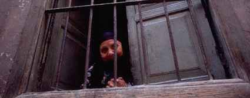

+++
title = "ممنوعات من التليفزيون!"
date = 2006-10-01
authors = ["محمد جمال عرفة", "إسلام أون لاين"]
aliases = ["/articles/masr-1002/"]

[taxonomies]
authors = ["mohamed-gamal-arfa", "islam-aon-lain"]
sections = ["masr"]

[extra]
section_name = "ولاد البلد"
share_image = "/media/admins.20at.com/masr/mamno3.jpg"
summary = "اتهمت ممثلات محجبات التلفزيون المصري الرسمي بتعمد استبعاد 5 مسلسلات لهن من مساحة العرض المخصصة لمسلسلات رمضان لمجرد ارتدائهن الحجاب، وذلك على الرغم من حصول مسلس"
section_slug = "masr"
section_colour = "#666666"
thumb = "/media/admins.20at.com/masr/mamno3.jpg"
n_comments = 19
original_url = "http://masr.20at.com:80/newArticle.php?sid=8935"
archived = "20080611191031"
date_source = "byline/meta"
aliases_20at = ["//masr.20at.com/article.php?sid=1002", "//masr.20at.com/newarticle.php?sid=8935"]

[extra.provenance]
original_url = "http://masr.20at.com:80/newArticle.php?sid=8935"
capture_url = "https://web.archive.org/web/20080611191031/http://masr.20at.com:80/newArticle.php?sid=8935"
capture_label = "١١ يونيو ٢٠٠٨، ١٩:١٠ UTC"
date_note = "من سطر التوقيع في المقال"
other_urls = ["//masr.20at.com/article.php?sid=1002"]
comments = "١٩"
missing_images = ""
+++

<figure></figure>

اتهمت ممثلات محجبات التلفزيون المصري الرسمي بتعمد استبعاد 5 مسلسلات لهن من مساحة العرض المخصصة لمسلسلات رمضان لمجرد ارتدائهن الحجاب، وذلك على الرغم من حصول مسلسلاتهن على تقدير "ألف" أي المرتبة الأولى في لجنة مشاهدة الأعمال الرمضانية.

وأرجعت الممثلات هذا القرار إلى توجيهات رسمية من وزارة الإعلام بمنع ظهور ممثلاث محجبات على الشاشة الصغيرة خلال الشهر الكريم، ووصفن هذه التوجيهات بأنها "مؤامرة" ضدهن. ولم يتسن الحصول على رد من الوزارة.

وقالت الممثلة حنان ترك لصحيفة "المصري اليوم" السبت 30-9-2006 إنها علمت من أحد أعضاء لجنة المشاهدة، دون أن تذكر اسمه، أن قرارا وصلهم بعدم اختيار أي مسلسل للممثلات المحجبات لعرضه في رمضان، وذلك بعد أن قرروا اختيار مسلسل "قلب حبيبة" للممثلة المحجبة سهير البابلي.

وتعليقا على ذلك اعتبرت سهير أن التلفزيون الرسمي يتآمر على الحجاب حيث رفض ظهور المحجبات بينما اختار مسلسلات بها مشاهد خارجة لتطل على المشاهدين في الشهر الفضيل.

وقالت الممثلة العائدة إلى التمثيل بعد غياب طويل: "90% من سيدات مصر محجبات، ومنهن أيضا زوجات وبنات للمسئولين الرافضين لمسلسلات المحجبات، وهو ما يعني قمة الازدواجية والتناقض، ويشير إلى حالة فصام بين أفكارهم وبين المجتمع المصري".

<h3>إنفلونزا الطيور</h3>

الممثلة المحجبة سهير رمزي العائدة إلى الشاشة بمسلسل "حبيب الروح" بعد اعتزال 14 عاما، كشفت أن المنتج شريف عبد العظيم أبلغها تليفونيا أن خطابا من وزير الإعلام أنس الفقهي منع عرض مسلسلات الممثلات المحجبات في التلفزيون المصري خلال رمضان رغم وجود قرار سابق يوصي بعرض مسلسل واحد لهن.

وأعربت سهير عن دهشتها لمنع مسلسلات الممثلات المصريات المحجبات من التلفزيون المصري بينما تتهافت على بثها فضائيات عربية عديدة.

وتساءلت مستنكرة: "هل أصبح الحجاب مثل إنفلونزا الطيور حتى يخشى منه المسئولون في ماسبيرو (مقر التلفزيون)؟، التليفزيون المصري له موقف من المحجبات، والحرب ضدهن رسالة مقصودة لإحباطهن".

أما الممثلة المحجبة حديثا حنان ترك فطالبت المسئولين عن قرار منع الممثلات المحجبات من الظهور على التلفزيون بالشجاعة الأدبية.

وقالت: "إذا كان هناك قرار بعدم ظهور مذيعات أو ممثلات يرتدين الحجاب، لماذا لا يعلن ذلك بشكل رسمي حتى نحترم هذا الجهاز الاعلامى؟.. إذا كان هذا القرار للوزير أو أي مسئول كبير فلا بد أن تكون لديه الشجاعة الأدبية لإعلانه".

<h3>قابيل وهابيل</h3>

وتركز العديد من مسلسلات رمضان الحالي -خصوصا مسلسلات الفنانات المحجبات اللاتي يعرض لخمسة منهن مسلسلات على الفضائيات- على محاربة الفساد سواء الأخلاقي أو المالي أو التجاري.

ويعتبر مسلسل "قلب حبيبة" لسهير البابلي هو النموذج الأبرز في تصديه لانحرافات فساد الأخلاق، وهو أشبه ما يكون بصياغة عصرية لقصة قابيل وهابيل.

وفي مسلسلها "كشكول لكل مواطن" تحارب الممثلة المحجبة "صابرين" فساد بعض رجال الأعمال، حيث تجسد دور زوجة متدينة تكتشف بعد سنوات طويلة أن زوجها رجل الأعمال الشهير قام بالعديد من الأعمال غير المشروعة، فتسعى لمحاربة فساد زوجها ومحاولة إصلاحه.

الأمر نفسه تقوم به الممثلة سهير رمزي في مسلسلها "حبيب الروح" الذي تحارب من خلاله مافيا الفساد في المستشفيات، وبالأخص عمليات سرقة وبيع الأعضاء البشرية.

ومن مسلسلات المحجبات الممنوعة أيضا من العرض في التلفزيون المصري خلال شهر رمضان مسلسل "أصعب قرار" للفنانة عبير صبري العائدة إلى التمثيل بعد اعتزال نحو خمسة أعوام.

أما مسلسل "أولاد الشوارع" للفنانة حنان ترك فهو يحذر من أن هؤلاء الأطفال قنبلة موقوتة في المجتمع قابلة للانفجار في أي وقت.

<h3>"ملكيات أكثر من الملك"</h3>

والطريف في مسلسلات رمضان هذا العام أن الممثلات المحجبات تفرضن نوعا من الرقابة الذاتية على مسلسلاتهن قبل أن تفرضها لجان الرقابة الرسمية حتى إن بعض المخرجين والمنتجين يصفون المحجبات بأنهن "ملكيات أكثر من الملك".

فالممثلة سهير رمزي حذفت بنفسها ٢٥ مشهدا من مسلسلها "حبيب الروح"، وقالت إنها لا يمكن أن تقوم ببطولة مسلسل يحوي مشاهد تسيء إلى حجابها ووقارها، كما حذفت الرقابة المصرية ثلاثة مشاهد أخرى تحتوي جمل حوارية بها على إيحاءات جنسية.

كما طالبت الممثلة عبير صبري بحذف عدد من المشاهد من مسلسلها "أصعب قرار"، واختلفت مع المؤلف محمد الغيطي لرفضها أداء بعض المشاهد المثيرة، معتبره أن هذه المشاهد تتعارض مع حجابها وتدينها.

<h3>974d</h3>
