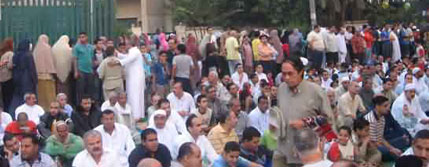

+++
title = "دعاء الإمام الأصغر في العيد"
date = 2006-12-29
authors = ["أحمد سمير"]
aliases = ["/articles/masr-1386/"]

[taxonomies]
authors = ["ahmed-samir"]
sections = ["masr"]

[extra]
section_name = "ولاد البلد"
share_image = "/media/admins.20at.com/masr/emam.jpg"
summary = "يحكى أنه في كان هناك شيخ يسمى \"الإمام الأصغر\" لمنصبه الرفيع.. الإمام كان مشهورا بحبه لآل الحكم والأمر والنهي.. وذات مرة وأثناء صلاة العيد جهز دعاء ليلقيه في حضر"
section_slug = "masr"
section_colour = "#666666"
thumb = "/media/admins.20at.com/masr/emam.jpg"
n_comments = 14
original_url = "http://masr.20at.com:80/newArticle.php?sid=9319"
archived = "20080222082955"
date_source = "byline/meta"
aliases_20at = ["//masr.20at.com/article.php?sid=1386", "//masr.20at.com/newarticle.php?sid=9319"]

[extra.provenance]
original_url = "http://masr.20at.com:80/newArticle.php?sid=9319"
capture_url = "https://web.archive.org/web/20080222082955/http://masr.20at.com:80/newArticle.php?sid=9319"
capture_label = "٢٢ فبراير ٢٠٠٨، ٠٨:٢٩ UTC"
date_note = "من سطر التوقيع في المقال"
other_urls = ["//masr.20at.com/article.php?sid=1386"]
comments = "١٤"
missing_images = ""
+++

<figure></figure>

يحكى أنه في كان هناك شيخ يسمى "الإمام الأصغر" لمنصبه الرفيع.. الإمام كان مشهورا بحبه لآل الحكم والأمر والنهي.. وذات مرة وأثناء صلاة العيد جهز دعاء ليلقيه في حضرتهم وهم يصلون خلفه وظهورهم للحائط وأمامهم حاجز يغزي العين ويحمي البدن ويسمح لكاميرات التصوير لحامليها من أصحاب التصريحات الأمنية بالتقاط الصور.. الدعاء كان جميلا مفعما بالمشاعر الحساسة والإحساس بالولاء والعرفان.. بدأ الشيخ دعائه قائلا..

بسم الله والحمد لله والصلاة والسلام على رسول الله.. اللهم صلى على محمد وعلى آل محمد.. اللهم أحمى منصب شيخ الإمام الأصغر.. اللهم اجعله دائما بالتعيين ولا توصل له حد من المحترمين.. أو من العلماء المزعجين.. اللهم أحفظنا بالسلطان قائمين وأحفظنا بالسلطان قاعدين وأحفظنا بالسلطان راقدين ولا تشمت بنا الحاقدين الحاسدين . اللهم ألزقنا في الكرسي بالصمغ والغراء ولا تجعل لعلماء الأمة سلوى ولا عزاء.

اللهم إنا نسألك عمرا طويلا وجلدا بليدا وصوتا في الحق خفيضا ولسانا في الشر سليطا.. اللهم إنا نسألك منصبا لا يزول وكرسيا يدوم ويدوم ونسألك إنها تخرب ونقعد على تلها وتولع وندفي بنيرانها وتفلس ونجمع إحنا أموالها..

ثم انطلق في الدعاء لولي النعم قائلا: اللهم أنصر الرئيس أمير المؤمنين.. حتى لو كان في الصلاة بيحط اليد الشمال على اليد اليمين.. اللهم أنصره على أعدائه أعداء الدين من اليساريين وكل بتوع المعارضة الملاعين..

اللهم أصلح فساد قلوبهم وثبت ولاة أمورهم حتى لو غصب عن أهلهم.. اللهم أنصر اليهود والإسرائيليين على الارهابيين عشان أنت عارف يا رب أنهم أصلا من جماعة الإخوان الملاعين.. اللهم أجعل بيننا وبين الناس ستارا وحجابا وبيننا وبين الحاكم لذة وانسجاما..

ثم تذكر مولانا حظ نفسه من الدنيا فقال: يا حنان.. يا منان.. يا ذا الجلال والإكرام زد لنا من العطايا والأنعام.. وقربنا من السلطان.. الرئيس ومن بعدة الوريث.. فنحن يا ربنا عارفين الرئيس ولسه منعرفش الوريث.. اللهم أرزقنا حب الوريث وحب من يحب الوريث وحب كل عمل يقربنا للوريث..

اللهم إننا نؤمن بك ونتوكل عليه فهو القوى ونحن الضعفاء إليه وهو الغنى بالفلوس ونحن الفقراء إليه ..اللهم وفقنا في الفتوى لما يحبه ويرضاه وجنبنا في الخطبة ما يغضبه ونخشاه.. وأغننا بفضله عن من سواه ..

اللهم إنا نسألك علم لا ينفع وصوت لا يسمع وبيانات وقت الأحداث لا تفزع ونعوذ بك من نفس تكتفي وتشبع ونسألك ذمة واسعة وجبهة خاضعة وكرامة غائبة.. اللهم طهرني من خطاياي بالماء والثلج والجاكوزى كما طهرت غيري يا أرحم الراحمين.. اللهم أجعل منصب الإمام الأصغر لنا في الدنيا قرينا وفى المكتب مؤنسا ومن الناس سترا وحجابا والى الآخرة رفيقا..

وانطلق الإمام إلى الشأن العام داعيا: اللهم حجب نساء المسلمين إلا في فرنسا كي نكون طيبين.. ونطيع القوانين.. اللهم حجب نساء المسلمين أما زوجات أولى الأمر فكفاية يبقوا محتشمين.. أو زى ما هم عايزين.. إننا يا ربنا نريد أن نعيش امنين..

اللهم أهلك الكافرين بالكافرين وأخرجنا من بين أيديهم سالمين.. هم كده مع نفسهم وإحنا نايمين وقاعدين على سريرنا مالناش دعوه بحاجة خالص ومستريحين.. اللهم طهر قلوبنا من النفاق وأعمالنا من الرياء وأموالنا من الربا إلا شهادات الاستثمار عشان أنا قلت أنها حلال يا أكرم الأكرمين..

اللهم أمرتنا بالدعاء ووعدتنا بالاستجابة فاستجب لنا دعائنا وخصوصا موضوع الوريث فأنه يهمنا.. فان اليوم إحنا مقضينها مراجيح وعايزين بكره برده يبقى تفاريح وصلى اللهم على سيدنا محمد.. وآخر دعوانا أن الحمد لله رب العالمين ..

<h3>اقرأ أيضا</h3>

 عيد الأضحى.. دماء ومخلفات!

 في صلاة العيد.. كنت إماما!

<a href="/articles/masr-n9313/"> بيدي لا بيد بوحة!</a>

<a href="/articles/masr-n9314/"> الخرفان بتحبك يا ريس..!</a>

 العيد فرحة.. ياسلام!

<a href="/articles/masr-1383/"> العيد.. رقص ورهينة في محطة مصر!</a>

 شوية بلالين علي حبة زينة

 التخصص يكسب.. في المدبح

<h3>6190</h3>
