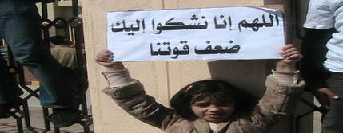

+++
title = "الإخوان والسكتة الدماغية.. السياسية"
date = 2007-03-15
authors = ["أحمد زين"]
aliases = ["/articles/masr-1742/"]

[taxonomies]
authors = ["ahmed-zein"]
sections = ["masr"]

[extra]
section_name = "ولاد البلد"
share_image = "/media/admins.20at.com/masr/sakta.jpg"
summary = "هل أصيب الإخوان بالسكتة الدماغية السياسية التي تقابل السكتة الدماغية؟"
section_slug = "masr"
section_colour = "#666666"
thumb = "/media/admins.20at.com/masr/sakta.jpg"
n_comments = 0
original_url = "http://masr.20at.com:80/newArticle.php?sid=9675"
archived = "20070818212359"
date_source = "byline/meta"
aliases_20at = ["//masr.20at.com/article.php?sid=1742", "//masr.20at.com/newarticle.php?sid=9675"]

[extra.provenance]
original_url = "http://masr.20at.com:80/newArticle.php?sid=9675"
capture_url = "https://web.archive.org/web/20070818212359/http://masr.20at.com:80/newArticle.php?sid=9675"
capture_label = "١٨ أغسطس ٢٠٠٧، ٢١:٢٣ UTC"
date_note = "من سطر التوقيع في المقال"
other_urls = ["//masr.20at.com/article.php?sid=1742"]
comments = ""
missing_images = "١"
+++

<figure></figure>

هل أصيب الإخوان بالسكتة الدماغية السياسية التي تقابل السكتة الدماغية؟

تحدثوا كثيرا عن التأسيس الثالث على يد المرشد عاكف مقارنين بينه وبين البنا والتلمساني في مسألة الانفتاح واكتساب مساحات جديدة في الشارع والمكاسب السياسية، وأهم من تحدثوا الثالوث ضياء رشوان وعمرو الشوبكي ورفيق حبيب القبطي الإخواني كما يصفه البعض، لكن رأيًا آخر يعتقد أن الإخوان يعيشون أسوأ عصورهم حتى في ظل المكاسب التي تحققت خاصة على مستوى التمثيل البرلماني غير المسبوق 20% من مقاعد مجلس الشعب.

أول أعراض هذه السكتة كان السكوت غير المبرر عن اعتقال القيادة السياسية ذات الكاريزما العالية عصام العريان وترك الإخوان ملفه تماما للدرجة التي تردد معها من خلال بعض المعتقلين معه أن الرجل أصيب بنوع من الضيق في محبسه حين كان الإخوان يقاطعون المظاهرات التي يدعو إليها بعض النشطاء للتنديد باستمرار حبس العريان، وربما كانت المفارقة أن أكثر من هتف للعريان كان القيادة اليسارية كمال خليل !!... العجيب أن قيادات الإخوان قطعت على نفسها عهدًا بإعطاء الأمان للنظام حين قال أحدهم إننا لن نتحرك نيابة عن الشعب.

من هذه السكتات السياسية صمتهم العجيب حول أول جس نبض من النظام تجاه حرب الأرزاق، حين تم إقصاء عبد المجيد مشالي القيادي الشاب من استثماراته الأساسية بشركة اي تو والتي حققت تحت إدارته نجاحا فريدا في عمر قصير، بل إن أحد الشباب الإخواني العاملين فيها أجبر بناء على تعليمات مشتركة من ضابط أمن دولة ومسئوله الإخواني على كتابة استقالته وعوتب على تسريبه الضغط الممارس عليه إلى إحدى الصحف المستقلة.

السكتة الأعظم كانت مسألة الميليشيات التي يبدو أنها دوخت الإخوان حتى لم تدع لهم فرصة في التفكير حتى في رد مناسب، فجاءت الردود كوميدية لدرجة الاستفزاز حتى هيجت على الإخوان النخبة القليلة التي كانت دومًا معهم، خاصة أن تفسيرات كون المطلاب يقومون بعمل اسكتش جاءت من قيادات لها حضورها وقبولها مثل العريان و أبو الفتوح الذي أصر أنه عرض مسرحي!!!

ثم جاءت السكتة الأكبر والأسوأ حين صمتت الجماعة صمتًا مريبًا تجاه الخبطة الأعظم في مصادرة أموال والحجز على شركات قيادات كبيرة قدرت أموالها المصادرة بعشرة مليارات، بل وبعض هؤلاء استقال من الجماعة منذ زمن، وحسب مصادر إخوانية فإن الهدف من السكتة كان طمأنة النظام (لماذا؟).

واطمأن النظام تمامًا وتوالت الصفعات على هيئة اعتقالات متوالية حتى قال أحد الشباب إنه يعتقد ان الجماعة "متنحة" من جراء الضربة على الرأس، وقال آخر إن الموقف يذكره بالصعيدي الذي ضرب ميت قفا على سهوة.

سكتة أخرى ولا أبشع ولا أروع حين كفا الإخوان على خبر حزبهم ماجورًا ضخمًا، لمنع التسرب، والذي لاعبوا به النظام أيامًا معدودات، البعض يقول إن في ذلك مزيدًا من سياسة الطمأنة، لكن الجديد هو أن أفكار الحزب التي صاغها عدد من قيادات الجماعة لم تحظ بموافقة الكبار نظرا لتحررها وليبراليتها التي ذهبت إلى قبول رئاسة الأقباط والمرأة للدولة مع مساحات حرية حقيقية في الفنون والفكر وبالتالي اتخذ المشايخ قرارا بأن يقفلوا على بدعة الحزب ربما لأن كل بدعة ضلالة وكل ضلالة في النار، رغم أن أي متابع لا بد أن يعرف أن الإخوان يحتاجون لرافعة ترفعهم من الخسائر الضخمة التي حازوها على كل الأصعدة.

يكفي لتعرف عمق الشلل الإخواني الحاد أن تقارن بين موقف الجماعة في بداية المحاكمات العسكرية لقادتها عام 1995 وموقفها الآن، فرغم قلة الإمكانات آنذاك وعدم وجود سوى ممثل واحد للإخوان في البرلمان، وقلة المساحة الإعلامية المتاحة للإخوان ليتحركوا فيها فلا فضائيات ولا إنترنت ومع ذلك فإن الاحتاجاج والاعتراض على هذه المحاكمات لا يمكن مقارنتها بالأداء الإعلامي الحالي الذي تتصدر أولوياته تهنئة المرشد للشيخ عبد الله الأحمر بفترة رئاسة ثالثة في حزبه اليمني، وذكريات الدعوة للشيخ فرج النجار وشرح أركان البيعة للشيخ جمعة أمين، وصور كل القيادات العجوزة التي تجدها ولا بد في صدارة الصفحة الرئيسية لموقع الإخوان.

<h3>الخلاصة</h3>

لدي سؤال حقيقي طرحته على أحد القيادات الإخوانية الشابة ولم يجبني.. سؤالي هو في هذه الأيام التي يواجه فيها الإخوان حربًا أكبر بكثير من حروب سابقات.. ماذا يناقش الإخوان في مكتب إرشادهم؟ وهل هناك أفكار لمواجهة الموقف أفضل من توجيه عبد المنعم أبو الفتوح لتهدئة شباب الإخوان بمقال نشر على موقعهم اسمه "فصبر جميل"؟

للأسف اسمها المعارضه رقم واحد

مقال رائع .تحية طيبة الى الاستاذ احمد زين..أما آن لهذه الجماعه ان تراجع نفسها فيما تعمل فأفكارها و مناهجها الداخلية تعانى من شيخوخة كبيره و ديكتاتوريتها الداخليه و تناقض تصريحاتها و لهم فيما قال الدكتور عبد الستار المليجى عبرة .

