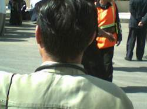

+++
title = "في القفا (سلاية) !"
date = 2007-04-26
authors = ["أحمد بلال", "دعاء الشامي"]

[taxonomies]
authors = ["ahmed-balal", "doaa-elshamy"]
sections = ["masr"]

[extra]
section_name = "ولاد البلد"
share_image = "/media/admins.20at.com/masr/2fa-masla2.jpg"
summary = "أمثالنا الشعبية معروفة بثرائها، فلن تجد أي موقف من مواقف الحياة بحلوها ومرها إلا وستجد من بين تلك الأمثال الشعبية ما يلخصه أو يعبر عنه.. بل إن الكثيرين منا لا ي"
section_slug = "masr"
section_colour = "#666666"
thumb = "/media/admins.20at.com/masr/2fa-masla2.jpg"
n_comments = 0
original_url = "http://masr.20at.com:80/newArticle.php?sid=9945"
archived = "20070819022722"
date_source = "byline/meta"
aliases_20at = ["//masr.20at.com/newarticle.php?sid=9945"]

[extra.provenance]
original_url = "http://masr.20at.com:80/newArticle.php?sid=9945"
capture_url = "https://web.archive.org/web/20070819022722/http://masr.20at.com:80/newArticle.php?sid=9945"
capture_label = "١٩ أغسطس ٢٠٠٧، ٠٢:٢٧ UTC"
date_note = "من سطر التوقيع في المقال"
other_urls = []
comments = ""
missing_images = "١"
+++

<figure></figure>

أمثالنا الشعبية معروفة بثرائها، فلن تجد أي موقف من مواقف الحياة بحلوها ومرها إلا وستجد من بين تلك الأمثال الشعبية ما يلخصه أو يعبر عنه.. بل إن الكثيرين منا لا يخوضوا أي تجربة إلا بعد أن يكونوا استمدوا قرارهم من تلك الأمثال.. التي يعتبرها علماء الاجتماع معبرة عن خبرات الشعوب والمجتمعات.

ولما كان "القفا" هو أحد أهم العناصر في حياتنا المصرية، فقد كان من الطبيعي أن يلقي اهتماما واضحا في أمثالنا الشعبية، وقد يكون ذلك هو العزاء الوحيد لـ"ستاموني" في فيلم "الكيف" والذي كان يشتكي مرارا من عدم اهتمام الفنانين بـ"القفا" برغم أنه "بيستحمل كتير أوي اليومين دول".

<h3>القفا وحوجة الأيام</h3>

ومن أشهر الأمثال التي استخدمت "القفا" هو "اللي ميحوجكش الزمان لوشه.. بكره يحوجك لقفاه"، وهو مثل يحض على إقامة علاقات جيدة مع الجميع، حتى هذا الذي تعتقد أنك لا تحتاج له في أي شيء، فعليك أن تتأكد أنك ستكون في أمس الحاجة إليه غدا.

وفي المقابل نجد مثلا آخرا هو "خدنا إيه من وشك عشان تدينا قفاك"، وهو مثل يوجه إلى الشخص الذي لا يوليك اهتماما، حيث تؤكد له أنك لم تستفد منه إطلاقا حتى يعاملك بلا مبالاة، ويستخدم أحيانا للشخص الذي لا ينظر إليك أو يكون جالسا معك وينظر بعكس اتجاهك.

"في الوش مراية وفي القفا سلاية"، وهو مثل شعبي يعالج قضية الأنانية، وهو يقال في الشخص الذي يتحدث أمامك بكل ما طاب من كلمات ومديح، وفي غيابك يكون كشوك السمك ولا يتحدث عنك إلا بكل سوء.

أما هؤلاء الذين يتحدثون بلا حساب، ولا يوجد على لسانهم أي رقيب فقد خصتهم أمثالنا الشعبية بمثل يحمل فيه "القفا" خطأ اللسان، فيقول "لولاك يا لساني ما انسكيت يا قفايا"، وهو مثل يتحدث عن أن "القفا" هو الذي يتحمل نتائج خطأ الإنسان، وأن حفظ "القفا" وسلامته يبدأ من حفظ اللسان.

"بوس القفا يعلم الوفا"، مثل يوضح مدى أهمية القفا عند المصريين ليصبح هو ميثاق وعهد للمحبة والرضا والوفاء، فتكون بوستك للقفا أكبر دليل على وفائك لصاحبه ودي نصيحة هائلة، فلتبحث الآن عمن تريد أن تخبره بوفائك له فتطبع بوسه قصيرة على قفاه لأنك لو طولت لن تضمن العواقب!

<h3>قفا مرات ابني</h3>

وعن الحموات نذكر مثل "جوزت ابني لبنتي.. الوش وش بنتي والقفا قفا مرات ابني"، وهو يعني أن أم الزوج تتحدث في البداية عن زوجة ابنها بأنها في معزة ابنتها نفسها، ثم يأتي بعد ذلك تصنيف المعاملة، فكل خير أو شيء جيد تفعله زوجة الابن فهو يرجع إلى أم الزوج التي اعتبرت زوجة الابن ابنتها، أما عندما تخطئ زوجة الابن أو تفعل شيئا مسيئا فيكون الحديث هنا عن زوجة الابن الوافدة على الأسرة والتي لا تتحلى بقيم أم الزوج التي كانت منذ قليل أمها!!.

"سيب حبيبك على هواه.. ولما ييجي أديله على قفاه"، وهو مثل يحض على الصبر على المحبوب، وقد يمتد هذا الصبر إلى أي شخص آخر غير المحبوب، و يقال للشخص الذي يعاني من أن حبيبه أو أي شخص آخر يتعمد البعد عنه لفترة من الزمن.

أما عن هؤلاء الذين يطلبون المستحيل فيقول المثل الشعبي "يا طالب الدبس من قفا النمس"، والدبس هو العسل الأسود فمن يطلب العسل الأسود من "قفا" النمس، كمن يطلب المستحيل، لأن النمس حيوان شديد الحذر وحاسة الشم عنده كبيرة جدا، تجعله يختفي بسرعة قبل وصول أي شخص إليه لدرجة تجعل من الصعب حتى رؤيته، و النمس في المثل تعني الشخص الحذر الماكر، وهو يعني أن تأخذ شيئا من هذا الشخص على غفلة أو من "قفاه" لأن حذره يجعله دائم اليقظة.

<h3>هجيبه من قفاه</h3>

ومن أمثالنا الشعبية الأخرى التي تتحدث عن القفا "شوكي في قفا غيري" و "الدفا عفا والبرد لحاس القفا".

وفي حياتنا اليومية الكثير من التعبيرات التي نستخدم فيها "القفا"، وقد يرجع ذلك إلى القيمة الكبيرة التي يمثلها "القفا" في حياة المواطن المصري، فنقول مثلا "هجيبه من قفاه" وهو تعبير يدل على قوة الشخص المتحدث وتحقير من شأن الشخص المراد به الحديث.

وأيضا "على قفا مين يشيل" وهو تعبير يدل على الكثرة، و "رجع قفاه يقمر عيش" وتدل على خيبة الشخص المراد به الكلام، ونقول أيضا "شايفني مختوم على قفايا" وهو تعبير يدل على أن الشخص الذي يتحدث شخص يقظ و"مفتح" ولا يمكن استغفاله.

"وشك شين وقفاك مصدي تضرب فيه البلغة تعدي" وهذه المرة ليس مثل عامي ولكنه بيت شعر من التراث البدوي يوضح مواصفات خاصة للقفا القذر وهو ما وصف في المثل بالمصدي.

<h3>القفا الملسوع</h3>

حتى التكنولوجيا الحديثة استعملناها بطريقتنا الخاصة أو لنقل ثقافة "القفا"، فنجد الكثير من رسائل الـ"sms" التي يتبادلها الشباب عبر أجهزة تليفونهم المحمول تتعلق بـ"القفا"، فعلى سبيل المثال لا الحصر نجد رسالة تقول "حبيبي طالع فيها فاكرني هدلعه.. ياما نفسي يديني ضهره وعلى قفاه هلسعه".

هكذا يحتل "القفا" مكانة كبيرة في الحياة اليومية المصرية، فما بين الظلم الواقع عليه بشكل مادي بطريقة عرفها المصريون جميعا على يد الشرطة التي من المفترض أن تحافظ على كرامته، أو بشكل معنوي عن طريق التهكم عليه، يقف القفا المصري شامخا لا يبالي بأي شيء، وإذا كان "ستاموني" في فيلم "الكيف" قد قرر الثأر "للقفا" على اعتبار أنه "بيستحمل كتير" فإننا ندعو لحملة شعبية مصرية كبيرة لجمع تراث "القفا"، والذي سيجدون أغلبيته قابعة داخل أقسام الشرطة المصرية!!.

<a href="/articles/masr-n9957/">خلي بالك من (قذالك)!</a>

<a href="/articles/masr-n9956/">قفاك حصانك</a>

<a href="/articles/masr-n9946/">الذين لزقوا الحكومة على قفاها!</a>

<a href="/articles/masr-n9958/"> قفايا.. حرام!</a>

<a href="/articles/masr-n9954/"> طاطي راسك.. طاطي طاطي</a>

ابو يوسف

أرسل هذا التعليق بواسطة : القفا قفاي

الهوا هواي والقفا قفاي والدنيا تعباني

ووهنا هواية

اه يا قفا اه يا قفا

إيه الجمال ده يا ندا بس؟

أرسل هذا التعليق بواسطة : محمد السيد برضه

طبعا أنا مش عارف أعبر عن الكلام الرائع ده ....

لو تاخد بالك من المقابلة بين الفقرة التانية والثالثة ...

بس أناحاسس إن في معني كبير ....

يالا بقي.... عقبال كل قفا ...

بس برضه مش حاسكت ...

مع افتتاح ولاد البلد الجديد ...تقدروا تشرفوا المدونة بقي

www.mesh7askot.blogspot.com

