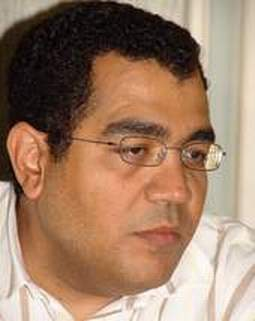

+++
title = "الذين لزقوا الحكومة على قفاها!"
date = 2007-04-26
authors = ["ياسر فرج"]

[taxonomies]
authors = ["yasser-farg"]
sections = ["masr"]

[extra]
section_name = "ولاد البلد"
share_image = "/media/admins.20at.com/masr/2fa-laz2o2.jpg"
summary = "هناك أشخاص استطاعوا أن يضحكوا علي حكومتنا الرشيدة التي تدعي أنه لا يوجد كائن من كان يستطيع أن يستهزأ بها، ولكن للأسف جاء من ضربها علي قفاها، منهم من صفقنا له عل"
section_slug = "masr"
section_colour = "#666666"
thumb = "/media/admins.20at.com/masr/2fa-laz2o2.jpg"
n_comments = 0
original_url = "http://masr.20at.com:80/newArticle.php?sid=9946"
archived = "20070915153936"
date_source = "byline/meta"
aliases_20at = ["//masr.20at.com/newarticle.php?sid=9946"]

[extra.provenance]
original_url = "http://masr.20at.com:80/newArticle.php?sid=9946"
capture_url = "https://web.archive.org/web/20070915153936/http://masr.20at.com:80/newArticle.php?sid=9946"
capture_label = "١٥ سبتمبر ٢٠٠٧، ١٥:٣٩ UTC"
date_note = "من سطر التوقيع في المقال"
other_urls = []
comments = ""
missing_images = ""
+++

<figure></figure>

هناك أشخاص استطاعوا أن يضحكوا علي حكومتنا الرشيدة التي تدعي أنه لا يوجد كائن من كان يستطيع أن يستهزأ بها، ولكن للأسف جاء من ضربها علي قفاها، منهم من صفقنا له علي ما فعل لأننا نتمنى أن تفيق هذه الحكومة من سباتها، ومنهم من أحسسنا أنه عندما ضرب القفا فكأنه ضرب قفا الشعب كله!.

<h3>عبد الله كمال</h3>

قد يستعجب القارئ ويظن أننا نستهزئ به، إذ كيف يخطر علي بال أحد أن عبد الله كمال حامي حمي الحكومة يكون ممن لزقوا الحكومة علي قفاها، ولكن إذا حكّمنا العقل سنجده أول المستهزئين بحكومتنا والضاحكين عليها..

فقد أستطاع أن يصل بذكاء منقطع النظير لموقع يحسده عليه كل أقرانه ولا يستطيع أحد أن ينكر عليه شطارته المهنية وأفكاره الصحفية المتطورة، ولكنه أعطي لحكومتنا قلم ولا كل الأقلام عندما أقنع لجنة السياسات وصديقه "جمال مبارك" أنه سيقوم بتأسيس جريدة تكون عين الحكومة الساهرة وخط الدفاع الأول ضد الهجمات البربرية من الصحفيين المعارضين الوحشين الذين يقفون ضد التوريث!

ورغم أن مؤسسته تتكبد خسائر فادحة إلا أن حكومتنا في سبيل الهدف السامي فتحت له خزائن كسري ليغترف منها كما يريد.. والحقيقة أن الرجل لم يأخذ شيئا في جيبه الخاص فيكفيه مرتبه ومكتب الرأي العام الذي أخذه مكافأة فوق البيعة نظير موقفه الكويتي المشرف، ولكن وجدت حكومتنا نفسها في موقف لا تحسد عليه عندما وجدت أن عفريتها الذي حضرته لا يريد أن ينصرف، فهي لا تستطيع أن تغلق الجريدة الذي كان الاتفاق علي وجودها لمدة انتخابات الرئاسة فقط، ومن ناحية أخري فهي جريدة لا يسمع بها أحد وإن كان للأمانة وإحقاقا للحق فإنه يوجد مجهود صحفي مبذول بها ولكن الانطباعات الأولي تدوم.

<h3>منتخب مصر</h3>

لزق المنتخب ولاعبيه واتحاد الكرة المصري حكومتنا قفا ساخن جدا، فقد خرجت الحكومة بكل مسئوليها ورجالها للاحتفاء بالمنتخب ووزعت علي اللاعبين مكافآت مجزية حتى اللاعبين الذين لم يلمسوا الكرة اغترفوا من أموالنا ووضعوا في حساباتهم التي تضخمت!

ولا يفكر أحد أننا حاقدون فهذا حقهم ولكن هل يعقل أنه عندما دعا رئيس مجلس الشعب وهو يمثل الحكومة المنتخب الوطني لتكريمه في بيت السلطة لم يستجب سوي ثلاثة لاعبين منهم اثنان لم يشاركا في المباريات، ولكن عندما دعاهم الأمير ترك بن عبد العزيز -والذي يضرب الحكومة هو وهند الفاسي يوميا علي قفاها- ذهب إليه جميع اللاعبين وأعضاء الجهاز الفني والإداريين..

الجميع ذهب إلي أخر الدنيا الفندق الذي يقيم الأمير السعودي وعائلته فيه، هذه العائلة التي تعودت أن تأتي بالمطربين والراقصين ليسلوها فلماذا لا ينضم لهذا السيرك الليلي المنتخب الوطني هرول الجميع دائسين علي كرامة مصر لأنهم يعلمون ما ينتظرهم.. أظرف متخمة بالفلوس وساعات الرولكس في مقابل تسلية صاحب السمو الملكي هؤلاء اللاعبين الذين أنتظرهم رئيس الجمهورية ليكرمهم لأنهم أدخلوا البهجة علي قلوب المصريين لطعهم الأمير بالساعات دلالة علي شعوره بالعظمة وتأكيدا علي أن أصحاب الهامات والمقامات مهما كانوا يجب أن يكونوا في شرف استقباله لقد انحاز ملايين المصريين لقرار حسن شحاته بعقاب ميدو لتجاوزه الأصول فلماذا لم يواصل حسن شحاته مراعاة الأصول وحمل الكأس الغالية بنفسه ليجمع الأموال عليها.

<h3>ناصر الخرافي</h3>

هذا المستثمر الكويتي الذي يمن علي المصريين سنويا وعلي مؤسسة الأهرام بجوائز مسابقة القرآن الكريم التي أسماها باسمه وشغل عنده وتحت أمره الأزهر بجميع إداراته، لقد أصبح اسمه عنوانا للفزع فهو الرجل الذي لا يقهر الذي اشتري من حكومتنا - بعد أن لزق القفا - 26 فدان بالعياط بسعر 200 جنيه للفدان وبالتقسيط المريح مع أن المصريون اشتروا الفدان بخمسة ألاف جنيه!

ولم يكتفي بهذا بل استولي علي 26 فدان آخرين بوضع اليد والغريب أن الفدادين التي استولى عليها الخرافي صاحب الفضل والكرامات علي المصريين تحتوي علي منطقة أثرية تضم هرمين منهما هرم سنوسرت، وشركة الخرافي تقوم الآن بالتنقيب علي أثار أخري بالمنطقة مستغلين الموافقة التي حصلوا عليها بحفر بئر عمقها 50 مترا للمياه.. فهل هناك قفا أشد من هذا؟

نعم هناك وهو القفا الذي أعطاه الأديب الكبير صنع الله إبراهيم للحكومة عندما رفض جائزة الرواية العربية التي تمنحها الحكومة المصرية، أتدرون لماذا لأنها جائزة صادرة من حكومة لا تملك مصداقية منحها كما قال فقد انتصر لكرامة المثقف المصري وترك الحكومة وقفاها بيقمر عيش!

<h3>أسامة الغزالي حرب</h3>

رجل بمليون رجل فقد استفاد من الحكومة أيما استفادة، كان عضوا في أغلب المجالس المتخصصة يقبض البدلات من هنا ومن هنا وأخيرا انقلب علي الحكومة ودخل في زمرة المعارضة وأطلق علي لجنة السياسات لقب الحيتان وقال أن "أحمد عز" يدير الحزب وكأنه شركة حديد، حرب الآن يخرج للحكومة لسانه ويقوم بتأسيس حزب يتوقع الجميع أنه سيكون حزب ذا شأن كبير.

<h3>يحي حسين</h3>

المهندس يحي حسين محارب الفساد الأول، الذي فضح الحكومة في صفقة بيع عمر أفندي والذي طالب بالحجر علي القائمين ببيع أصول مصر، قال أن أموال المعونات الخارجية تحولت لمكافآت لأبناء كبار المسئولين واتهمه كتاب السلطة أنه من الإخوان وكأنهم يدينون أنفسهم فهل هذا الوطن لا يوجد به شرفاء غير الإخوان.

القائمة كبيرة ولكن المساحة لا تكفي لنذكر كل من لزق الحكومة علي قفاها.. منهم رامي لكح والسيد راشد ومحمد إبراهيم سليمان.. فمتى تحمي حكومتنا قفاها من الضرب؟.

<a href="/articles/masr-n9957/">خلي بالك من (قذالك)!</a>

<a href="/articles/masr-n9956/">قفاك حصانك</a>

<a href="/articles/masr-n9945/">في القفا (سلاية) !</a>

<a href="/articles/masr-n9958/"> قفايا.. حرام!</a>

<a href="/articles/masr-n9954/"> طاطي راسك.. طاطي طاطي</a>

<h3>6518</h3>

اتعليق الاول

أرسل هذا التعليق بواسطة : الهندي

بحسب ان الي لزقوا الحكومة ناس وحشة بس لا طلع في ناس بنت حلال

زي دكتور اسامة وو المهندس يحيي

لالالالا بس أنا زعلان .....

أرسل هذا التعليق بواسطة : محمد السيد طبعا..امال مين؟؟

انا قلت الموضوع حيمشي علي الناس الوحشين اللي مش كوبيسين دول بس .... لكن لقيتكم جبتوا سيرة أسامة الغزالي ... وبعدين يحيي حسين ....

الله عليكي يا مصر ....

بس أنا زعلان منكم ....

بقي تسيبوا عالم زي الفل من نوعية ... شلة الحلوين اللي ضحكوا علي الحكومة وخلوها تمسكهم الجرايد القومية ...."مش عايز ضحك ..أيوة جرايد وقومية كمان".

وتسيبوا واحد زي عمو فؤاد علام ... اللي خلاها تعمله خبير عسكري سياسي أمني إسلامي بتاع كله ...

ولا كل رجال الأعمال الهربانين ... واللي مش هربانين ....

ولا واحد زي سعد الدين إبراهيم اللي لطعهم قفا محترم قبل السجن وخلاله وبعده ...

ولا الجاسوس عزام اللي ريسنا حلف براس والدته إنه مش حيطلعه ويحترم أحكام القضاء..."بس واضح سجنه بيقضيه بره سجون مصر"

أما أكبر قفا بقي .... يوم مافتحوا الباب للتعديلات الدستورية ..... عفريت حضروه ومش عارفين يصرفوه ...

متبقوش تنسوا تاني بقي .... أحسن والله كده أزعل منكم ...

الله عليكي يارشيدة .... "يووه تاني بتضحكوا ..أنا قصدي الحكومة مش معزة بكاااااااااااار"

يالا بقي.... عقبال كل قفا ...

بس برضه مش حاسكت ...

مع افتتاح ولاد البلد الجديد ...تقدروا تشرفوا المدونة بقي

www.mesh7askot.blogspot.com

جديد اللى انتا بتقوله ... بجد طريقه مختلفه

ايه ياعم اللى انتا كاتبه ده .. سمك لبن تمر هندى .. ايه الموضوع الملخبط ده ... ايه الخط اللى بيربط الشخصيات التى ذكرتها ببعض يعنى يا اما كنت تاخد وجهه من نافق الحكومه ووصل "اداها على قفاها يعنى " زى عبد الله كمال و بكرى وعادل حموده .... او فعلا الناس المحترمه زى نهى الزينى ويحيى حسين انما اللى انتا كاتبه ده مش صحافه .. محمود ايه ده يا محمود

