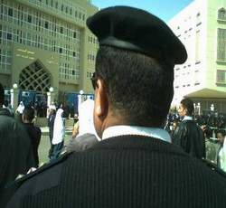

+++
title = "طاطي راسك.. طاطي طاطي"
date = 2007-04-26
authors = ["حسام الهندي"]

[taxonomies]
authors = ["hasam-elhandi"]
sections = ["masr"]

[extra]
section_name = "ولاد البلد"
share_image = "/media/admins.20at.com/masr/2fa-yern2.jpg"
summary = "\"طاطي راسك طاطي طاطي.. أنت ف وطن ديمقراطي.. أنت بتنعم بالحرية.. بس بشرط تكون مطاطي..لما حاميها يكون حراميها.. وبلاده ورا ضهره راميها.. طالع نازل واكل فيها.. مسن"
section_slug = "masr"
section_colour = "#666666"
thumb = "/media/admins.20at.com/masr/2fa-yern2.jpg"
n_comments = 0
original_url = "http://masr.20at.com:80/newArticle.php?sid=9954"
archived = "20071009232943"
date_source = "byline/meta"
aliases_20at = ["//masr.20at.com/newarticle.php?sid=9954"]

[extra.provenance]
original_url = "http://masr.20at.com:80/newArticle.php?sid=9954"
capture_url = "https://web.archive.org/web/20071009232943/http://masr.20at.com:80/newArticle.php?sid=9954"
capture_label = "٩ أكتوبر ٢٠٠٧، ٢٣:٢٩ UTC"
date_note = "من سطر التوقيع في المقال"
other_urls = []
comments = ""
missing_images = ""
+++

<figure></figure>

"طاطي راسك طاطي طاطي.. أنت ف وطن ديمقراطي.. أنت بتنعم بالحرية.. بس بشرط تكون مطاطي..لما حاميها يكون حراميها.. وبلاده ورا ضهره راميها.. طالع نازل واكل فيها.. مسنود بالبدلة الظباطي طاطي راسك طاطي طاطي..أنت ف وطن ديمقراطي..".

إنها أغنية للشاعر "أحمد فواد نجم"، وإذا لم تعجبك هذه القصيدة فإليك هذا من السيناريو المعتاد لواحد يروح القسم وميعجبش الباشا..

- أنت ياد بترفع صوتك ليه

- أنا ارفع صوتي وقت ما انا عاوز.. أنا عاوز المحامي بتاعي

- طب طاطي ورايني قفاك كدة .. خد خد خد خلي المحامي ينفعك !!

لكن حاذر أن هناك كاميرا موبايل تترصد لقفاك ساعتها، سوف ترى صورك وأنت بتنضرب ويضحك عليك الباشا وتتناقلها المواقع الالكترونية.

والسؤال لماذا القفا بالذات هو محل التركيز من قبل رجال الشرطة ؟؟ هل الأمر مرتبط بدور القفا في الثقافة الشعبية المصرية باعتباره ممثلا للكرامة والعزة على عكس ما هو سائد في العالم الذي يعتبر الأنف والأنفة هما محل الكرامة؟

وما هو شعورك عندما ينتهك قفاك ؟ ماذا يغري المخبرين في القفا ؟

اقتربنا من نغمات أقسام الشرطة.. يد تبطش وقفا يرن..لنسمعها سويا..

<h3>البطل.. يتكلم</h3>

سألت احد المخبرين في دردشة - وبالتأكيد لن أقول أسمه- لماذا القفا بالذات؟ يضحك وتضحك شناباته الكبيرة، قائلا: "معرفش إحنا طلعنا ومن صغرنا عرفين إن المخبرين بيضربوا علي القفا، لكن ليه معرفش، يمكن علشان القفا زي عرض الراجل ولما يضرب علي قفاه يحس بالتهزييء، لكن المخبر لازم تكون ايديه كبيرة وجامدة ويخوف الواد اللي أمامه وليس المهم ان أضرب بتوع السياسة بس لا أنا بضرب اللي الباشا بيقول لي اضربه".

ولما سالت المخبر لو حد ضربك علي قفاك ؟ وقبل أن أكمل -ظهر على شنبه القلق من السؤال- وقاطعني "أنا أموت ومحدش يضربني علي قفاي أبدا هو أنا مش راجل ولا إيه".

<h3>مركز الكرامة</h3>

قابلت أحد البشوات - ضابط - فسألت لماذا تخصون القفا بكل هذه الأهمية؟

الراجل كان واقعي جدا في رده وقال "أنا ما بضربش حد وليس من أسلوبي الضرب، لكن هناك من يتعامل بالاسلوب ده مع المواطنين، لكني ارفضه".

ولما ألححت عليه أجاب: "لأن القفا منطقة صعبة الحماية علي العكس من الوجه ومن الممكن أن يضرب الإنسان علي قفاه دون أن يري من ضربه فلا يفكر في الكذب، ولكن للأسف البعض يضرب علي القفا من أجل إذلال الإنسان أمامه واسمع أن هناك من يقول أن هناك شي اسمه مركز الكرامة عند الانسان في قفاه".

<h3>والمضروب له رأي</h3>

إبراهيم، طالب جامعي، يقول: "في أحد المرات كنت في مقر أمن الدولة وعندما دخلت للتحقيق في أول مرة وبدون أي سابق إنذار وجدت ضربات تتوالى علي قفاي بشدة وقسوة، كنت متوقع أن أضرب ولكن عندما يبدأ الضابط معي التحقيق لكن هكذا جاء الضرب بدون سبب".

محمد علي، طالب، يحكي عن تجربته مع القفا، قائلا: "أول ما مرة دخلت إلى القسم كانت في قضية سياسية عرفت وتأكدت أن هناك بشر هم بالاساس مرضى نفسيون يضربون لأنهم يحبون الضرب، لا يريد معلومات ولا أي شي سوي الضرب وبالنسبة للضرب علي القفا أرفض أن أتكلم فيه لأنه أمر أحزن منه".

<h3>الناس تعرف</h3>

محمود سمير، موظف، يرى أن كل الناس تعرف ما يحدث في الأقسام وكليب القفا المشهور علي الانترنت معروف للجميع، اللي بيحصل ده مهزله ويجب وقفة قوية ضد الذين يفعلون هذا".

يضيف: "كيف يكون شخص كل تعليمه أنه وصل إلي الإعدادية ولا يعرف شي عن التعامل مع البشر نجعله يضرب الناس، والعيب ليس عليه بالأساس العيب علي اللي مشغله والضابط اللي شايفه بيعمل كده وبيسمح له، وكمان القفا عند أي واحد كرامة وعزة وعمر ما حد يرضي أنه يتهان من حد تاني أبدا، ده لو حد عمل لي كده انا أموته أو أموت نفسي أحسن".

هكذا قالوا.. لكن السيناريو لا يزال مستمرا.. الأيدي تبطش..والضربات نازلة ع القفا ترن !

<a href="/articles/masr-n9957/">خلي بالك من (قذالك)!</a>

<a href="/articles/masr-n9956/">قفاك حصانك</a>

<a href="/articles/masr-n9946/">الذين لزقوا الحكومة على قفاها!</a>

<a href="/articles/masr-n9945/">في القفا (سلاية) !</a>

<a href="/articles/masr-n9958/"> قفايا.. حرام!</a>

<h3>bb76</h3>

اول تعليق

أرسل هذا التعليق بواسطة : الهندي

طيب اقول اية لنفسي

مش هقول لنفسي هقول

لكل ولاد البلد

مبروك علي الصميم

ويارب المجهود يكلل بالنجاح

يا واصل

أرسل هذا التعليق بواسطة : محمد عبدالعاطي

يا واصل يا هندي ليك اصحاب مخبرين وضابط محترمين اهم

الموضوع جميل

الله ينور

أرسل هذا التعليق بواسطة : محمود سعيد

الراجل سبقنى أهو وقال مية مية

جايب مخبر وضابط ومواطن

بس قفا الضابط ده عاوز يتلدع 60 قفا على غفلة

الي اولاد البلد انتم رجال الغد

أرسل هذا التعليق بواسطة : رامز عباس

اصدقائنا المحترمين اولاد البلد الصحافه الصح كنت منذ فترات اتضايق لغلق التعليقات وها انا اهنئي وبشدة التصميم الجديد الرائع للغايه بجد واتمني عودة زملائنا الفرسان البراء اشرف ودعاء الشامي ورضوي وعمرو واتمني انكم تفرضوا حاجه لوائل عباس الوعي المصري واشكركم لاهتمامكم بنا وبثقافتنا وياريت يكون هناك بند للمقترحات وان نفذت بجهدكم التنويه للقارئي الالكتوني الموقر كصاحب للفكرة وايضا افسحوا المجال لمواهب الشباب الصحفينين بكل الجرائد دول بيكتبوا في بعض الاحيان بابداع اكرمكم الله ولاد البلد انا سعيد بالموضوعات والتصميم وانتم فعلا هتكونوا عايزين ايه اكتر من سعادتنا

ايه ياعم هندى .. ده كلام مدونات مش صحافه !!

طبعا الموضوع معمول فيه مجهود لا انكر بس ... و عرفنا ان ليك مصادر واصله من المخبرين و ضباط امن الدوله .. ماشى بس انا حسيت انك بتحكى حكايه فى مدونه ... عارف هاتزعل بس عادى يعنى ... انا شايف انك كنت جبت رأى حد نفسى يحلل موضوع الاهانه بالضرب على القفا و دلالته و سبب النشوه التى تعترى المخبر " السادى " و هو بيقولك طاطى يااااااض

القفا

أرسل هذا التعليق بواسطة : البلدانى

لية الاهتمام بالقفا مافية حاجات تانية كتير قوى تستحق الاهتمام

مثلا المعدة ولية عايزة تاكل هم

والرجلين ممكن ينضربوا بالفلقة

والايدين ممكن الضرب عليهم ونزع الاظافر

والضهر ينضرب بالكرباج

وممكن نبعت ناس ياخدوا دورة تدريبية فى القعاد على الخازوق

لازم يبقى فية تقدم

ابو يوسف

أرسل هذا التعليق بواسطة : ممكن تورينا الصحافة

يا عم بيبو

هو ده اسمك ولا انت خايف تقول اسمك ممكن تورينا انت الشغل الصحافة

عمال تدخل في كل موضوع وناقص تتف علي الموقع

لو مش عجبك متعلقش

بيبو يا حبيبي اسمك يا عيني بيبو يختي كميلة اندغة اندغة

مبروك

أرسل هذا التعليق بواسطة : دكتور عادل

مبروك عليكم الموقع والتصميم والى الامام

ياناس ياهوووه ملعون ابوه

أرسل هذا التعليق بواسطة : ديمة

بجد يلعن ويحرق وبيعت لكل واحد منهم اللى يضربهم ببلغة قديمة على قفاهم المصدى

وقول لمحمد وغيره ما يزعلش ومايحزنش وقفاه غالى علينا

بجد

القفا بيستحمل كتيييير اوى فى الزمن دة

أرسل هذا التعليق بواسطة : احمد ابوصالح_صحفى معارض

معنديش ابلغ من تعليق محمود عبد العزيز فى فيلم الكيف وهو بيقلوة كلة بيغنى للعيون والشفايف والرموش محدش غنا للافة فرد قال مع انة بيستحمل كتير اوى فى الزمن دة ههههههه

